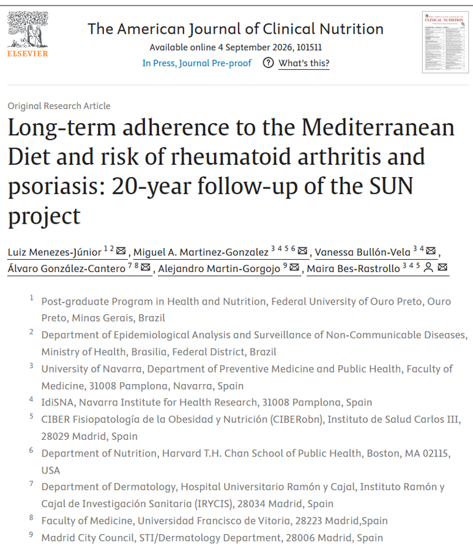
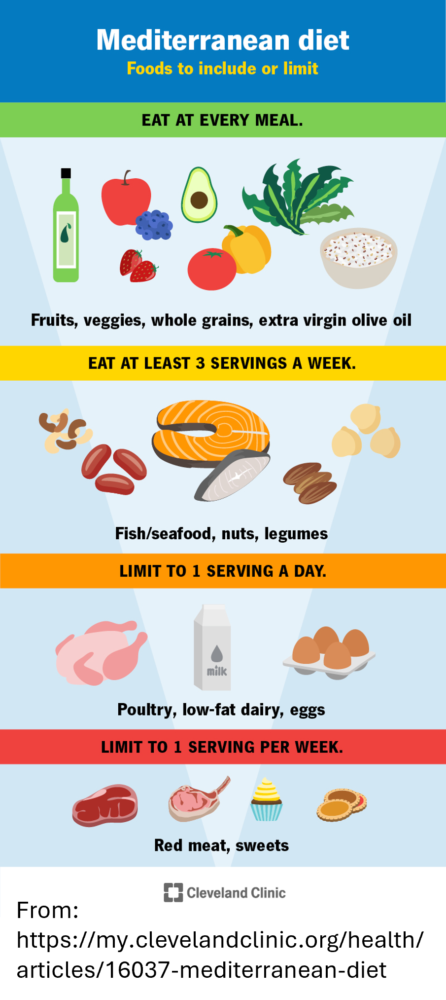

Let's talk about: how your diet play a role in the incidence of inflammatory chronic disease.

## Research question and objectives 

This study investigated the association between the **Mediterranean diet** (hereafter referred to as the **MedDiet**) :plate_with_cutlery: and the risk of developping an autoimmunite condition, focusing on two specific ones: 
- **Rheumatoid arthritis** :bone:, a chronic disease that causes inflammation throughout the body, especially the joints and their surrounding tissues, to the point where movements associated with everyday activities such as writing, holding objects or walking, are restricted or painful. If left untreated, it can also affect other organs including the heart, lung and nervous system. In 2019, rheumatoid arthritis was affecting around 18 million people worldwide, mostly women and adults in their sixties (*GDB 2019*). 
- **Psoriasis** :red_circle:, another chronic inflammatory disease, mainly affecting the skin, and recognised as a serious disfiguring and disabling non-communicable disease (NCD - that is, a serious illness that cannot be transmitted from one person to another). The visible skin changes caused by the disease have a significant impact on a person's physical, emotional and social well-being, sustantially impairing its quality of life. Although there is currently no cure, current treatments can help control the symptoms and eventual comorbidities related to psoriasis. Around 60 million people worldwide are estimated to have psoriasis, with a higher prevalence in high-income areas and older populations (*WHO 2016*, *Parisi et al. 2020*).

In both conditions, the regulation of the immune system is impacted, mistakenly attacking the body's own tissues. This dysregulation may be influenced, of course, by genetics, but it is also known that environmental and lifestyle factors, particularly <u>dietary habits</u>, also play an important role (*Maydani et al. 2020*). 

Modern diets are dominated by <u>ultra-processed foods, saturated fats and refined sugars</u>, that have been shown to disrupt the balance of the gut microbia and weaken the gut's protective barrier, potentially increasing the risk of inflammation (*Manzel et al. 2014*, *Rondinella et al. 2026*). 
It could therefore be hypothesized that a diet that emphasizes <u>minimally processed, plant-based foods</u>, would be associated with a lower incidence of inflammatory conditions. 

The **Mediterranean diets** is one of these healthy dietary pattern. As implied by its name, the MedDiet is inspired by the traditional eating habits of people living around the Mediterranean Sea. Despite variations from one country to another because of differences in culture, ethnic background, religion, economy or geography, all these Mediterranean diets share some common features such as: 
- High intake of vegetables :carrot: and fruits :apple:, whole grains :baguette_bread:, and olive oil :olive:;
- Regular consumption of fish :fish:;
- Small to moderate amounts of meat :meat_on_bone: and dairy products :cheese:;
- Very limited consumption of processed foods :hamburger: or sugars :candy:.

There is already a lot of evidence suggesting the positive effects of the MedDiet on health (some of which are cited in this study, so please don't hesitate to take a look at the full article *see the link below*). However, most previous studies did not use <u>long-term cohort data</u> (that is, data collected from individuals who are followed over a long period of time). Morevoer, because the MedDiet has traditionally been considered as a whole, <u>the specific contribution of its individal components</u> is still not fully understood. 

To resume, the objective of this study was therefore to investigate whether the incidence of rheumatoid arthritis :bone: and psoriasis :red_circle: was lower among people who followed the MedDiet :plate_with_cutlery: over several years. The authors were also interested in identifying which specific dietary components of the MedDiet could best explain this reduction in risk. 

## A brief presentation of the methodology 

The study involved participants from the *SUN Project*, which is a prospective, dynamic cohort :busts_in_silhouette: established in 1999 to investigate the impact of nutrition and lifestyle on the development of chronic disease, recruiting alumni from Spanish universities :mortar_board: (*and let keep this is mind*). 
For the purpose of this study, the authors excluded participants who had been followed for less than 2 years, as well as those who already had rheumatoid arthritis, psoriasis, vitiligo (another chronic autoimmune and inflammatory skin disorder), cancer, diabetes or cardiovascular disease during the first 2 years of follow-up. The final sample included **15,874 participants** (only! :stuck_out_tongue_winking_eye:) who were followed for a mean period of **15.1 years**.

At enrollment, participants provided detailed information regarding potential confounders (that is, variables that can bias the relationship being investigated because they are related to both the exposure and the outcome): 
- Their <u>sociodemographic profile</u>: age, sex, educational level (years of schooling) and BMI.
- Their <u>medical history</u> of stress, anxiety, depression and other prevalent chronic conditions. 
- Their <u>lifestyle</u>: smoking status, amount of physical activity performed each week, sedentary behavior (assessed based on whether the participant watched TV more than 2 hours per day), sleep duration (<6, 6-8, or >8 hours per night), and average time spent sunbathing.
- Some of their <u>dietary habits</u>, including alcohol consumption (grams/day), total energy intake (kcal/day), whether they followed a special diet and whether they had the habit of snacking between meals. 

Changes in lifestyle and the emergence of new clinical diagnoses were subsequently assessed every two years, and dietary intake was evaluated during follow-up at 10 and 20 years.  
Finally, the researchers measured how closely each participant followed the MedDiet using the ***Mediterranean Diet Score*** (MDS). A higher score indicated greater adherence to the diet. Participants were then divided into T1, T2 and T3 categories (corresponding, respectively, to the lowest, intermediate and highest level of adherence).

## Results: there are good things on the plate! 

Interestingly, **participants who followed the MedDiet :plate_with_cutlery: most closely were less likely to develop both rheumatoid arthitis :bone: and psoriasis :red_circle:**.  

For rheumatoid arthritis :bone:, the difference was particularly noticeable as the risk of developing the disease was <u>reduced by half</u> among participants with the greatest adherence to the MedDiet compared with those with the lowest adherence.  
A similar reduction in the risk of psoriasis :red_circle: was observed among participants with the greatest adherence to the MedDiet, although the results were this time <u>not statistically significant</u> (meaning that the authors cannot rule out the possibility that this result was due to the chance and could be therefore applied to the global population). 

It should be noted that these participants whith the highest MDS also tended to engage in <u>healthy behavior</u>: they were more physically active, less likely to be current smokers, and avoide snacking between meals more often than participants with lower MDS. However, they also <u>drank more alcohol</u> (*but we would be getting ahead of ourselves by saying that drinking alcohol is beneficial to our health*:woozy_face:). These differences are important because it can be hypothesize that they could also influence the risk of developing disease (*an assumption tested and verified as we will see later* :arrow_heading_down:).  
As stated in the introduction, rheumatoid arthritis and psoriasis are more common in older populations. Yet, in this study, participants with the greatest adherence to the MedDiet - and therefore the lowest incidence rates of rheumatoid arthitis and psoriasis - were <u>older</u> than participants with lower MDS, with an average age of 40.3 years.  

Interestingly, this association between adherence to the MedDiet and the reduction in the risk of developing the studied chronic autoimmune and inflammatory disorders does not seems to be influenced by any of these specific characteristics. **In other words, whatever your age, sex or lifestyle, the more strictly you follow the MedDiet, the less likely you will be affected by rheumatoid arthitis or psoriasis.**

There was not an isolated food that appeared to explain the best this association with the diseases incidence rates, suggesting that **the overall dietary pattern seemed to matter the most**. Nevertheless, the authors found that the participants with lower risks of rheumatoid arthritis or psoriasis tended to eat more fruits, nuts and vegetables, combined with lower consumption of meat.  
This finding is not surprising, as it was already demonstrated that <u>plant-based foods</u> are rich in polyphenols and antioxidants that may help regulate inflammation in the body (*Martínez-González et al. 2003*, *Martínez-González et al. 2014*). In contrast, some substances found in <u>red and processed meats</u> have been associated with systemic inflammatory responses (*Libera et al. 2021*).

Despite the quality of the study, particularly its large sample size and the number of potential confonding variables taking into consideration in the analyses, one limitation raised by the authors should be kept in mind: all participants had a university degree, and more than half worked in healthcare. Although this may have improved the quality of their questionnaire responses, it may also limit how well these findings apply to people with different levels of education or socioeconomic backgrounds. Future studies involving more diverse participants are therefore needed to determine whether these findings apply to a wider population.

### :jigsaw: **Putting everything together**

The conclusion is quite simple: **Health is on the plate!!** Be mindful of what you eat, as your diet can have a great influence on your health. We already know that our diet can contribute to the development of some diseases, but what we learn from this study is that it may also help reduce the risk of developing some others.  
Indeed, the main finding of the study is that following a MedDiet :plate_with_cutlery: helps reducing the incidence of two specific chronic autoimmune and inflammatory disorder (rheumatoid arthitis and psoriasis). More specifically, increase your intake in fruit and nuts and decrease your meat consumption (which will be good both for your health :sparkling_heart: and the planet :earth_africa: by the way ^^)  
On that note, enjoy your meal!! :yum: 
  
  
---
---
---
  
  
> **Read the article**: Menezes-Júnior L, Martinez-Gonzalez MA, Bullón-Vela V, González-Cantero Á, Martin-Gorgojo A, Bes-Rastrollo M (2026) **Long-term adherence to the Mediterranean Diet and risk of rheumatoid arthritis and psoriasis: 20-year follow-up of the SUN project.** *Am J Clin Nutr* 101511 (https://doi.org/10.1016/j.ajcnut.2026.101511).

> **Cited references**:  
> - https://www.health.harvard.edu/healthy-aging-and-longevity/guide-to-the-mediterranean-diet
> - Global burden of 369 diseases and injuries in 204 countries and territories, 1990–2019: a systematic analysis for the Global Burden of Disease Study 2019. (https://vizhub.healthdata.org/gbd-results/)
> - Libera J, Iłowiecka K, Stasiak D. 2021. Consumption of processed red meat and its impact on human health: a review. *Int J Food Sci Technol* 56(12):6115–23
> - Manzel A, Muller DN, Hafler DA, Erdman SE, Linker RA, Kleinewietfeld M. 2014. Role of “Western diet” in inflammatory autoimmune diseases. *Curr Allergy Asthma Rep* 14(1):404
> - Martínez-González MA, Alonso A, Fernández-Jarne E, De Irala J. 2003. What is protective in the Mediterranean diet? *Atherosclerosis* 166(2):405–7
> - Martinez-Gonzalez MA, Bes-Rastrollo M. 2003. Dietary patterns, Mediterranean diet, and cardiovascular disease. *Curr Opin Lipidol* 25(1):20–6.483
> - Meydani SN, Guo W, Han SN, Wu D. 2020. Nutrition and autoimmune diseases. In: Present Knowledge in Nutrition: Clinical and Applied Topics in Nutrition. 11th ed.Elsevier; 549–68
> - Parisi R, Iskandar IYK, Kontopantelis E, et al. 2020. National, regional, and worldwide epidemiology of psoriasis: Systematic analysis and modelling study. *BMJ* 369:m1590 
> - Rondinella D, Margarita E, Raoul PC, Galli FS, Severino A, Porcari S, Mele MC, Gasbarrini A, Cammarota G, Rinninella E, et al. 2026. The impact of diet on gut microbiome composition: Implications for immune-mediated diseases. *Clin Immunol Commun* 9:1–11

