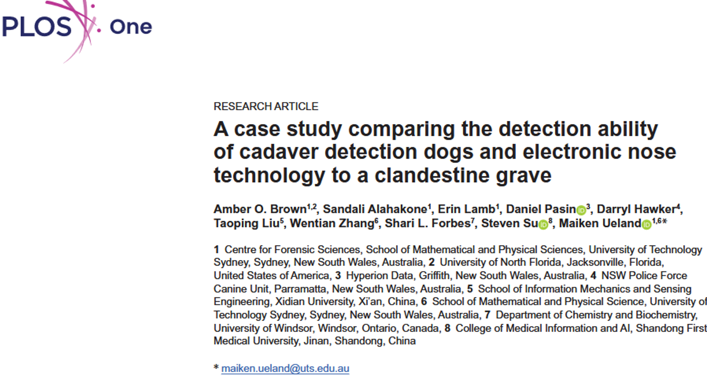

Let's talk about: a comparison of the performance of electronic technologies and dogs trained to detect human remains..

## Research question and objectives 

Have you ever been confronted with the *smell of a corpse*? Me? Well ... yes and no: as part of my studies, I had the opportunity to attend an autopsy. But (*fortunately, I would say*) the person had died the day before and, as the autopsy would reveal, of natural causes, with no impressive trauma. Apart from the smell of the autopsy room (the same as that of hospitals, due to the sterilization of autopsy equipment), I was therefore not exposed to the smell of death itself :face_exhaling:. This experience would eventually convince me that I prefer working on bones :skull: rather than on more or less decomposed corpses :zombie:.    
This smell, described by those who have experienced it as suffocating, can be explained by the <u>degradation of tissues by bacteria and enzymes</u>, which release chemical compounds (also called *volatile organic compounds* - **VOC**). However, if death is recent, or if the body is isolated in an airtight environment (for example, underground), this smell may be more difficult to perceive. At least for the human nose!   
Indeed, we can call upon our **four-legged friends** :dog:, whose olfactory system is so highly developed that they can detect these odors and can therefore help with the detection of corpses :zombie: (*DeGreeff et al. 2012*, *Rendine et al. 2019*, *Cablk et al. 2012*). However, this is not the case for all dog breeds, and it often requires regular training.  
More recently, researchers have developed an *electronic nose* (***NOS.E***) :robot: which would also be capable of detecting these VOCs associated with the decomposition of the human body, mainly nitrogen- and sulfur-containing compounds, as well as alcohols and aldehydes (*Brown et al. 2023*, *Karami et al. 2024*, *Sunnucks et al. 2024*).  
Although the effectiveness of cadaver detection dogs :dog: is no longer discussed, we still lack an understanding of which VOCs specifically play a role in this detection, or at what concentrations. Yet this information is crucial for improving the training of these expert dogs and ensuring the credibility of their findings in court :woman_judge:.  

**The aim of this study was therefore to compare the cadaver detection :zombie: results obtained by trained dogs :dog: and an electronic nose :robot:**.

## A brief presentation of the methodology 

To conduct this study, the authors did not wait for a crime :police_officer: to take place! Nope, they actually buried a <u>body donated to science</u>. The "grave" was dug approximately 60 cm deep and located more than 200 m away from any other human remains present at the site, and then left undisturbed for <u>3 months</u> to simulate a case of a person who had been missing for a long time :zombie:. The soil was then disturbed in different locations to allow air to escape, mimicking animal activity in a natural environment. Two <u>control "graves"</u> were also created, this time without a buried corpse, but where the soil was also disturbed on several occasions: to prevent the dogs' detection from being based solely on visual rather than olfactory cues.  
Speaking of these four-legged friends :dog:! 3 cadaver detection dogs took part in this study: 1 Labrador retriever and 2 English Springer spaniels. They visited the site several times, each time being released from their leashes at different locations. It should be noted that none of the dogs had previously participated in the detection of buried human remains, although one of them had 6 years of training experience (compared to 1 and 2 years for the other two dogs).    
In parallel, the authors also surveyed the site using their electronic nose *NOS.E* :robot: and recorded the instances in which the sensors detected alcohols, alkanes, or nitrogen- or sulfur-containing compounds.  

For both the dogs and the *NOS.E*, several search sessions were scheduled: on day 98 (i.e., 3 months after the corpse was buried, which we will refer to as time point M), then at M+7days, M+2weeks, M+1month, M+7weeks, and M+9weeks.   
It should be noted that this study was conducted in Australia, during winter, when the average temperature was 13.4 °C.

Finally, the results obtained by the dogs and the *\*NOS.E\** were compared as follows:

| Dogs' detection :dog: | *NOS.E* detection :robot: | Final results |  
| :---: | :---: | :---: |  
| Yes | Yes | "True positive" |  
| Yes | No | "False positive" |  
| No | Yes | "False négative" |  
| No | No | "True négative" |  

## Results: technology as support rather than as a replacement 

Let's first discuss the results obtained with the ***NOS.E*** :robot:: the sensors associated with the detection of alcohols and alkanes, nitrogen, and sulfur were the most reactive, showing changes over time. Interestingly, VOCs were also detected above the control "grave" (i.e., the one containing no body), mainly nitrogen- and sulfur-containing compounds, probably of natural origin. These would therefore not be good indicators for cadaver detection.   
As for our **expert dogs** :dog:, unsurprisingly, they all successfully detected the presence of the corpse. They consistently marked an area corresponding to the upper part of the torso of the remains (which is also where the *NOS.E* signals were the strongest). This makes sense when we consider that this region of the body contains numerous organs, which therefore emit more volatile compounds during decomposition (*Brown et al. 2023*). Among the 3 dogs that participated in the study, the most experienced one never produced any "false positives" :1st_place_medal: (i.e., detecting a body when the *NOS.E* detected no VOCs associated with decomposition).   
It should nevertheless be mentioned that the dogs (and even the *NOS.E*) were less effective at detecting the presence of the corpse when the soil had not been disturbed beforehand.  

Based on the comparison between the results obtained by the dogs and those obtained by the *NOS.E*, the authors conclude that **both the presence and the concentration threshold of certain combinations of VOCs** (mainly sulfur- and nitrogen-containing compounds) **explain the effectiveness of expert dogs in detecting the presence of buried human remains**.  

These promising initial results now need to be confirmed by a larger-scale study, incorporating more corpses to account for the potential effects of the deceased person's weight, sex, or age, the time elapsed since death and burial, as well as different environments and weather conditions.

### :jigsaw: **Putting everything together**

Ultimately, rather than suggesting that technology could replace dogs trained to detect corpses, this study demonstrates that it can generate data that provides a better understanding of the mechanisms at play. This understanding helps to give greater significance to the results obtained by the dogs and opens up new avenues for improving their training.  

---
---
---

> **To read the article**: Brown AO, Alahakone S, Lamb E, Pasin D, Hawker D, Liu T, et al. (2026) **A case study comparing the detection ability of cadaver detection dogs and electronic nose technology to a clandestine grave**. *PLoS One* 21(10): e0360233 (https://doi.org/10.1371/journal.pone.0360233)

> **The mentionned references**:  
> - Brown A, Lamb E, Deo A, Pasin D, Liu T, Zhang W, et al. (2023) The use of novel electronic nose technology to locate missing persons for criminal investigations. *iScience*; 26(4):106353. 
> - Cablk ME, Szelagowski EE, Sagebiel JC. (2012) Characterization of the volatile organic compounds present in the headspace of decomposing animal remains, and compared with human remains. *Forensic Sci Int*; 220(1–3):118–25
> - DeGreeff LE, Weakley-Jones B, Furton KG. (2012) Creation of training aids for human remains detection canines utilizing a non-contact, dynamic airflow volatile concentration technique. *Forensic Sci Int*; 217(1–3):32–8. 
> - Karami H, Thurn B, de Boer NK, Ramos J, Covington JA, Lozano J, et al. (2024) Application of gas sensor technology to locate victims in mass disasters – a review. *Nat Hazards*; 121(1):31–60. 
> - Rendine M, Fiore C, Bertozzi G, De Carlo D, Filetti V, Fortarezza P, et al. (2019) Decomposing human blood: Canine detection odor signature and volatile organic compounds. *J Forensic Sci*; 64(2):587–92. 
> - Sunnucks EJ, Thurn B, Brown AO, Zhang W, Liu T, Forbes SL, et al. (2024) Performance of a novel electronic nose for the detection of volatile organic compounds relating to starvation or human decomposition post-mass disaster. *Sensors (Basel)*; 24(18):5918.

