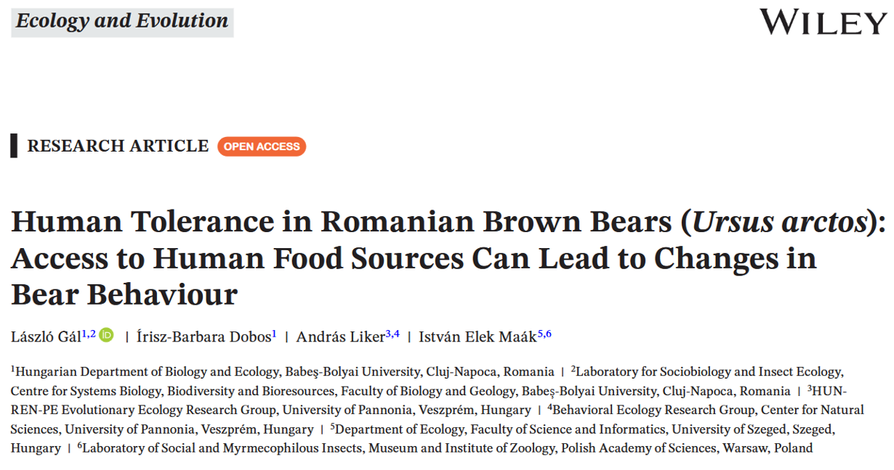

Let's talk about: how the access to food waste contributes to reducing Brown bears' wariness towards human environment.  
 

## Research question and objectives 

In ethology (*that is, the scientific study of animal behavior*), **habituation** is a form of learning in which an individual's behavior is modified by the repeated exposure to a stimulus (*Rankin et al. 2010*).   
For example, this happens when you gradually tame a stray kitten :cat2: by regularly giving it food, until it eventually becomes your new furry companion :face_holding_back_tears:. It also the case when you train dogs :dog2: to recognise specific scents to help detect human remains :nose: (*I invite you to (re)discover a previous post on this topic [here](https://www.whatsupresearch.com/cadaver-detection-robots-versus-dogs/)* :wink:).   
However, this habituation can also lead to a reduction in animal's vigilance or wariness toward humans, sometimes at the expense of their own survival: if an animal does no longer flee when confronted to human presence, it may become more vulnerable to hunting :bow_and_arrow:, contract potentially fatal diseases :microbe: (for example, a group of montain gorillas in Rwanda's Volcanoes National Park was infected with human metapneumovirus, resulting in the death of several individuals, *Palacios et al. 2011*), be involved in vehicle collisions :oncoming_automobile:, ...  
That being said, the ongoing expansion of human infrastructures into natural habitats makes interactions between humans and wildlife increasingly unavoidable.  

It is therefore essential to **assess the factors that may reduce wild animals' vigilance and wariness towards human environments**. This was the aim of the present study, which focused more particularly on brown bears :bear: (*Ursus arctos*).  

Unfortunately, brown bears have disappeared from most European countries, largely because we have expanded our territory over theirs and, in some cases, actively persectuted them... (*well, when I say "we", it was not me, I swear!*). On the contrary, some regions, as Romania, have introduced conservation and protection measures over recent decades (*Bereczky et al. 2011*, *Stăncioiu et al. 2019*). This study was precisely conducted in Romania :romania:, in the town of Băile Tușnad.  

## A brief presentation of the methodology 

In Romania, the brown bear population is estimated at more than 6,000 individuals (*Pop et al. 2012*, *Popescu et al. 2017*). 
Băile Tușnad is the smallest town in the country in terms of population, and also a popular touristic destination (*have any of you ever been there?* 👀). Located at an altitude of 650m, the town is surrounded by dense forests :evergreen_tree:, which provide abundant natural food resources for brown bears. They also exploit human-related food resources available nearby, including agricultural crosps :ear_of_rice: and fruit trees.  

Here, the study was focused on **observing brown bears' behavior :bear: around two garbage container islands :put_litter_in_its_place: located in urban area :houses**.  
These waste disposal areas were equipped with bear-resistant metal enclosures and surrounded by electric fences. The first container island was located between the forest edge and a residential building; the second one was situated close to the forest edge, a garage, the railway station and a residential property.  
Finally, both container islands were bordered at the back by dense vegetation (shrubs, trees and tall grass), not illuminated by streetlights, therefore providing cover for bears.  

Bears' activity near to these island containers was monitored thanks to security camera :video_camera: and the following parameters were measured: 
- **hesitation time** :thinking: : the time interval between the first appearance of an individual within the camera's field of view and its entry into the garbage container island (*to what extend does the bear assess potential risks before approaching the food source?*)
- **vigilance behavior** :monocle_face: : the cumulative time during which the bear interrupts its foraging to scan its surrounding (*how does the bear remain vigilant towards potential threats?*)
- **foraging duration**: the time spent searching for or consuming food, both inside and outside the enclosure (*does the bear prefer to access food resources while avoiding the risks associated with entering the enclosed area?*)

The presence of waste outside the containers as well as the operational status of the electric fences were also taken into account in these analyses. 

## Results: Stealing other people's food, a calculated risk 

Over a one-year period, the container islands were visited by 8 individuals, to whom the researchers had given cute little names: Igor (the only male :male_sign:), Bonbon, Fánk and Pite (all females :female_sign:, each accompanied by 3 cubs :teddy_bear:), Berkenye (a subadult bear), and Rozi (another female :female_sign:) with her two cubs, Bounty and Snickers :teddy_bear:, who would later be found without their mother :cry:.  
Except for the two orphan cubs, each bear visited the containers alone. Even when mothers were accompanied by their cubs, the latter were generally left in a safe place while the adult searched for food.  

At the first container island, 179 visits were recorded. It is worth noting that the electric fence was active for only slightly more than 15% of the time, compared to 40% at the second container island, where only 32 bear visits were observed.  
Nevertheless, the mere presence of these electric fences increased the hesitation time in all cases.  
Most visits took place at night :last_quarter_moon_with_face: (particularly between midnight and 4 a.m.).  
Visits were less frequent between October and December, with instead a peak during the summer months. This pattern is consistent with the seasonal activity cycle of brown bears, particularly their hibernation period.  

As bears repeatedly returned to the sites, researchers observed a decrease in hesitation and vigilance behaviors, alongside an increase in foraging time, particularly when food waste was available around the containers. In other words, **the more often bears returned to the container islands, the more confident they seemed to become, showing less concern about their surroundings and spending more time taking advantage of the available food resources**. 

Therefore, brown bears appear willing to risk encountering humans to access these food resources, sometimes travelling up to 38km for this purpose, as previously reported (*Rigg 2005*). Indeed, human food waste represents a substantial food source in terms in both caloric and nutritional value (*Elfström et al. 2014*).  

### :jigsaw: **Putting everything together**

So, to conclude, this study showed that the repeated exposure to human environments, particularly during foraging for food in waste containers, can lead to a reduction in vigilance and avoidance behaviors in brown bears, suggesting an increased tolerance towards urban environments.  
Simple preventive measures, such as installing electric fence and properly maintaining waste containers, could help reduce the risk of human-bear encounters.  

---
---
---

> **To read the article**: Gál L, Dobos Í-B, Liker A, and Maák IE. 2026. **Human Tolerance in Romanian Brown Bears (Ursus arctos): Access to Human Food Sources Can Lead to Changes in Bear Behaviour**. *Ecology and Evolution* 16, no. 11: e74359 (https://doi.org/10.1002/ece3.74359)

> **The mentionned references**:  
> - Bereczky L, Pop M, and Chiriac S. 2011. Trouble-Making Brown Bear Ursus arctos Linnaeus, 1758 (Mammalia: Carnivora) – Behavioral Pattern Analysis of the Specialized Individuals. *Travaux Du Muséum National D'histoire Naturelle “Grigore Antipa”* 54: 541–554
> - Elfström M, Davey ML, Zedrosser A, et al. 2014. Do Scandinavian Brown Bears Approach Settlements to Obtain High- Quality Food? *Biological Conservation* 178: 128–135
> - Palacios G, Lowenstine LJ, Cranfield MR, et al. Human metapneumovirus infection in wild mountain gorillas, Rwanda. *Emerg Infect Dis*. 2011;17(4):711-3
> - Pop MI, Sallay A, Bereczky L, and Chiriac S. 2012. Land Use and Behavioral Patterns of Brown Bears in the South-Eastern Romanian Carpathian Mountains: A Case Study of Relocated and Rehabilitated Individuals. *Procedia Environmental Sciences* 14: 111–122
> - Popescu VD, Iosif R, Pop MI, Chiriac S, Bouroș G, and Furnas BJ. 2017. Integrating Sign Surveys and Telemetry Data for Estimating Brown Bear (Ursus arctos) Density in the Romanian Carpathians. *Ecology and Evolution* 7: 7134–7144
> - Rankin CH, Abrams T, Barry RJ, et al. Habituation revisited: an updated and revised description of the behavioral characteristics of habituation. *Neurobiol Learn Mem*. 2009;92(2):135-8
> - Rigg R. 2005. A Review of Studies on Brown Bear Ecology in Relation to Home Range, Habitat Selection, Activity Patterns, Social Organisation, Life Histories and Population Dynamics. *Oecologia Montana* 14: 47–59
> - Stăncioiu PT, Dutcă I, Bălăcescu MC, and Ungurean ŞV. 2019. Coexistence With Bears in Romania A Local Community Perspective. *Sustainability* 11: 7167

