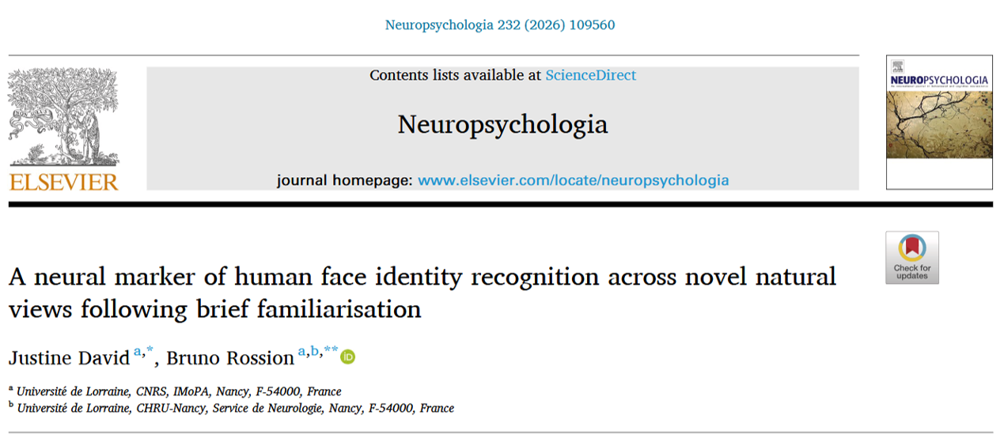

Let's talk about: the identification of the neural markers in play in the recognition of familiar faces.  
 

## Research question and objectives 

Are you someone who is **good at recognizing faces** or do you suffer from **prosopagnosia** (a neurological condition also known as *face blindness*, characterized by the inability to recognize or remember human faces, including those of close relatives or even one's own reflection in the mirror)?  
According to a study by *Jenkins et al. (2018)*, neurotypical adults are able to recognize around 100 faces. This is quite an impressive number when you consider that these faces are encountered in different environments and that the same person can look different depending on their appearance (for example, a different hairstyle, a side or front view, or an expression of happiness or anger, ...).  
Because this **facial recognition** ability 🙂😎🤓🥸 is so fascinating, researchers developed a study to better understand the underlying neurological mechanisms 🧠.

## A brief presentation of the methodology 

To investigate this question, the authors conducted an experimental study involving 28 volunteers, mostly women ♀️, with no neurological disorders.  

The participants took part in an experiment divided into two main stages:
- a first stage of <u>familiarization or learning</u> lasting **7 minutes**, during which the participants were asked to learn a specific set of three faces through semantic associations: each face was associated with a first name, an occupation and a personality trait.
- then, a stage of <u>**Fast Periodic Visual Stimulation**</u> (*Adrian & Matthews 1934*, *Regan 1966*) during which a succession of unfamiliar faces was rapidly displayed on a screen, at a regular rate of 6 images per second. Every fifth image appeared one of the faces that participants had previously been familiarized with. This allowed the authors to make the connexion between a specific brain response with the presentation of a familiar face. One advantage of this method is that it does not rely solely on participants' verbal responses, thereby providing an objective measure of facial recognition.  
During this second stage of the experiment, the participants' <u>brain activity</u> was recorded using an **electroencephalogram** (EEG). <u>Eye movements</u> were also monitored using **electrooculography** (EOG), ensuring that participants kept their gaze focused on the faces displayed in the centre of the screen.  

It is worth noting that all the faces presented belonged to Caucasian men ♂️ (*white males, basically*), none of whom were celebrities well-known by French people. Several photographs of each individual were presented, varying in terms of camera angle, facial expression, lighting, head orientation and background.  
Another important detail is that participants were not informed that the persons they had learned to recognize during the familiarization phase would reappear during the rapid visual stimulation sequence. The authors went even further to divert participants' attention from the actual purpose of the study by assigning them a small visual detection task: they had to indicate whenever the vertical bars framing the face simultaneously changed colour.

Finally, the researchers performed a <u>frequency-domain analysis of the brain signals</u> to identify responses associated with the presentation of the familiarized faces frequency. These brain responses were then compared with those elicited by unfamiliar faces, which participants had not previously been exposed to during the familiarization phase.

## Results: Brief familiarization is sufficient to shape facial recognition 

Clear <u>peaks</u> were identified in the EEG recordings at the 1.2 Hz harmonics, corresponding to the moments when familiar faces appeared on the screen. This activity was mostly localized in the <u>occipito-temporal regions of the brain</u> (*that is at the back and sides of the brain, an area that plays an important role in processing visual information*).  
**These findings demonstrate the brain's ability to recognize faces to which it has previously been familiarized, even after a very short exposure (less than 10 minutes), and despite variations between the faces presented during the learning phase and those shown during testing (different orientations, facial expressions, backgrounds, ...).**

Although this facial recognition ability has already been documented in the literature, this study makes several new methodological contributions:
- The authors introduced an objective method for characterizing facial recognition, based on <u>Fast Periodic Visual Stimulation</u>.  
- They demonstrated that this ability can be detected after a <u>short familiarization period</u> (7 minutes), compared with 40 minutes in *Kaufmann et al. (2009)*, 2.5 hours in *Herzmann & Sommer (2010)*, and even 2 months in *Campbell & Tanaka (2021)*.  
- The authors presented <u>different facial configurations of the same identity</u> to each participant, while in previous studies, either only one photograph per identity had been tested (*Paller et al. 2000, *Schulz et al. 2012*, *Tanaka et al. 2006*), or the same facial configuration had been used during both the familiarization and testing phases (*Paller et al. 2000*, *Tanaka et al. 2006*, *Herzmann & Sommer 2010*).

### :jigsaw: **Putting everything together**

Although recognizing a face may seem intuitive to us, understanding exactly how our brain achieves this remains a fascinating scientific challenge. By exploring the brain mechanisms underlying this ability, researchers are not only seeking to understand how we recognize others, but also to uncover some of the best-kept secrets of the human brain.

---
---
---

> **To read the article**: David J, Rossion B (2026) **A neural marker of human face identity recognition across novel natural views following brief familiarisation**. *Neuropsychologia* 232: 109560 (https://doi.org/10.1016/j.neuropsychologia.2026.109560)

> **The mentionned references**:  
> - Adrian, E.D., Matthews, B.H.C., 1934. The berger rhythm : potential changes from the occipital lobes in man. *Brain: J Neurol*. 57, 355–385
> - Jenkins, R., Dowsett, A.J., Burton, A.M., 2018. How many faces do people know? *Proc Biol Sci*. 285 (1888), 20181319
> - Regan, D., 1966. Some characteristics of average steady-state and transient responses evoked by modulated light. *Electroencephalography and Clinical Neurophysiology* 20 (3), 238–248
> - Kaufmann, J.M., Schweinberger, S.R., Burton, A.M., 2009. N250 ERP correlates of the acquisition of face representations across different images. *J Cognit Neurosci*. 21 (4), 625–641
> - Herzmann, G., Sommer, W., 2010. Effects of previous experience and associated knowledge on retrieval processes of faces : an ERP investigation of newly learned faces. *Brain Res*. 1356, 54–72
> - Campbell, A., Tanaka, J.W., 2021. When a stranger becomes a friend : measuring the neural correlates of real-world face familiarisation. *Vis Cogn*. 29 (10), 689–707
> - Paller, K.A., Gonsalves, B., Grabowecky, M., Bozic, V.S., Yamada, S., 2000. Electrophysiological correlates of recollecting faces of known and unknown individuals. *Neuroimage* 11 (2), 98–110
> - Schulz, C., Kaufmann, J.M., Kurt, A., Schweinberger, S.R., 2012. Faces forming traces : neurophysiological correlates of learning naturally distinctive and caricatured faces. *Neuroimage* 63 (1), 491–500
> - Tanaka, J.W., Curran, T., Porterfield, A.L., Collins, D., 2006. Activation of preexisting and acquired face representations : the N250 event-related potential as an index of face familiarity. *J Cognit Neurosci*. 18 (9), 1488–1497

