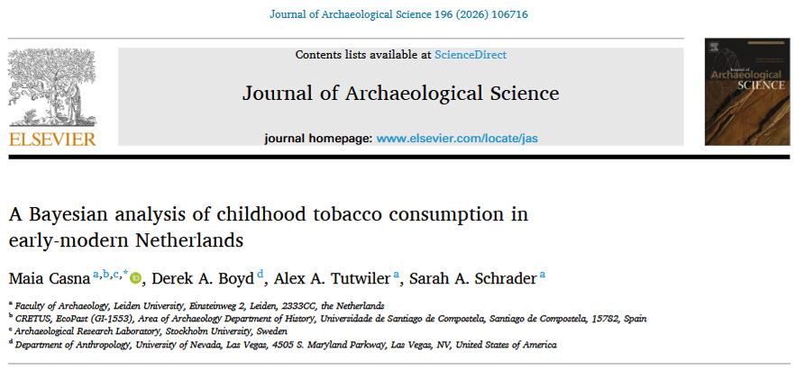
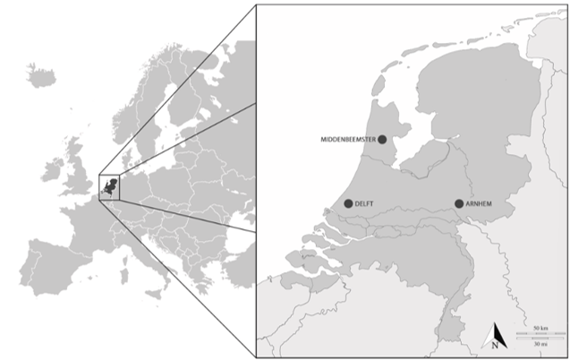
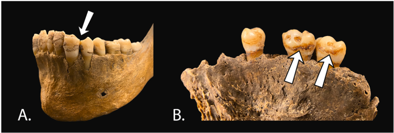

Let's talk about: the analysis of non-adult skeletal remains dating from the Dutch post-medieval period to assess their smoking habits.

## Research question and objectives 

It is now well known that tobacco :smoking: damages nearly every organs in the body and causes more than 7 million deaths each year. Yet, despite numerous campaigns aimed at helping people quit tobacco use or even to prevent them to begin, it is estimated that there are **more than 1 billion smokers worlwide**. Children, adolescents and young adults are particularly sensitive to the health consequences of tobacco use as nicotine affects brain development, increases long-term dependence, and contributes to cardiovascular risks (source: [WHO](https://www.who.int/news-room/fact-sheets/detail/tobacco), *Hafström et al 2005*, *Patel 1999*, *Gibbs et al 2016*, *McGrath-Morrow et al 2020*, *Thomson et al 2020*).  
Tobacco (*Nicotiana tabacum* and *Nicotiana rustica*) is a plant native to the Americas where it is thought to have been cultivated since around 5000–3000 BC. Regarding its introduction to Europe, it dates back to the **16th century**, after Christophe Columbus and his crew first encountered it in the Bahamas and Cuba (*Musk et de Klerk 2003*). **Tobacco use in historical societies is well documented**, through a wide range of evidences, such as: historical documents (*Goodman 2005*, *Snelders, 2021*), material culture (e.g., tobacco boxes, smoking pipes, see *McShane, 2021*), macroscopic analysis of human skeletal remains (*Casna et al 2024*), and biomolecular data detecting nicotine residues in bones and teeth (*Badillo-Sanchez et al 2023*, *Bartholdy et al 2024*).  

**This study wanted to bring its piece to the puzzle :jigsaw: by investigating smoking habits :smoking: among a social group that has been consistently left out of most analyses, that is non-adults**.  
Regarding more recent periods such as the 20th century, we already know that it was common to see children smoke as it was not even condemned (either morally or legally). A 1914 report by the *Association of Dutch Teachers* documented that <u>half of primary school children were tobacco users</u> (*BvNO 1914*) and we can found contemporaneous publications explicitely addressing and analyzing this phenomenon (e.g. *Le Rütte 1917*, *Van Berken 1914*).  
But what about the **Dutch post-medieval times** (i.e. around the 17th-19th centuries)?  

## A brief presentation of the methodology 

The skeletal remains analyzed in this study come from <u>3 sites</u>: *Arnhem* (Eusebiuskerk), *Delft* (Nieuwe Kerk) and *Middenbeemster* (Keyserkerk) - *town names definitely easier to write than to pronounce!* :sweat_smile:.  
Although they are all dated from the same chronological period (between 1624 and 1850), they represent different regions from the <u>Netherlands</u> :netherlands: as well as different living environments and socioeconomic status (see, respectively the map below, extracted from the article, and the following table): 

| Site :pushpin: | Dating :spiral_calendar: | Living environment :cityscape: | Socioeconomic status :moneybag:
| :--- | :---: | :--- | :--- | 
| Arnhem, Eusebiuskerk | 1626-1829 | Urban | Low | 
| Delft, Nieuwe Kerk | 1624-1821 | Urban | High | 
| Middenbeemster, Keyserkerk | 1829-1866 | Rural | Middle-low |         

 

Although archaeology and biological anthropology has already documented evidences of tobacco use among adults (*Bartholdy et al 2024*, *Casna et al 2024*, *Inskip et al 2023*, *Williams 2022*, *Zielman and Baetsen 2020*), data related to **non-adult population** are laking.  
Hence, the authors only focused their analysis on **103 subjects** whose <u>age-at-death was estimated to be less than 20 years old</u>. This age was estimated through the classical observation <u>dental development and eruption patterns :tooth:, as well as epiphyseal fusion :bone:</u> - *a biological growth process where the cartilage on the extremity of long bones is completely replaced by solid bone* (*AlQahtani et al 2010*, *Cunningham et al 2016*, *Demirjian et al 1973*, *Moorrees et al 1963*, *Schaefer et al 2009*).  

Tobacco consumption was assessed through the observation of two specific markers on the individuals' dentition :tooth: (*Davies-Barrett & Inskip 2024*):
- the presence of **pipe-notches** (A), that is characteristic rounded or V-shaped grooves observed on the anterior teeth resulting from the habitual use of a pipe stem held between the teeth during smoking;
- **dental staining** on the lingual tooth surfaces (B)

## Results: Smoking tobacco  was not just a habit reserved for adults 

Of the 103 individuals analyzed, 21 (20.4%) exhibited dental markers associated with tobacco consumption. This suggests that **childhood tobacco use was commonly observed within the post-medieval Dutch society**. Besides, it is most likely that these figures are underestimated considering that the absence of tobacco-related markers in individuals who died at an early age cannot be taken as definitive evidence that they did not smoke.    
The highest prevalence was observed for the site of Delft, whereas Middenbeemster presented the lowest (24.1% vs 18.8%). In Delft, the smokers were also younger, with an estimated age-at-death ranging between 5.5 and 7 years.  
To explain these differences in prevalence, the authors considered the distinct living environments and socioeconomic contexts represented by the three sites, proposing the following interpretations:
- **in rural environments** :farmer: (*such as Middenbemster*), children may have been exposed to smoking when they began participating to outdoor agricultural labor, as form of a leisure activity or for socialize within adult working groups. That would explain why markers of tobacco used was mostly observed in older individuals, most probably especially boys (*although sex estimation was not performed as available methods are not reliable for non-adult skeletal remains*, *Cunningham et al 2016*). Indeed, in the post-medieval Netherlands, rural children usually start working around the age of 6 to 9 years old (*Schenkeveld 2008*). 
- **in urban environments :city_sunset:, and especially within whealthier households :moneybag:** (*such as in Delft*), smoking was an integral part of domestic life (*Brongers 1964*) and children spent substantial time in the company of adults, increasing their opportunity for early exposure to tobacco, both passive and active (*Heywood 2017*, *Filippidis et al 2015*)

### :jigsaw: **Putting everything together**

In conclusion, these findings confirm that during the post-medieval Dutch period, children were also tobacco users :smoking:. This smoking habit was likely shaped by the environment in which they lived, worked and interacted with adults.  
These evidences also remind us that children experienced  behaviors that are often associated with adulthood, which sometimes began remarkably early. 

---
---
---

> **To read the article**: Casna M, Boyd DA, Tutwiler AA, Schrader SA, et al. (2026) **A Bayesian analysis of childhood tobacco consumption in early-modern Netherlands**. *Journal of Archaeological Science* 196(2026): 106716 (https://doi.org/10.1016/j.jas.2026.106716)

> **The mentionned references**:  
> - AlQahtani, S.J., Hector, M.P., Liversidge, H.M., 2010. Brief communication: the London atlas of human tooth development and eruption. *Am. J. Phys. Anthropol.* 142 (3), 481–490
> - Badillo-Sanchez, D., Ruber, M.S., Davies-Barrett, A.M., Sandhu, J.K., Jones, D.J.L., Hansen, M., Inskip, S.A., 2023. Examination of human osteoarchaeological remains as a feasible source of polar and apolar metabolites to study past conditions. *Sci. Rep*. 13 (1), 696
> - Bartholdy, B.P., Hasselstrøm, J.B., Sørensen, L.K., Casna, M., Hoogland, M., Beemster, H. G., Henry, A.G., 2024. Multiproxy analysis exploring patterns of diet and disease in dental calculus and skeletal remains from a 19th century Dutch population. *Peer Community J*. 4, e46
> - Brongers, G.A., 1964. Nicotiana tabacum - the history of tobacco and tobacco smoking in the Netherlands. Theodorus Niemeyer N.V.
> - BvNO/Bond van Nederlandsche Onderwijzers Afdeling Rotterdam, 1914. Het Rooken Door Kinderen: Rapport, Opgemaakt Naar Aanleiding Van Een Onderzoek, Omtrent Het Rooken Door Schoolkinderen, Gehouden Door De Afd. Rotterdam Van Den Bond Van Nederlandsche Onderwijzers. Uitgegeven door de gemeente Rotterdam
> - Casna, M., Davies-Barrett, A.M., Schrader, S.A., 2023. Exploring the impact of tobacco consumption on the respiratory health of two Dutch skeletal populations (1300–1829 CE). *World Archaeol*. 55 (5), 508–525
> - Cunningham, C., Scheuer, L., Black, S., 2016. Developmental Juvenile Osteology. Academic Press.
> - Davies-Barrett, A.M., Inskip, S., 2024. Who smokes anymore? Documentary, archaeological and osteological evidence for tobacco consumption and its relationship to social identity in industrial England (AD 1700-1850). In: Craig-Atkins, L., Harvey, K. (Eds.), The Material Body: Embodiment, History and Archaeology in Industrializing England, 1700-1880. Manchester University Press, pp. 133–169
> - Demirjian, A., Goldstein, H., Tanner, J.M., 1973. A new System of dental age assessment. *Hum. Biol.* 45 (2), 211–227
> - Filippidis, F.T., Agaku, I.T., Vardavas, C.I., 2015. The association between peer, parental influence and tobacco product features and earlier age of onset of regular smoking among adults in 27 European countries. *Eur. J. Publ. Health* 25 (5), 814–818
> - Gibbs, K., Collaco, J.M., McGrath-Morrow, S.A., 2016. Impact of tobacco smoke and nicotine exposure on lung development. *Chest* 149 (2), 552
> - Goodman, J., 2005. Tobacco in History: the Cultures of Dependence. Taylor & Francis
> - Hafström, O., Milerad, J., Sandberg, K.L., Sundell, H.W., 2005. Cardiorespiratory effects of nicotine exposure during development. *Respir. Physiol. Neurobiol*. 149 (1–3),325–341
> - Heywood, C., 2017. A History of Childhood, second ed. Polity
> - Inskip, S., Zachary, L., Serrano Ruber, M., Hoogland, M., 2023. Pipe smoking and oral health in males from the Netherlands during the 18th–19th century. *Post Mediev.Archaeol.* 1–14
> - Le Rütte, J.C.G.A., 1917. Het tabaksmisbruik bij de Nederlandsche schooljeugd. Vragen van de dag. Maanschrift Voor Nederland En Koloniën 32, 930–941
> - McGrath-Morrow, S.A., Gorzkowski, J., Groner, J.A., Rule, A.M., Wilson, K., Tanski, S.E., Collaco, J.M., Klein, J.D., 2020. The effects of nicotine on development. *Pediatrics* 145 (3), e20191346
> - McShane, A., 2021. Tobacco-Taking and Identity-Making in Early Modern Britain and North America. *Historical J*. 65 (1), 108–129
> - Moorrees, C.F.A., Fanning, E.A., Hunt, E.E., 1963. Age variation of Formation stages for ten permanent teeth. *J. Dent. Res.* 42 (6), 1490–1502
> - Musk AW, de Klerk NH. (2003) History of tobacco and health. *Respirology*;8(3):286-90
> - Patel, D.R., 1999. Smoking and children. *Indian J. Pediatr*. 66 (6), 817–824
> - Schaefer, M., Black, S., Scheuer, L., 2009. Juvenile Osteology. A Laboratory and Field Manual. Academic Press
> - Schenkeveld, W., 2008. Children's work in Dutch agriculture (1800-1913). *Tijdschr. Soc. Econ. Geschied.* 5 (2), 28–54
> - Snelders, S., 2021. Normalisation and ambivalence: tobacco in the seventeenth-century Dutch republic. *The Journal of the Social History Society* 20, 11–26
> - Thomson, B., Emberson, J., Lacey, B., Peto, R., Woodward, M., Lewington, S., 2020. Childhood Smoking, Adult Cessation, and cardiovascular mortality: prospective study of 390 000 US adults. *J. Am. Heart Assoc*. 9 (21), e018431
> - Van Berken, T., 1914. Jongens Die Rooken: Een Verhaal. H. J. W. Becht
> - Williams, G.L., 2022. Opgraving Delft, Nieuwe Kerk. ADC ArcheoProjecten.
> - Zielman, G., Baetsen, W.A., 2020. Wat De Nieuwe Sint Jansbeek Boven Water Bracht: Dood En Leven in Het Arnhemse Verleden: Archeologisch Onderzoek Sint Jansbeek Te Arnhem. RAAP-rapport 4476

