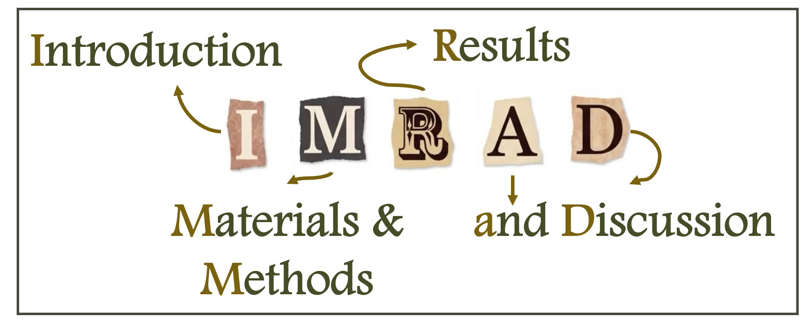

This week, instead of deciphering an article published by other scientists, I would like to share my tips, tricks, and advice on how to write a scientific paper, so that you can contribute to the advancement of science through your own research.

## Why it is important to publish? 

Here we are! :partying_face: You have finished analyzing your data and answering your initial research questions (or perhaps identified a particular phenomenon), and now you want to share your findings with your peers.  
To do so, in addition to presentation of your work at conferences, and generally before moving on to science communication for the general public, one key step is to publish a **scientific paper** :bookmark_tabs:. 

Sharing and disseminating research findings, whatever the format, is one of a researcher’s responsibilities: any result that goes unpublished is lost and wasted.  
One could even argue that failing to share research findings with the scientific community is unethical, or even disrespectful to those who contributed to the work. I’m thinking, for example, of the volunteers who participated in the study, or of the taxpayers whose money - through public research funding or donations to research foundations - helped finance your work (and that's even more important at a time when government funding for research is increasingly being cut 💰).  

Every contribution, however small, deserves to be shared. In fact, even negative results should be published too (even if, unfortunately, this can be more challenging, as some journals may consider them less fancy).  
Yet a negative result still produces knowledge: it let us know, for instance, that a method does not work under specific conditions, or that a population does not respond to a particular experimental intervention. It help us knowing which avenues to close off, but also which new ones to explore! Such findings can raise new questions, and we need to highlight them.  

Publishing is all the more important because, today (*and, unfortunately, increasingly so*), a researcher’s career is judged by the quantity (*often more than the quality, with one frequently coming at the expense of the other, regrettably*) of their scientific output. This is the unfortunate reality of the ***publish or perish*** rule.

## How to prepare, write and publish our paper? 

### ***First, let's choose the journal*** 

Usually, before starting to write the paper itself, it is recommended to **identify the journal** 📓 in which you would like to publish.  
Having your paper accepted on the first try can be quite rare. It may be considered *out of scope* by the journal, especially when the subject is interdisciplinary; it may be deemed insufficiently innovative or too focused on methodology; its overall quality may be considered insufficient for publication in its current form; or the journal may simply prioritize other studies when it receives too many submissions. And sometimes, the reason remains unclear... **Don't get discouraged!** Especially when you consider that international peer-reviewed journals generally have acceptance rates ranging from 25% to 50%.

I would therefore recommend identifying several potential journals and ranking them in order of preference.  
And there is plenty of choice: today, there are estimated to be nearly **60,000 journals** worldwide! These include English-language journals (the majority) as well as journals published in other languages; generalist journals and specialized ones (i.e., focused on a specific discipline), ... To put it simply, your choice will depend on the scope you wish to achieve. Would it be more relevant to share your findings internationally, across Europe, or at a more local level? Do you want to target specialists in your field or focused on a specific aspect of your research question? Or, on the contrary, would you like to reach the broadest possible audience by choosing an interdisciplinary journal? Your decision will also be influenced by more practical considerations, such as the timeline dedicated to the reviewing process (between the submission and the first decision), acceptance and publication (usually around 6 months to a year).  
Beyond these considerations, I would also recommend prioritizing journals that offer ***open access***, meaning that publication (for authors) and/or access to the published articles (for readers) are free of charges.
*On this topic, to boycott paywalled journals that restrict the dissemination of research, there are tools that provide free access to research articles, such as [Sci-Hub](https://sci-hub.su/). Such a boycott may be all the more meaningful given that researchers are not paid for publishing their articles, and reviewers (the experts who assess submitted papers and recommend whether they should be accepted for publication) are not paid for their time and expertise either.*  
I would also recommend choosing ***peer-reviewed_ journals*** 👥, that is journals that use a formal review process involving several experts (usually 2 or 3) as this process generally adds value to the final published paper: because the authors receive feedback that can help them improve how they present their findings, refine their methodology, and discuss their results in the context of the existing literature. It could even be a ***blinded review***, in which reviewers do not know the authors' identities, and vice versa. This approach can help limit conflicts of interest, for example, when a reviewer might be tempted to favor a colleague by accepting their work more readily or, conversely, to obstruct the publication of a "competitor"'s research.  
Some people may advise you to prioritize journals with a high **_Impact Factor_ (IF)**, a citation-based metric commonly used to assess a journal's influence. Personally, I would not treat this as an absolute rule, since the IF also depends on your discipline. If you work in a *niche* field, for instance, the number of publications - and therefore of citations - may naturally be lower, which will affect the journal's IF.  
There are also a few tricks to help you choose the right journal. You can start by looking at your own references to identify the journals that most frequently publish research on your topic. Also, you can use tools such as [JANE (Journal/Author Name Estimator)](https://jane.biosemantics.org/), which allows you to identify journals that may be a good fit for your research based on your paper's title and/or abstract.

But, why is it important to identify the journal before writing your paper? Well, because most journals have their own formatting requirements. These may include word limits, the number and order of sections, reference and citation styles, guidelines for figures and tables, and requirements for supplementary materials. This formatting can be a tedious process (especially if you have to repeat it after a rejection) but is essential if you want to avoid having your manuscript rejected at the very first stage because it does not comply with the journal's requirements! These rules are usually listed in the journal's **_Guidelines for Authors_** section on its website.
  
  
### ***Then, write!*** :fountain_pen:

Once you've identified the journal and familiarized yourself with its publication guidelines, you are ready to start writing! This can actually be a pretty fun stage if you think of it as a way to organize your findings and highlight how your work contributes to the ever-growing body of scientific knowledge.  
When it comes to getting started, there are, once again, several approaches, and no magic formula. Everyone needs to find their own method and make it their own. The only rule is to **dare to give it a go!** Don't be afraid of the blank page (*easier said than done, I know!*). Little by little, ideas and words will come to you, and you can always refine your wording as you go along :kissing:. Some people prefer to start with a bullet-point outline, while others dive straight into writing the different sections, either in order or jumping from one section to another... It's up to you to find what works best!  
In any case, most scientific papers follow a similar structure, known as the **IMRAD** format.

Of course, other structures exist. For example, some journals require the Methods section to come after the Results, while others ask the authors to combine the Results and Discussion sections. Some journals may also request a dedicated *Key Messages* box, and some others require a separate Conclusion section rather than incorporating it into the Discussion. This is another reason why identifying your target journal in advance is so important: it ensures that you can structure your manuscript according to its specific requirements.  
In any case, this structure can also be applied when writing a thesis, dissertation, or research report of any kind, so don't hesitate to make it your own!
  
  

  

The purpose of the Introduction is to explain **why** the study was conducted. Be careful, though as this is not about telling the story of how the project came about, but rather about **justifying** the relevance of your research question and hypotheses.  
This justification is based primarily on the scientific literature, which you are expected to have reviewed as thoroughly as possible beforehand (although this does not necessarily mean conducting a systematic review, as that is a research method in its own - *we'll come back to that later* 😉). You need to explain what has been done so far and, most importantly, what is still missing that you aim to address. This could involve a new method, a new context, a new test, new variables, and so on.  
Your literature review allows you to introduce your **research question**, which you should then refine into **objectives** and **hypotheses**. The difference between these three concepts can sometimes be tricky to grasp.  
To keep it simple:
- **The observation** (*totally made up, it's just for the example* 😉): A student puts off studying for hours because they decide to tidy up a mess they hadn't even noticed for the past six months. Yet the literature doesn't seem to offer any explanation for why this happens.
- **The research question** that follows (which should be phrased as a <u>question</u>): to what extent does the stress related to the exams influence students' tendency to procrastinate on their studies by engaging in household chores instead? Note that it is usually preferable to ask an open-ended question ("how," "why," "to what extent," etc.) rather than one that can only be answered with a yes or no.
- **The objectives** (usually one main objective and several secondary objectives, expressed using <u>action verbs</u> such as demonstrate, quantify, assess, evaluate, etc.):
  - Main objective: To understand why students prioritize other tasks over studying as exams approach.
  - Secondary objective 1: To identify the most common substitute activities (cleaning, cooking, tidying up, etc.).
  - Secondary objective 2: To analyze the relationship between perceived stress levels and the frequency of these behaviors.
- The **hypotheses** (which should be specific and point toward the <u>expected results</u>):
  - The higher the level of exam-related stress, the more likely students are to engage in household chores instead of studying.
  - Students who perceive studying as difficult or discouraging spend more time on secondary household activities.

**In short, the Introduction presents what is already known (the literature review), what remains unknown (a specific knowledge gap identified in the current state of research), and the research question that addresses this gap, broken down into objectives and hypotheses.**

  

The goal of this section is to explain **how** you conducted your research to test your initial hypotheses and address your research objectives.  
The first step is to describe the <u>study design</u>: prospective or retrospective, experimental, randomized and/or with a control group or not, literature review with or without meta-analysis, and so on (*I'll provide a more comprehensive overview of the different study designs and their definitions in a future post* 😉).  
The section then revolves around two main components:
- The **materials**:
  - What is your <u>sample</u>? What were your inclusion, non-inclusion, and exclusion criteria? (*I'll also explain these different terms in a future post* 😉). You need to demonstrate that your sample adequately represents your target population. In our previous example, it's easy to understand that studying procrastination among every students in the world would be impossible. The idea is therefore to provide enough information to demonstrate that, although your sample is not exhaustive, it is still representative of a particular segment of this population (e.g., French students from different academic disciplines and socioeconomic backgrounds, with different living arrangements - student residences, shared apartments, living alone, or living with family, etc.).
  - Which <u>variables</u> did you collect? These data should be described in as much detail as possible to make them easy to understand. You should also explain how they relate to your research question. Be sure to consider potential confounding variables, i.e., variables that may introduce bias into the relationship being investigated because they are associated with both the exposure and the outcome.
  - How did you collect your data (<u>experimental protocol</u>)? Here again, providing as much detail as possible about your data collection methods helps ensure the <u>reproducibility</u> of your study, meaning that another researcher should be able to apply the same methods.  
  N.B.: Where applicable, make sure to specify that the research was conducted in accordance with research ethics principles (and I sincerely hope it was!!): approval from the relevant ethics committees, respect for informed consent and anonymity, ...
- The **methods**: This refers to all the <u>statistical analyses</u> you applied to your data to test your hypotheses (*another spoiler: I'll introduce you to the main statistical tests available in a future post* 😉).

This presentation may be done with various levels of details: you may specify the names of the measurement tools and/or software used to collect variables and perform statistical analyses (including version numbers), provide bibliographic references if you have adapted a previously published method, and report any intra- and inter-observer assessments used to establish the reliability of your methods and results, ...  
Note that if your paper focuses primarily on developing a new method, you may prefer to publish it as a methodological paper, which follows a format that differs from the conventional IMRAD structure. If this is the case, I encourage you to consult the journal's Instructions for Authors, which should provide further guidance.

**Finally, the Materials and Methods section defines your sample and presents all the methodological details needed to assess the reliability of your study and reproduce it.**

  

This section presents all your results in their <u>raw form</u>, without any interpretation. Ideally, you could organize your results according to the specific objectives and/or hypotheses they address. This approach also helps you sort through the various analyses you performed during your research project. Some may have, for example, been conducted solely to check data quality or carried out as preliminary tests. Not everything necessarily needs to be reported: focus only on the results that help answer your research question.  
This section should also include a description of your sample characteristics: number of participants, age range, gender distribution, and any other relevant categories. In longitudinal studies, it is common to use a *flow chart* to illustrate how the sample size changes throughout the study, showing the initial number of participants enrolled and any subsequent losses to follow-up.  
Next, you should present the results of the statistical tests described in the previous section: correlation coefficients, p-values assessing the statistical significance of differences, regression coefficients, and so on. Before presenting these results, you should also describe the distribution of your variables: means and standard deviations for quantitative variables, and counts and frequencies for categorical variables.

A tip: don't hesitate to use <u>figures and tables</u>! You don't need to repeat everything in the main text, focus instead on highlighting the most significant findings. Conversely, if your results can be presented in just a few lines, it may be better to avoid using graphs, which take up space and are sometimes subject to journal-specific limits on the number of figures allowed. That said, figures can help reduce the word count (which can be useful depending on the journal's requirements) and make your results quicker to read and easier to understand by highlighting trends and key findings.  
Be careful not to repeat the same information in the text, tables, and figures. Text, tables, and figures should complement one another, not duplicate one another.  

Graphs are particularly useful for multivariate analyses and when you want to highlight changes over time or differences between specific groups or according to particular factors. For example, to illustrate differences in stress levels among students from different academic disciplines, *boxplots* can be very helpful.  
*Well, by now, you've probably guessed that the graphical presentation of research results will also be the subject of a future post!* 😉 But for now just know that there are plenty of options to choose from, including scatter plots, line graphs, histograms (or bar charts), pie charts, and many more! 

Whether you're presenting graphs or tables, make sure to include enough detail for the information to be easily found and interpreted: axis labels, color codes or point styles, units of measurement, ...  
Depending on the journal, you may also be able to move some results (usually those that are less significant or less relevant to your study) as *supplementary materials*.  
Furthermore, in the spirit of open science, I strongly encourage you to make your raw, anonymized data openly accessible. You can do this either by allowing other researchers to contact you directly to request access or by depositing your dataset in an official repository that assigns it a DOI (Digital Object Identifier, that is an unique identifier which provides a permanent reference to your dataset, allows it to be cited in the scientific literature, and helps you track how it is being reused).

Finally, don't leave out negative results (i.e., findings that do not support your initial hypotheses). Always be honest and transparent! The next section will give you an opportunity to explain any discrepancies between your expected and actual results and/or suggest avenues for further investigation.

**So, in short, the Results section presents your data in their raw form (distributions, means, and standard deviations) alongside the outputs of your statistical analyses, without interpreting them.**

  

We've now reached the final section of the paper, and probably the most important one, too! This is where you get to provide a <u>concrete answer</u> to your research question based on your findings, addressing each of your initial hypotheses one by one.  
As in the Introduction, the scientific literature plays a particularly important role here, as you need to <u>compare your findings</u> with those of previous studies. If your conclusions differ from what has been reported in the literature, you should take the time to explain why: could these discrepancies be due to differences in the study populations, the variables investigated, or the data collection or analysis methods, for example?  
It is usually advisable to begin the Discussion with an opening paragraph that reminds the research question and provides an overall answer. The following paragraphs can then address each initial hypothesis in turn, presenting the specific conclusions drawn from your results and discussing them in light of the existing literature.  
Beyond presenting your conclusions, this section should also include a paragraph discussing the <u>limitations</u> of your study. No research approach is perfect, and being aware of and honest about its limitations is essential to ensuring the credibility of your conclusions. This is an opportunity to discuss, among other things, the representativeness of your sample and the reliability of your measurements. You should also suggest potential improvements where appropriate.  
Also, don't hesitate to highlight the strengths of your study, either throughout the Discussion or in a dedicated paragraph: a novel approach, new data, innovative findings, new perspectives, ...

Finally, some journals allow - or even require - a separate <u>Conclusion</u> section. This should be very short (no more than 4/5 sentences) and should provide a definitive answer to the research question, state whether the initial hypotheses were supported or rejected, and explain how your work contributes to advancing knowledge in the specific field of research.  
You can also mention potential avenues for future research that could address the limitations discussed above, further emphasizing that your work is part of a broader research effort that deserves to be continued.

**So finally, the Discussion is where you answer your research question and address your initial hypotheses based on your findings, compare your results with the existing literature, acknowledge the limitations of your study, and suggest directions for future research.**

## Now that the paper is written, what do we do? 

Ok ok, you've got the main content of your paper written, but you're not quite done yet! 😅 There are still a few finishing touches to take care of:

- Coming up with a **title** (well, obviously!)  
  There are several schools of thought here: going for a *catchy* title that encourages people to click, even if that means embellishing your findings a little (for example, through a play on words), or instead highlighting the methodology ("a randomized controlled trial to..."), or even presenting the main finding of your study right from the start (we can think of all those articles about "the oldest..." discoveries in prehistoric research).  
  In any case, I'd recommend choosing a title that is clear, precise, informative, and not too long. It should spark the reader's curiosity while remaining accurate, and include the appropriate keywords for your research topic.  
- Writing an **abstract** and choosing its **keywords**  
  Here again, the idea is to provide enough information about your study to encourage readers to explore the full paper. Journals generally impose a word limit (often around 500 words).  
  It should follow the IMRAD structure: present the overall objective of your study and, if relevant, its rationale in light of the existing literature; provide at least the study design, the main characteristics of your sample, and a brief description of your protocol; you can then combine your results with their discussion to highlight the main findings that address your initial hypotheses; if space allows, explain how your study contributes to advancing knowledge in your field, and perhaps suggest avenues for future research.  
  Some journals require a structured abstract, with section headings, while others allow a more flexible format. Some journals also allow you to submit a *graphical abstract*, which, as the name suggests, summarizes the study's objectives and main findings in a figure that should be as simple and easy to understand as possible, without any accompanying text.  
  Regarding the keywords, these usually range from 3 to 10 and summarize the main topics covered in your paper. Think of them as the #hashtags that help people find your Instagram posts!
- Listing the **authors**  
  This means identifying everyone who contributed to the study, from designing the protocol and recruiting participants to collecting, analyzing, and interpreting the data. And the order of appearance matters! The first and last authors are generally those who invested the most time in conducting the research and writing the paper, or who supervised the work. The order of the authors in between usually reflects their relative contributions. Besides, all authors should be kept informed of the manuscript's progress and given the opportunity to review and approve its content before publication, even if they haven't directly participated in writing it.  
  For each author, you should specify their affiliation, meaning their professional institution or organization, whether that's a university, hospital or clinical institution, research institute, company, ...  
  You'll also need to designate a *corresponding author*, i.e., the person who can be contacted for questions or requests concerning the paper.
- Adding **bibliographic citations** and the complete reference list  
  Each journal has its own referencing style. So, consult its *Instructions for Authors* to determine how references should be cited in the text: as numbers (1), superscript numbers², or in an author–date format (Remy et al. 2026)," or another, more detailed format.  
  The same applies to the complete reference list at the end of your paper: how many authors should be listed before using "et al." (*which means "and colleagues," by the way!*), whether the journal title should be written in full or in its abbreviated form (for example, "International Scientific Research Journal" can be abbreviated as "Int. Sci. Res. J."), where to place the publication year (after the authors' names or at the end of the reference), how to format volume numbers and page ranges, and so on.  
  A few tips: be mindful of the number of references! Although there is no magic number, too few may suggest an insufficient understanding of the existing literature, while too many may obscure the innovative aspects of your research. So, focus on the most relevant and recent references. Prioritize articles published in journals with established scientific credibility (rather than general science communication articles, although you can cite research notes, theses, excavation reports, book chapters, ...), and only cite articles you have actually read. Avoid the "snowball effect", whereby you cite an article that itself relies on another publication for a particular piece of information. Instead, go back to the original source and cite the publication that first reported the information you're discussing.  
  Finally, don't hesitate to use reference management tools such as *Zotero* or *EndNote*. They're easy to learn and allow you to automatically import references from online sources and insert citations into your Word document in the format required by your chosen journal.
- Adding a few **additional sections**: funding sources, potential conflicts of interest, and acknowledgments   
  Some journals also require information about funding sources and a declaration from the authors stating whether they have any conflicts of interest. For example, a conflict of interest could arise if an author receives funding from a pharmaceutical company while the paper aims to evaluate the effectiveness of one of that company's drugs.  
  Finally, at the co-authors' discretion, you can include an Acknowledgments section to thank people who contributed to the study, whether as volunteers, data analysts (whose contribution was too limited to warrant authorship), or individuals who provided access to data, for example.

### ***Let's submit?*** 

Once you've finished writing your paper and adjusted its formatting to meet the journal's guidelines, it's time to submit it!! 🥳  
This step can unfortunately be a bit tedious, depending on the journal's submission platform... :face_with_peeking_eye: Then, just click the "Submit" button!! ^^ Congratulations on making it this far!!  
The next few days will feel long as you wait for a response from the editor (does your article comply sufficiently with the journal's *guidelines*? Does its topic fall within the journal's *scope*?) and then for feedback from the reviewers... This can take several weeks or even several months, so be patient!!  
Reviewers have three possible recommendations:
- Accept the article as it is (which rarely happens on the first round)
- Accept the article after minor or major revisions (the distinction between the two is often rather blurry, although major revisions generally require considerably more work)
- Reject the article.

And then, one day, your email notification goes off 📬: you've received the reviewers' comments! You'll need to read them, try not to get discouraged (above all!), and take the time to respond to every single comment... within two weeks 😬  
*Well, yeah! Science doesn't waste time (although it depends on who's expected to do the work 🤫). Now that I've crossed over to the other side and am being asked to review papers myself, I'm actually glad to have a generous amount of time to read each article carefully and provide the most constructive feedback possible (which is what I wish for you, rather than a simple "not sufficient" or "I disagree"). Remember, once again, that reviewers aren't paid for their expert assessment and have to fit this work in around their daily responsibilities.*

In any case, your response to the reviewers should include the following:
- A first document addressing the reviewers' comments, with a point-by-point response to each one. Don't hesitate to *butter them up a little* with polite expressions such as "You're absolutely right," "Thank you for this excellent comment," or "Thank you for your time and expertise"... (*Personally, these things don't really sway me, but this is what I've always been advised to do, and at least it shows that you've taken the time to read the comment and respond to it.*)
- A second document containing your original manuscript with the changes made in response to the reviewers' comments. Make sure these changes are clearly highlighted so they can be easily identified (either using a different color or Word's Track Changes feature, if the journal allows it).
- The final version of the article, with all the revisions incorporated seamlessly and consistently.  
Once you've completed your revisions, you can submit the new version and... wait :p and hope that your responses are sufficient for the paper to be accepted as it stands. Otherwise, you may receive another round of comments and have to prepare another set of responses.

And finally, you'll get to celebrate the publication of your paper, the fruit of all your hard work: conducting the research, writing the manuscript, formatting it according to the journal's requirements, patiently addressing the reviewers' feedback, and completing the final *proofreading* stage (the final step offered by the journal after your paper has been accepted for publication, during which you check the information and layout for any errors).  
Well done! You should be proud of yourself and this new addition to your CV! 😘  
And by the way, feel free to share your publications here (or on my Instagram account, @OwlyFlow). I'd be delighted to share them with my audience too - or even write a science communication piece breaking them down for a wider audience! ^^

