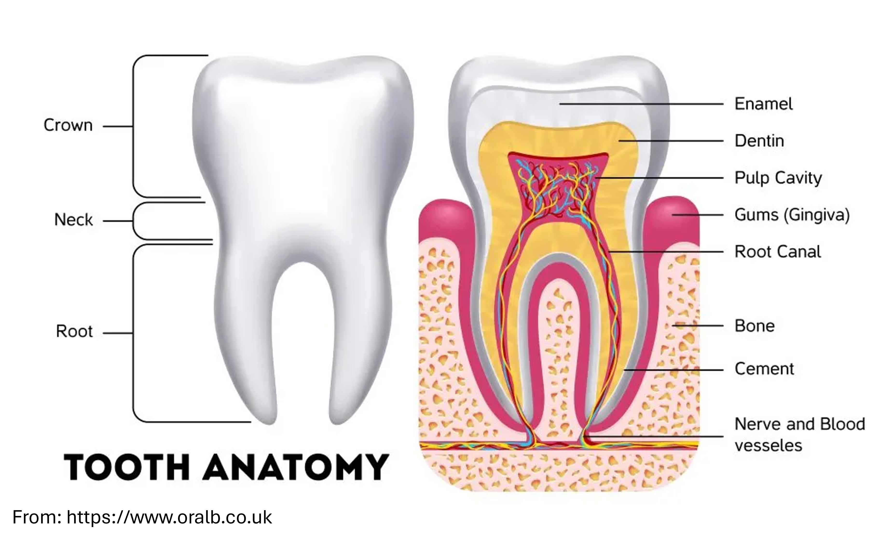

Let's talk about: how scientists demonstrated that *T. rex* was warm-blooded, with a body temperature suprisingly close to humans.

## Research question and objectives 

Scientists can use several methods to infer the **thermophysiology** of extinct species from fossil remains, that is **how they regulated their body temperature**. These include <u>anatomical studies</u>, <u>bone histology</u> (the study of bone tissue and its microscopic structure), mathematical modeling of how energy is produced, transferred, stored, and consumed (<u>energetics modeling</u>), <u>phylogenetics</u> (the study of evolutionary relationships between organisms based on their genetic similarities and differences), <u>geographic distribution</u> and methods based on the isotopic composition of fossils, rocks or minerals (<u>isotope-based paleothermometry</u>).  

Previous studies using these methods have provided evidence that some groups of dinosaurs were **endothermic** (*or, more simply, "warm-blooded"*). Like modern birds and mammals, endothermic animals are able to produce heat internally through metabolic processes, allowing them to maintain a relatively stable body temperature even when the surrounding temperature changes (*Codd et al. 2008*, *Bailleul et al. 2019*, *Clarke 2013*, *Valdes et al. 2024*, *Chiarenza et al. 2022*, *Amiot et al. 2006*, *Fricke & Rogers 2000*, *Dawson et al. 2020*, *Eagle et al. 2011*, *Eagle et al. 2015*, *Laskar et al. 2020*, *Tagliavento et al. 2023*).  

The objective of this study was to further investigate this previous evidence and, more specifically, to estimate the **body temperature** :thermometer: of ***Tyrannosaurus rex*** :t-rex: (*T. rex*).

:bangbang: *Note: Although birds are technically dinosaurs, they are usually distinguished from non-avian dinosaurs because they are the only dinosaur lineage to have survived the mass extinction 66 million years ago. For simplicity, in this post, the general term "dinosaurs" will refer only to non-avian dinosaurs*  

## A brief presentation of the methodology 

To estimate the body temperature :thermometer: of *T. rex* fossils :t-rex:, the authors used a technique called **clumped isotope thermometry** :atom_symbol:. This method is based on the measurement of how often certain heavy forms of carbon and oxygen (¹³C and ¹⁸O) are bonded together in carbonate minerals. Since this bonding pattern depends on the temperature at which the minerals formed, scientists can therefore **estimate past temperatures** and, in the case of fossil teeth, infer the body temperature of extinct animals (*Eagle et al. 2011*, *Deak et al. 2025*, *Griffiths et al. 2023*, *Löffler et al. 2019*).  

The authors used for their analyses **3 *T. rex* teeth** :tooth::  
- one incomplete, isolated tooth from specimen LACM 151468 (where LACM refers to the *Los Angeles County Museum* collection)  
- two teeth associated with specimen LACM 150167 (also nicknamed Thomas - *easier to remember isn't it? :p* - that is a well-preserved young adult that likely weighed over 3,000 kg during its lifetime, *Carr 2020*)  
These specimens were discovered at a site southeast of Ekalaka, in Carter County, Montana (a rather rural and remote region of the northwestern United States). They come from the **Late Cretaceous Hell Creek Formation** (*HCF*), a geological formation dating back approximately 66–67 million years, shortly before the mass extinction that wiped out the non-avian dinosaurs.    

To estimate *T. rex* body temperature, the authors compared their findings with those obtained from remains of contemporaneous **crocodilians** :crocodile:. They analyzed **5 teeth** :tooth: collected from a site near McGuire Creek, in McCone County, Montana and dating back to the very end of the Cretaceous Period, approximately 66 million years ago (a period known as *upper Maastrichtian*).  
Crocodilians are **ectothermic** (or *"cold-blooded"*), meaning that they rely largely on external sources of heat to keep their body temperature within a suitable range relative to the ambient temperature. They can also actively control their body temperature through behavioral adaptations, such as moving between sunny and shaded areas or alternating between water and land to warm up or cool down (*Grigg et al. 1998*, *Seebacher et al. 1997*).  

More specifically, the study analyzed the **enamel** of the teeth :tooth:, that is, the thin, hard outer layer covering the tooth crown (*and which is, btw, the hardest tissue in the human body!*). Composed of approximately 96% minerals, mainly calcium phosphate, enamel is highly mineralized and relatively resistant to alteration. These properties help preserve the original isotopic composition, making it an ideal material for estimating ancient temperatures with clumped isotope thermometry :atom_symbol:.  

Finally, using previously published information about past environmental temperatures (*Kohn & Cerling 2002*), the authors also aimed to understand how *T. rex* and crocodilians regulated their body temporature (that is their thermophysiological strategies) and how they may have responded to different environmental conditions to identify which habitats and climates may have been suitable for them.

## Results: *T. rex* were too hot as us 

The authors found a mean **body temperature** :thermometer: of 36.3 ±2.5°C :sunglasses: for ***T. rex*** :t-rex:, higher than that of the crocodilians :crocodile: they studied, which average 30.9 ±2.6°C. Interestingly, the estimated body temperatures for *T. rex* are similar to those reported in **extant large mammals** such as Indian and African elephants :elephant: (36.0° and 36.2°C, respectively, *Clarke & Rothery 2008*). It is also within the broader range of temperatures reported for some **large flightless birds** such as extant ostriches 𓅦 (between 38.1°C and 39.7°C, *King & Farmer 1961*). On the contrary, these body temperatures are slightly lower than smaller flying birds that have an average body temperature of 41.6 ±0.5°C (*Clarke & Rothery 2008*).

Regarding the contemporaneous and local environment, the authors reconstructed **warm climate conditions**, with estimated average annual temperatures ranging from 17.8°C to 33.4°C. Because the body temperatures estimated for *T. rex* were higher than those of their reconstructed environment, this could suggest that they were capable of generating substantial amounts of metabolic heat and actively regulating their body temperature - a process known as **endothermic thermoregulation** (*Here's our demonstration!*).  
The fossil record indicates that large tyrannosaurs occurred at high paleolatitudes, that is, much farther north regions (e.g. Alaska's North Slope or Trans-Pecos, Texas, *Fiorillo & Tykovski 2014*, *Lawson 1976*). This suggests that they may have been also able to tolerate relatively cold conditions, potentially down to around −13°C :cold_face:. However, based on the model developed in this study, it seems that extreme heat — around 45–48°C :hot_face: — could have posed a serious risk of overheating.

It should be mentioned that considering that this study analyzed very old fossil remains, the authors used multiple independent methods to evaluate whether the tooth enamel had undergone post-burial alteration that could affect the reliability of the results. 

### :jigsaw: **Putting everything together**

Finally, based on the temperatures estimated from clumped isotope thermometry :atom_symbol: in tooth enamel :tooth:, the authors provided additional evidence that *T. rex* :t-rex: was a warm-blooded, temperature-regulating animal. They were able to maintain a relatively high body temperature compared with their environment, consistent with **endothermic thermoregulation**.   
The findings also support the hypothesis that, despite the lack of fossil discoveries in these regions, *T. rex* could have inhabited a broad range of environments across the North American paleocontinent, including colder, higher-latitude regions. 

---
---
---
  
Before we wrap up, I'd like to invite you to vote on the topic of the next article you'd like me to break down for you: 

<iframe title="StrawPoll Embed" id="strawpoll_iframe_PKglevBoRZp" src="https://strawpoll.com/embed/PKglevBoRZp" style="position: static; visibility: visible; display: block; width: 100%; flex-grow: 1;" frameborder="0" allowfullscreen allowtransparency>Loading...</iframe>

---
---
---

> **Read the article**: Flores RJ, Eagle RA, Trayler RB, Larocca Conte G, Kim SL, Chiarenza AA, Farnsworth A, Valdes PJ, Chiappe L, Tripati A. (2026) **The body temperature of Tyrannosaurus rex**. **Sci Adv** 12(38):eaeb7653 https://doi.org/10.1126/sciadv.aeb7653)

> **Cited references**:  
> - Amiot R, Lecuyer C, Buffetaut E, Escarguel G, Fluteau F, Martineau F (2006) Oxygen isotopes from biogenic apatites suggest widespread endothermy in cretaceous dinosaurs. *Earth Planet Sci Lett* 246, 41–54
> - Bailleul AM, O’connor J, Schweitzer MH (2019) Dinosaur paleohistology: Review, trends and new avenues of investigation. *Peer J* 7, e7764 
> - Carr TD (2020) A high- resolution growth series of Tyrannosaurus rex obtained from multiple lines of evidence. *Peer J* 8, e9192
> - Chiarenza AA, Mannion PD, Farnsworth A, Carrano MT, Varela S (2022) Climatic constraints on the biogeographic history of Mesozoic dinosaurs. *Curr Biol* 32, 570–585.e3
> - Chiarenza AA, Cantalapiedra JL, Jones LA, Gamboa S, Galván S, Farnsworth AJ, Valdes PJ, Sotelo G, Varela S (2024) Early Jurassic origin of avian endothermy and thermophysiological diversity in dinosaurs. *Curr Biol* 34, 2517–2527
> - Clarke A, Rothery P (2008) Scaling of body temperature in mammals and birds. *Funct Ecol* 22, 58–67
> - Clarke A (2013) Dinosaur energetics: Setting the bounds on feasible physiologies and ecologies. *Am Nat* 182, 283–297 
> - Codd JR, Manning PL, Norell MA, Perry SF (2008) Avian-like breathing mechanics in maniraptoran dinosaurs. *Proc R Soc B* 275, 157–161 
> - Dawson RR, Field DJ, Hull PM, Zelenitsky DK, Therrien F, Affek HP (2020) Eggshell geochemistry reveals ancestral metabolic thermoregulation in dinosauria. *Sci Adv* 6, eaax9361
> - Deak MD, Porter WP, Mathewson PD, Lovelace DM, Flores RJ, Tripati AK, et al. (2025) Metabolic skinflint or spendthrift? insights into ground sloth integument and thermophysiology revealed by biophysical modeling and clumped isotope paleothermometry. *J Mamm Evol* 32, 1
> - Eagle RA, Tütken T, Martin TS, Tripati AK, Fricke HC, Connely M, Cifelli RL, Eiler JM (2011) Dinosaur body temperatures determined from isotopic (13c-18O) ordering in fossil biominerals. *Science* 333, 443–445
> - Eagle RA, Enriquez M, Grellet-tinner G, Pérez-huerta A, Tütken T, Montanari S, et al. (2015) Isotopic ordering in eggshells reflects body temperatures and suggests differing thermophysiology in two cretaceous dinosaurs. *Nat Commun* 6, 8296
> - Fiorillo AR, Tykoski RS (2014) A diminutive new tyrannosaur from the top of the world. *PLOS ONE* 9, e91287
> - Fricke HC, Rogers RR (2000) Multiple taxon–multiple locality approach to providing oxygen isotope evidence for warm-blooded theropod dinosaurs. *Geology* 28, 799 
> - Griffiths ML, Eagle RA, Kim SL, Flores RJ, Becker MA, Maisch HM, Trayler RB, et al. (2023) Endothermic physiology of extinct megatooth sharks. *Proc Natl Acad Sci U.S.A.* 120, e2218153120
> - Grigg GC, Seebacherd F, Beard LA, Morris D (1998) Thermal relations of large crocodiles, crocodylus porosus, free—Ranging in a naturalistic situation. *Proc Biol Sci* 265, 1793–1799
> - King JR, Farner DS “Energy metabolism, thermoregulation and body temperature” in *Biology and Comparative Physiology of Birds* (elsevier, 1961), pp. 215–288
> - Kohn MJ, Cerling TE, “12. Stable isotope compositions of biological apatite” in *Phosphates*, Kohn MJ, Rakovan J, Hughes JM, eds. (de Gruyter, 2002), pp. 455–488
> - Laskar AH, Mohabey D, Bhattacharya SK, Liang M-C (2020) Variable thermoregulation of late cretaceous dinosaurs inferred by clumped isotope analysis of fossilized eggshell carbonates. *Heliyon* 6, e05265 
> - Lawson DA (1976) Tyrannosaurus and Torosaurus, Maestrichtian dinosaurs from trans-Pecos, Texas. *J Paleontol* 50, 158–164 
> - Löffler N, Fiebig J, Mulch A, Tütken T, Schmidt BC, Bajnai D, Conrad AC, Wacker U, Böttcher ME (2019) Refining the temperature dependence of the oxygen and clumped isotopic compositions of structurally bound carbonate in apatite. *Geochim Cosmochim Acta* 253, 19–38
> - Seebacher F, Grigg GC (1997) Patterns of body temperature in wild freshwater crocodiles, crocodylus johnstoni: thermoregulation versus thermoconformity, seasonal acclimatization, and the effect of social interactions. *Copeia* 1997, 549
> - Tagliavento M, Hofmann S, Böttcher ME, Peltz M, Fiebig J (2023) Clumped isotope analysis of (bio)apatite using a Kiel iv device in long-integration dual- inlet mode. *Rapid Commun Mass Spectrom* 37, e9656
