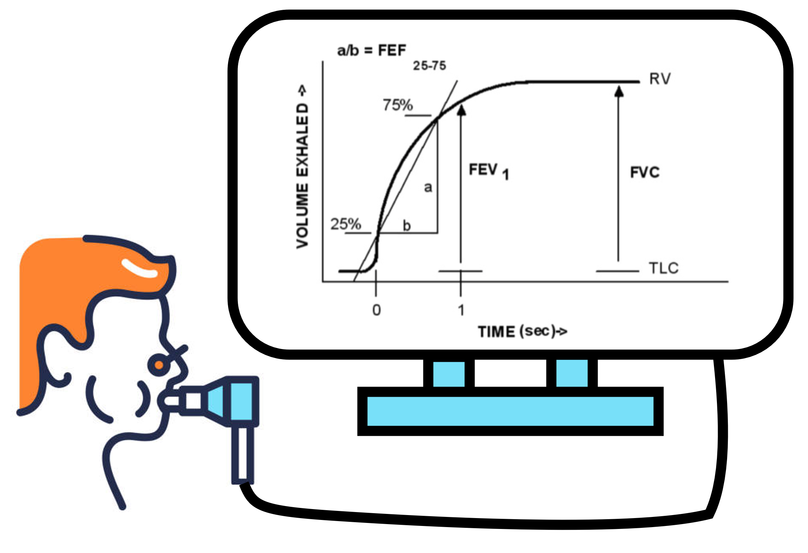

Let's talk about: how global warming pose a threat to our respiratory health.

## Research question and objectives 

Considering the unusually high temperatures 🌡️ experienced by many of us this summer, with some countries recording one of their hottest summers on record (see: https://wmo.int/media/news/earth-has-hottest-august-record), it is not surprising to notice that increasing attention is being paid to **understanding how heat affects our health**. This was the goal of the present study, focusing more specifically on **respiratory health** 🫁.  

It is already known that exposure to hot air can make breathing more difficult, through several mechanisms. For example, heat may cause the tiny blood vessels in the airways (capillaries) to swell, reducing the space available for air to flow through (*McFadden 1990*, *Zhu et al. 2025*). Likewise, hot temperatures increase exposure to respiratory irritants such as <u>ozone air pollution, pollen and mould spores</u>, which can further affect our respiratory health (*Al-Hegelan et al. 2011*).  
As a result,  high temperatures are often associated with respiratory symptoms, including <u>cough, breathlessness and wheeze</u> 🌬️, as well as an increase in respiratory-related <u>hospitalisations :hospital: or, in some cases, premature deaths 🪦</u> (*Sabia et al. 2010*, *O’Lenick et al. 2025*).  
**Older adults** are particularly vulnerable to these heat waves, as are <u>children, pregnant women, socially vulnerable people and individuals with underlying chronic diseases</u> (*Silveira et al. 2023*, *Derakhshan et al. 2024*, *Parsons et al. 2023*).   

Considering this well established negative impact of high temperatures 🌡️ on respiratory health 🫁, the objective of the present study was therefore to **better characterize the decline of lung function when people are exposed to short-term but high daily mean temperatures**. 

## A brief presentation of the methodology 

As in another study we previously deciphered, this one involved **1,923 participants** from a longitudinal cohort :busts_in_silhouette: (*that is, a large group of participants who were followed over an extended period*), called the **Lung Vitamin D and Omega-3 trial** (**VITAL**) and which originally aimed to assess the effects of these substances in the occurrence of cancer and cardiovascular disease in older adults (*Gold et al. 2016*).  

These participants came from 11 urban locations across the USA (*Boston, Baltimore, Philadelphia, Chicago, Detroit, St. Louis, Minneapolis/St. Paul, Phoenix, Houston, Dallas and Los Angeles*) and underwent **two spirometry testing** 🫁 between 2010 and 2018. Spirometry is a simple breathing test that measures how much air can be hold in the lungs and how quickly it can be exhaled.  
More precisely, the authors looked at 3 main measures of lung function:  
- The *forced expiratory volume in 1 sec.* (FEV1): the amount of air a person is able to exhale from their lungs in 1 sec. by blowing as hard as possible
- the *forced vital capacity* (FVC): the maximum amount of air a person can exhale from their lungs during a single forced breath 
- the *expiratory flow between 25-75% of forced vital capacity* (FEF25-75): the rate at which a person is able to exhale air from their lungs during the middle part of a forced exhalation

In addition to these measurements related to the respiratory function, the authors collected information on **wheather conditions** :sunny: at the date of the participant's spirometry testing and their geocoded home adress. These included daily mean temperature, relative humidity, and air pollution levels during the **7-days preceeding the spirometry test**.  
A temperature of 20°C was considered as the approximate reference for typical indoor temperatures, which is also consistent with WHO recommendations (*Barnard et al. 2018*), whereas **30°C** was used to represent hot conditions 🌡️ . 

Finally, the authors collected a **Social Vulnerability Index** (SVI) as a potential cofounding factor related to socioeconomic status, household characteristics, racial and ethnic minority status, housing conditions, and transportation. This score ranges from 0 to 1 and was categorized into quartiles. The lowest quartile represented the least vulnerable peole (while, conversely, the highest score represented the highest vulnerability).  
Based on previous literature (*Rice et al. 2019*), additionnal variables were collected to adjust the statistical models assessing the potential association between hot temperatures and lung function: participants' age, sex, height, weight, and tobacco use.

## Results: the hotter it gets, the harder it is to breath 

First of all, let's take a look at the sample: there were equal numbers of women and men, and most participants were older adults, with a **mean age of 65.5 years** :older_adult::older_woman:. This age distribution (*although it may limit the generalizability of the findings to the broader population*) is particularly relevant given that susceptibility to high temperatures increases with age. This vulnerability may be related to a reduced ability to regulate body temperature, including reduced sweating capacity, and the use of medications that can impair heat perception or increase the risk of heat stress.  
Furthermore, a minority of participants had a previous diagnosis of asthma (15%) or COPD (chronic obstructive pulmonary disease; 5%), and half had a history of tobacco smoking, even though only a small proportion (7%) were still current tobacco users.  
It should be noted that in most cases, this diagnosis of asthma and COPD were self-reported rather than clinically confirmed. This may partly explain the lack of statistically significant association observed for these variables (*see below*).  

Anyway, the main result of the study was that **an increase of temperature above the 20°C reference was associated with a decline in lung function** 🫁. The authors also assessed the effects of temperatures of 25°C, 30°C and 35°C, observing that this decline became increasingly pronounced at higher temperatures 🌡️.  

This association was also more pronounced among participants with asthma or COPD 🌬️.  
Regarding social vulnerability, assessed by the **Social Vulnerability Index** (SVI), participants with lower scores (so the most vulnerable ones) appeared to be more sensitive to this association between high temperatures and reduced lung function.  
However, it should be noted that these results were not statistically significant (*making it difficult to determine whether these findings can be generalized to the broader population*). 

As explained in the introduction, this negative impact of high temperatures on the lung function is not surprising considering the potential heat-related effects on the airways described in previous research. Yet, some studies have reported no such association, or even an increase in lung function at higher temperatures (*Lin et al. 2018*, *Green et al. 2010*, *Khot et al. 1988*, *Zhang et  al. 2020*).  
According to the authors, these differences may partly be explained by the way heat exposure was measured. Different studies used different temperature measures, which may not capture the same aspects of heat exposure (*Baldwin et al. 2023*, *Chersich et al. 2020*, *Syed et al. 2022*).  

### :jigsaw: **Putting everything together**
Finally, the conclusion is quite simple: to protect our respiratory health 🫁, and especially that of the most vulnerable among us, we have to **fight climate change** 🌡️!  
Here are a few examples of concrete actions each of us can take (listed in more details here: https://www.unep.org/news-and-stories/story/here-are-eight-simple-ways-you-can-fight-climate-change-today): 
- :bike: Choose modes of transportation that produce fewer emissions.  
- :zap: Reduce energy consumption through the limitation heating and air conditioning use, improvement of insulation, the use of more efficient appliances, ...  
- 🥗 Adopt a more sustainable diet: increase the proportion of plant-based foods and reduce food waste.  
- :recycle: Buy less, repair and reuse more, choose products made from sustainable resources.  

Measures are also available at the local, state and public institutions levels (more info here: https://www.ipcc.ch/report/ar6/wg3/chapter/summary-for-policymakers)
- :deciduous_tree: (Re-)Greening urban centers as these can help reduce heat islands and runoff during heavy rains.
- :bus: Reducing dependence on private cars while expanding public transportation, bike lanes, and pedestrian infrastructure .
- :office: Renovate buildings through an energy-efficient strategy and expand renewable energy sources.
- 🌱 Protecting ecosystems (forests, wetlands, and natural areas), transforming food systems and reducing food waste.
  
---
---
---
  
Before we wrap up, I'd like to invite you to vote on the topic of the next article you'd like me to break down for you: 

<iframe title="StrawPoll Embed" id="strawpoll_iframe_Q0Zp78AMDgM" src="https://strawpoll.com/embed/Q0Zp78AMDgM" style="position: static; visibility: visible; display: block; width: 100%; flex-grow: 1;" frameborder="0" allowfullscreen allowtransparency>Loading...</iframe>

---
---
---

> **Read the article**: Nassikas N, Ni W, Luttmann-Gibson H, Bubes V, Zanobetti A, Coull B, et al (2026). **Short-term exposure to heat associated with lower lung function in older adults: analysis of the Lung VITAL cohort**. *BMJ Open Respiratory Research* 13:e004661 (https://doi.org/10.1136/bmjresp-2026-004661)

> **Cited references**:  
> - Al-Hegelan M, Tighe RM, Castillo C, et al. 2011. Ambient ozone and pulmonary innate immunity. *Immunol Res* 49:173–91
> - Baldwin JW, Benmarhnia T, Ebi KL, et al. 2023. Humidity’s Role in Heat- Related Health Outcomes: A Heated Debate. *Environ Health Perspect* 131:55001
> - Barnard LT, Howden-Chapman P, Clarke M, et al. 2018. Report of the systematic review on the effect of indoor cold on health. In: *WHO housing and health guidelines. Geneva: World Health Organization*
> - Chersich MF, Pham MD, Areal A, et al. 2020. Associations between high temperatures in pregnancy and risk of preterm birth, low birth weight, and stillbirths: systematic review and meta-analysis. *BMJ* 371:m3811
> - Derakhshan S, Eisenman DP, Basu R, et al. 2024. Do social vulnerability indices correlate with extreme heat health outcomes? *J Clim Chang Health* 18:100276
> - Gold DR, Litonjua AA, Carey VJ, et al. 2016. Lung VITAL: Rationale, design, and baseline characteristics of an ancillary study evaluating the effects of vitamin D and/or marine omega- 3 fatty acid supplements on acute exacerbations of chronic respiratory disease, asthma control, pneumonia and lung function in adults. *Contemp Clin Trials* 47:185–95
> - Green RS, Basu R, Malig B, et al. 2010. The effect of temperature on hospital admissions in nine California counties. *Int J Public Health* 55:113–21
> - Khot A, Burn R, Evans N, et al. 1988. Biometeorological triggers in childhood asthma. *Clin Allergy* 18:351–8
> - Lin Z, Gu Y, Liu C, et al. 2018. Effects of ambient temperature on lung function in patients with chronic obstructive pulmonary disease: A time- series panel study. *Sci Total Environ* 619–620:360–5
> - McFadden ER. 1990. Hypothesis: exercise-induced asthma as a vascular phenomenon. *Lancet* 335:880–3
> - O’Lenick CR, Cleland SE, Neas LM, et al. 2025. Impact of Heat on Respiratory Hospitalizations among Older Adults in 120 Large U.S. Urban Areas. *Ann Am Thorac Soc* 22:367–77
> - Parsons LA, Lo F, Ward A, et al. 2023. Higher Temperatures in Socially Vulnerable US Communities Increasingly Limit Safe Use of Electric Fans for Cooling. *Geohealth* 7:e2023GH000809
> - Rice MB, Li W, Wilker EH, et al. 2019. Association of outdoor temperature with lung function in a temperate climate. *Eur Respir J* 53:1800612
> - Sabia S, Shipley M, Elbaz A, et al. 2010. Why does lung function predict mortality? Results from the Whitehall II Cohort Study. *Am J Epidemiol* 172:1415–23
> - Silveira IH, Cortes TR, Bell ML, et al. 2023. Effects of heat waves on cardiovascular and respiratory mortality in Rio de Janeiro, Brazil. *PLoS One* 18:e0283899
> - Syed S, O’Sullivan TL, Phillips KP. 2022. Extreme Heat and Pregnancy Outcomes: A Scoping Review of the Epidemiological Evidence. *Int J Environ Res Public Health* 19:2412
> - Zhang H, Liu S, Chen Z, et al. 2020. Effects of variations in meteorological factors on daily hospital visits for asthma: A time-series study. *Environ Res* 182:109115
> - Zhu Y, Jiang Y, Du X, et al. 2025. Heat Exposure Changes Lung Function, Biomarkers of Airway Injury, and Airway Microbiota: A Randomized, Crossover Trial. *Environ Health* 3:1344–52

