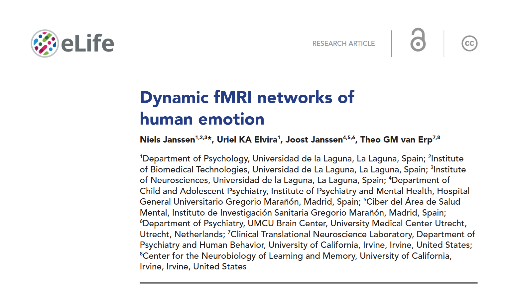
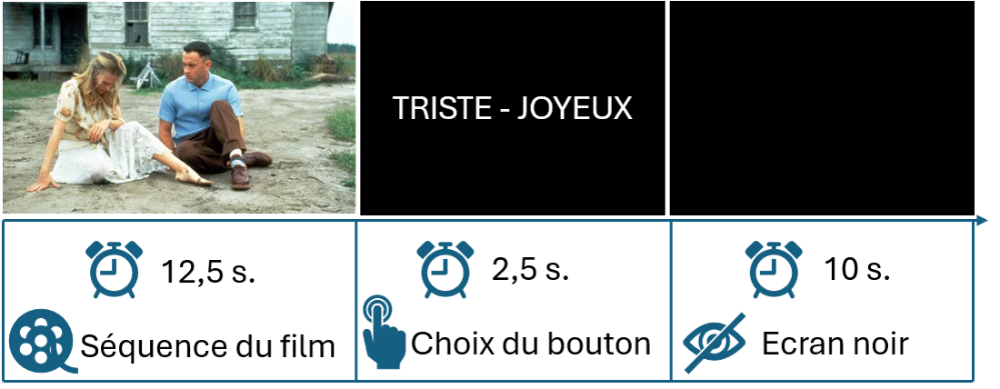
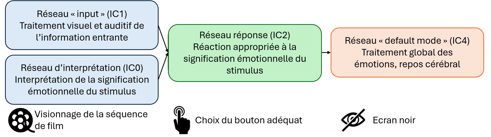

Parlons de : comment la neuroimagerie peut nous aider à comprendre comment le cerveau encode les émotions

## Question de recherche et objectifs 

On sait déjà que le traitement des émotions implique plusieurs régions interconnectées du cerveau :brain:, qui travaillent ensemble au sein de différents réseaux. Plus précisément, **Riedel et al. (2018)** ont identifié cinq réseaux distincts impliqués dans ce traitement des émotions :

* Les deux premiers réseaux sont principalement impliqués dans la <u>vision et l’audition</u> des informations. Ils se situent respectivement dans les cortex occipital et temporal supérieur ;
* Le troisième réseau, appelé <u>réseau de saillance</u> (*salience network*), nous aide à détecter et à porter notre attention sur les informations particulièrement importantes ou émotionnellement significatives. Il implique notamment l’activation de l’insula et du cortex cingulaire antérieur dorsal ;
* Le quatrième réseau comprend des régions appartenant à ce que l’on appelle le <u>réseau du mode par défaut</u> (*default mode network*), notamment les cortex préfrontal médian et cingulaire postérieur. Il nous aide à interpréter la signification d’une situation émotionnelle et à anticiper ce qui pourrait se produire ensuite ;
* Le cinquième réseau implique notamment l’amygdale, les gyri parahippocampiques et les gyri fusiformes, et contribue à <u>produire des réponses émotionnelles adaptées à la situation</u>.

Cependant, une question reste encore en suspens : la nature des informations émotionnelles reçues par le cerveau influence-t-elle la distribution spatiale et/ou la dynamique temporelle de ces réseaux (autrement dit, ***où*** et ***quand*** ces réseaux s’activent-ils) ?

C’est à ces questions que s’intéresse l'étude expérimentale que je vous présente ici, qui a consisté à observer l’activité cérébrale de participants pendant qu’ils regardaient des extraits de film à contenu émotionnel.

## Une présentation brève de la méthode 

22 adultes en bonne santé ont participé à cette étude expérimentale. On leur a demandé de regarder des extraits de 12,5 secondes du film ***Forrest Gump*** :tv: (un film plutôt riche en émotions, il faut bien l’avouer !) tout en passant une IRM fonctionnelle (**IRMf**). Cette technique permet notamment de mesurer l’activité cérébrale en suivant les variations du débit sanguin dans différentes régions du cerveau :brain:.

L’avantage d’utiliser des <u>extraits courts</u>, plutôt que des séquences plus longues de plusieurs minutes, est que plus une séquence est longue, plus elle risque de contenir de nombreux événements cognitifs et émotionnels différents. Il devient alors plus difficile de déterminer précisément quand et comment les réponses émotionnelles du cerveau évoluent au cours du temps. En utilisant des extraits courts et soigneusement sélectionnés, les chercheurs ont ainsi pu étudier ces changements avec davantage de précision.

Par ailleurs, l’étude s’est intéressée au traitement des émotions <u>depuis l’apparition du stimulus émotionnel jusqu’après sa disparition</u>, afin de mieux comprendre comment le cerveau continue à traiter et à réguler une émotion une fois que le stimulus émotionnel n’est plus présent.

Les participants ont regardé 15 extraits au total, chacun ayant été sélectionné pour susciter une émotion particulière : **le bonheur** :smile:, **la peur** :fearful: ou **la tristesse** :sob:. Après chaque extrait, ils disposaient de 2,5 secondes pour choisir, à l’aide de manettes tenues en main, l’un des deux mots liés aux émotions qui étaient affichés à l’écran.

Enfin, un écran blanc de 10 secondes était présenté avant le début de l’extrait suivant.

Permettez moi de vous épargner les détails concernant les paramètres d’acquisition de l’IRMf, le prétraitement des données, l’extraction du signal et l’analyse des données… mais n’hésitez surtout pas à lire l’article dans son intégralité si le sujet vous intéresse ! *(voir la référence complète en bas de page)*

## Resultats: les signatures spatiotemporelles du cerveau émotif 

Ce qui est principalement intéressant dans cette étude, c'est que les chercheurs ont identifié quatre réseaux (bon en vrai, six, mais les deux autres ont été interprétés comme du bruit), chacun présentant une distribution spatiale et un profil temporel spécifiques, ce qui leur a permis d'être associé à différentes étapes du traitement des émotions :

* Les deux premiers réseaux (appelés **IC0** et **IC1**) étaient activés dès le début de l’extrait et restaient actifs pendant toute la durée de la séquence de 12,5 s.
  * Ces réseaux impliquaient une activité dans les régions cérébrales liées à la perception visuelle et auditive (notamment les gyri occipitaux latéraux et péricalcarins), tandis que **IC1** impliquait également le gyrus temporal supérieur, l’amygdale et les régions cingulaires postérieures médianes.
  * Plus précisément, l’activité cérébrale identifiée au sein du réseau **IC1** correspondait à certains aspects des réseaux 1, 2 et 5 décrits par *Riedel et al. (2018)*, qui sont associés à <u>la perception visuelle et auditive des stimuli émotionnels</u>, ainsi qu’à <u>l’évaluation de la nature de ces stimuli</u>.
  * Concernant le réseau **IC0**, une importante co-activité dans les régions frontales latérales et temporales moyennes a été observée, régions généralement associées au <u>traitement sémantique</u> (*Huth et al. 2016 ; Visser et al. 2012*). Ce réseau impliquait également des régions associées au <u>réseau de saillance</u>, telles que l’insula et le cortex cingulaire antérieur (*Seeley, 2019*). Par ailleurs, l’activité de ces régions atteignait son maximum environ 2 secondes après celle observée dans IC1. Les auteurs en ont donc conclu que ce réseau était impliqué dans <u>le traitement de la signification associée aux informations reçues</u>.
&rarr; :brain: **Les deux premiers réseaux permettent donc au cerveau de percevoir les informations émotionnelles, puis d’en comprendre la signification.**
* Le troisième réseau (**IC2**) était associé à la prochaine étape de l’expérience, à savoir prendre une décision concernant le stimulus émotionnel, incluant : <u>le traitement des mots liés aux émotions affichés à l’écran</u> (avec une activité localisée dans des régions corticales et sous-corticales); <u>la sélection du mot le plus pertinent associé à l’émotion</u> (avec des signaux plus importants détectés dans la région du noyau caudé); <u>la réponse motrice consistant à appuyer sur le bouton correspondant de la manette</u> (avec une activité observée dans des régions motrices primaires telles que le gyrus précentral, ainsi que dans des régions impliquées dans l’attention liée à la tâche, notamment l’insula et le cortex cingulaire antérieur) (*Grahn et al. 2008 ; Seeley, 2019*).
&rarr; :brain: **Le troisième réseau était donc associé à la tâche consistant à déterminer quelle émotion correspondait le mieux au stimulus que le cerveau venait de percevoir et à réagir de manière appropriée.**
* Le quatrième profil d’activité cérébrale identifié (**IC4**) correspondait au <u>réseau du mode par défaut</u>, qui est particulièrement actif lorsqu’une personne est au repos ou lorsque son esprit vagabonde. Ce réseau était actif tout au long de l’expérience comportementale, mais son activité atteignait un pic pendant la période de repos entre les différentes tâches (*Riedel et al. 2018 ; Buckner et al. 2008 ; Gross, 2015*).
&rarr; :brain: **Le quatrième réseau illustre donc le moment où le cerveau n’est plus focalisé sur une tâche externe spécifique.**

En d’autres termes, cette étude suggère que l’activité cérébrale semble suivre une certaine séquence précise :
**percevoir l’émotion → comprendre sa signification → prendre une décision appropriée → se reposer**

Il convient également de noter que l’accord entre les participants était plus important lorsque le stimulus émotionnel était la **tristesse**, et que leur prise de décision était également plus rapide. 
Est-ce que cela signifie que la tristesse est traitée particulièrement rapidement par le cerveau ? Peut-être… mais il vaut mieux rester prudent quant à cette interprétation.
En effet, on peut aussi supposer que ce résultat est en partie lié à la forte composante triste du film choisi pour l’étude expérimentale, *Forrest Gump* :sneezing_face:.
Par ailleurs, comme le soulignent les auteurs eux-mêmes, de précédentes études ont également mis en évidence un traitement rapide des stimuli associés à la peur (*Méndez-Bértolo et al. 2016 ; Bo et al. 2022 ; Grootswagers et al. 2020*).
Ainsi, des recherches supplémentaires seraient nécessaires pour déterminer si ce résultat est réellement spécifique à la tristesse ou s’il est plutôt lié aux caractéristiques particulières des stimuli utilisés dans cette expérience.

### :jigsaw: **Tout ce que cela signifie**
Pour résumer, grâce aux enregistrements d’IRMf réalisés pendant que les participants regardaient de courts extraits de *Forrest Gump*, les auteurs ont pu identifier et suivre au cours du temps quatre réseaux cérébraux indépendants, chacun associé aux différentes étapes du traitement des émotions : depuis la **perception du stimulus émotionnel**, jusqu’à **l’interprétation de sa signification**, puis à la **traduction de ce traitement en une décision**, à travers la sélection du mot correspondant à l’émotion, et enfin à la **période de repos** suivant la réponse.

Ces nouvelles connaissances sur le traitement des émotions, et en particulier sur sa dimension temporelle, sont non seulement intéressantes du point de vue des neurosciences fondamentales, mais pourraient également contribuer à de futures recherches cliniques sur les **troubles émotionnels**. En effet, ces troubles sont souvent associés à des difficultés à réguler les émotions au cours du temps, c’est-à-dire à des perturbations de **la régulation temporelle des émotions** (*Kuppens & Verduyn 2017 ; Waugh et al. 2015*).

---
---
---

> **Lire l'article**: Niels Janssen, Uriel KA Elvira, Joost Janssen, Theo GM van Erp (2026) **Dynamic fMRI networks of human emotion** *eLife* 14:RP106070 (https://doi.org/10.7554/eLife.106070.3).  

> **Références citées**:  
> - Buckner RL, Andrews- Hanna JR, Schacter DL. 2008. The brain’s default network: anatomy, function, and relevance to disease. *Annals of the New York Academy of Sciences* 1124:1–38 (https://doi.org/10.1196/annals.1440.011)
> - Grahn JA, Parkinson JA, Owen AM. 2008. The cognitive functions of the caudate nucleus. *Progress in Neurobiology* 86:141–155 (https://doi.org/10.1016/j.pneurobio.2008.09.004)
> - Gross JJ. 2015. The extended process model of emotion regulation: elaborations, applications, and future directions. *Psychological Inquiry* 26:130–137 (https://doi.org/10.1080/1047840X.2015.989751)
> - Huth AG, de Heer WA, Griffiths TL, Theunissen FE, Gallant JL. 2016. Natural speech reveals the semantic maps that tile human cerebral cortex. *Nature* 532:453–458 (https://doi.org/10.1038/nature17637)
> - Kuppens P, Verduyn P. 2017. Emotion dynamics. *Current Opinion in Psychology* 17:22–26 (https://doi.org/10.1016/j.copsyc.2017.06.004)
> - Riedel MC, Yanes JA, Ray KL, Eickhoff SB, Fox PT, Sutherland MT, Laird AR. 2018. Dissociable meta-analytic brain networks contribute to coordinated emotional processing. *Human Brain Mapping* 39:2514–2531 (https://doi.org/10.1002/hbm.24018)
> - Seeley WW. 2019. The salience network: a neural system for perceiving and responding to homeostatic demands. *The Journal of Neuroscience* 39:9878–9882 (https://doi.org/10.1523/JNEUROSCI.1138-17.2019)
> - Visser M, Jefferies E, Embleton KV, Lambon Ralph MA. 2012. Both the middle temporal gyrus and the ventral anterior temporal area are crucial for multimodal semantic processing: distortion-corrected fMRI evidence for a double gradient of information convergence in the temporal lobes. *Journal of Cognitive Neuroscience* 24:1766–1778 (https://doi.org/10.1162/jocn_a_00244)
> - Waugh CE, Shing EZ, Avery BM. 2015. Temporal dynamics of emotional processing in the brain. *Emotion Review* 7:323–329 (https://doi.org/10.1177/1754073915590615)