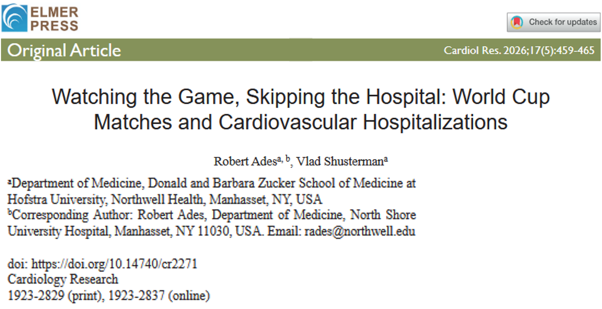

Cette semaine, parlons des potentiels changements observés dans les comportements en matière de recours aux soins associés aux troubles cardiovasculaires pendant les matchs de Coupe du Monde. 

## Question de recherche et objectifs 

La Coupe du monde de la FIFA 2026 :soccer: a attiré un public considérable à travers le monde, avec plus de 50 millions de téléspectateurs enregistrés rien que pendant le week-end d'ouverture. Ces chiffres exceptionnels témoignent de la passion que suscite le football -- *bon ... pas chez moi hein ...* :face_with_peeking_eye: (source: https://inside.fifa.com/fr/tournament-organisation/commercial/fifa-tv/news/audiences-mondiales-record-coupe-monde-2026).   
La question est : **est-ce que cette passion est susceptible d'impacter notre santé ?**

Il est intéressant de noter que de précédentes études ont reporté <u>un plus faible nombre de visites aux services d'urgence pendant les grands évènements sportifs</u> (*Ballesteros Pena et al. 2020*, *Barut et al. 2025*, *Almeida et al. 2014*). Il semble donc que la majorité des gens préfèrent repousser le moment de consulter un médecin plutôt que de manquer un match important ... :facepalm:  
Dans le même temps, l'effervescence qui entoure ces compétitions, surtout lors de matchs décisifs, pourrait également contribuer à la manifestation de troubles cardiovasculaires sévères. En effet, la littérature a rapporté une <u>une augmentation des urgences cardiaques ou des consultations pour des troubles cardiovasculaires les jours de matchs</u>, et plus particulièrement si l'équipe locale perd :grimacing: (*Carroll et al. 2002*, *Wilbert-Lampen et al. 2008*). 

Dans cette étude, les auteurs se sont demandés si ces deux mécanismes (**la réticence à consulter un professionnel de santé** et **l'augmentation des troubles cardiaques liés au stress**) s'observent également au sein de la population brésilienne :brazil:, chez qui le football :soccer: est profondément ancré dans la culture nationale. 

## Une brève présentation de la méthodologie 

Pour réaliser leur étude, les auteurs ont collecté des données spécifiques à partir du *Sistema de Informacoes Hospitalares do Systema Único de Saúde* (SIH-SUS), le système d'information brésilien qui recense les admissions hospitalières prises en charge par le système de santé public.  
Ils se sont focalisés sur le <u>dénombrement journalier des admissions à l'hôpital pour deux pathologies cardiovasculaires</u> :mending_heart::
- l'infarctus aigu du myocarde (abbrégé sous l'acronyme **AMI**), aussi plus communément appelé "crise cardiaque"
- l'insuffisance cardiaque (**HF**), une pathologie dans laquelle le coeur ne parvient pas à pomper le sang aussi efficacement qu'il le devrait 

Les auteurs se sont intéressés aux 3 précédentes éditions de la Coupe du Monde de la FIFA :soccer: auxquelles le Brésil :brazil: a participé : 7 matchs en 2014, 5 matchs en 2018 et 5 matchs en 2022. Il convient de noter que le Brésil a été le pays hôte en 2014. Sur ces 17 matchs, le Brésil en a gagné 17, perdu 5 et fait 2 matchs nuls.  
Ils ont examiné des périodes couvrant une fenêtre de 30 jours précédant et suivant chaque tournoi, afin de permettre une évaluation plus fiable de l'impact réel de chaque match. 

Afin de **déterminer l'association possible entre ces jours de match impliquant l'équipe brésilienne et le nombre d'hospitalisations pour cause cardiovasculaire**, les auteurs ont utilisé des <u>modèles de regression binomiale négative</u>

## Résultats: le football d'abord, la santé après 

Les auteurs ont observé une **réduction de 7% et 11% des admissions pour AMI et HF**, respectivement, les jours où le Brésil a joué, par rapport aux jours sans match.  
Bien que ces diminutions puissent paraitre relativement faibles, elles se sont averées <u>statistiquement significatives</u>, ce qui signifie que les différences observées n'étaient probablement pas un simple fait de coincidence.  
Il est intéressant de noter que ces hospitalisations pour AMI et HF étaient même <u>encore moins nombreuses les jours où le Brésil gagnait son match</u> que les jours où l'équipe nationale perdait ou qu'il y avait match nul, bien que ce résultat ne soit pas significatif.  
Aucune augmentation constante dans les admissions pour AMI ou HF n'a été observée au cours des 3 jours suivant les matchs du Brésil. Au contraire, il y a eu un retour progressif vers les niveaux d'hospitalisations courants. Ces résultats suggèrent qu'il n'existe <u>aucune preuve évidente d'un rebond des hospitalisations d'origine cardiovasculaires après les compétitions de la Coupe du Monde</u>.

Malheureusement, parce qu'ils n'ont pas pris en compte le volume global des admissions à l'hôpital, les auteurs n'ont pas pu établir si les admissions pour causes cardiovasculaires représentaient une plus grande proportion sur l'ensemble des admissions sur les jours de matchs. De fait, ils n'ont pas été capable de déterminer si, au-delà des changements probables dans les comportements en matière de recours aux soin, le risque en soi de manifester des symptômes d'infarctus du myocarde ou d'insuffisance cardiaque pourrait avoir augmenter les jours de matchs. Néanmoins, de précédentes études ont rapporté une augmentation des urgences cardiaques pendant les grands évènements sportifs (*Carroll et al. 2002*, *Wilbert-Lampen et al. 2008*). 

Bien que le système SIH-SUS utilisé dans cette étude couvre une part importante de la population brésilienne (environ 75%, *Pimentel et al. 2023*, *Brazilian Ministry of Health 2025*), il convient de faire preuve de prudence lors de l'extrapolation de ces résultats à l'ensemble de la population. 

### :jigsaw: **Donc, pour conclure...**

Pris ensemble, ces résultats confirment les précédentes observations que **les gens sont moins enclins à consulter un professionnel de santé pour des symptômes de trouble cardiovasculaire lors d'évènements sportifs majeurs**. Toutefois, étant donné les limitations de l'étude, ces conclusions ne peuvent pas être interprétées comme une augmentation avérée des risques de manifester de tels symptômes les jours de match.  
En d'autres termes : **s'il vous plait, ne prenez pas moins au sérieux votre santé lorsque votre équipe préférée joue !!!**
  
---
---
---

> **Pour lire l'article** : Ades R, Shusterman V. (2026) **Watching the Game, Skipping the Hospital: World Cup Matches and Cardiovascular Hospitalizations**. *Cardiol Res*;17(5): 459-465 (https://doi.org/10.14740/cr2271)

> **Les références mentionnées** : 
> - Almeida A, Eusebio M, Almeida J, Boattini M. (2014) The impact of the Lisbon Football Derby on the profile of emergency department admissions. *Acta Med Port*;27(6):700-703
> - Ballesteros Pena S, Fernandez Aedo I, Vallejo de la Hoz G. (2020) Impact of football matches on number of visits to an emergency department. *Emergencias*;32(5):345-348
> - Barut E, Barut K. (2025) The effect of football derbies on emergency department visits: evidence from Turkey, 2024. *J Epidemiol Glob Health*;15(1):125
> - Brazilian Ministry of Health, Pan American Health Organization. (2025) Special report on social participation in health and climate: supporting document for the implementation of the belem health action plan. 1st ed. Brazilian Ministry of Health
> - Carroll D, Ebrahim S, Tilling K, Macleod J, Smith GD. (2002) Admissions for myocardial infarction and World Cup football: database survey. *BMJ*;325(7378):1439-1442
> - Pimentel FG, Buchweitz C, Onocko Campos RT, Hallal PC, Massuda A, Kieling C. (2023) Realising the future: Health challenges and achievements in Brazil. *SSM - Mental Health*;4:100250
> - Wilbert-Lampen U, Leistner D, Greven S, Pohl T, Sper S, Volker C, Guthlin D, et al. (2008) Cardiovascular events during World Cup soccer. *N Engl J Med*;358(5):475-483
