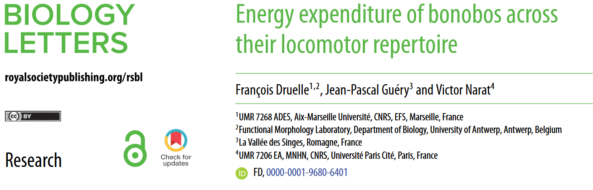

Le sujet du jour : de nouvelles hypothèses sur l'origine de la bipédie chez l'Homme, explorées via l'étude du coût énergétique associé au répertoire locomoteur du bonobo. 

## Question de recherche et objectifs 

La lignée humaine se distingue des autres grands singes, entre autres, par son mode de locomotion qui est la **bipédie** exclusive, soit le déplacement permanent sur ses deux membres inférieurs. Toutefois, la bipédie n'est pour autant pas un phénomène au genre humain : elle existe aussi chez d'autres espèces animales, bien que sous des formes différentes. On peut notamment citer les oiseaux qui sont bien totalement bipèdes quand ils se déplacent au sol :black_bird:.  
Chez nos plus proches cousins, les grands singes :monkey:, le **répertoire locomoteur est varié** puisqu'il comprend, en plus de la bipédie, d'autres modes de locomotion comme la brachiation (*suspension dans les arbres*), le saut, la grimpe et la quadrupédie (*déplacement sur les 4 pattes, qui peut elle-même prendre différentes formes*), avec des transitions dynamiques entre chaque mode (*Senut 2002*).  
Cette locomotion complexe répond à leur **habitat arboricole** :deciduous_tree::deciduous_tree::deciduous_tree:, qui se compose de supports discontinus, flexibles et instables. Or cet habitat arboricole caractérisait également l'environnement de nos ancêtres les hominines (*groupe qui rassemble toutes les espèces de la lignée humaine, qui s'est séparée de la lignée des chimpanzés il y a au moins 7 Ma*, *Elton 2008*).  

Les études en **paléoanthropologie** :bone: ont démontré que l'anatomie des fossiles de nos ancêtres étaient déjà adaptés à la locomotion bipède, notamment par l'orientation du trou occipital (*jonction entre la colonne vertébrale et la tête*) qui suggérait une posture érigée, bien qu'ils étaient également adaptés à la vie arboricole, notamment par la présence d'un gros orteil opposable sur le pied, ou de longs bras (*Coppens 1991*). 

Etudier le répertoire actuel des grands singes actuels permettrait donc de mieux comprendre **l'évolution de la bipédie** chez l'Homme :walking:. C'est en tout cas le pari des auteurs de l'article que je vous propose de découvrir aujourd'hui : cette équipe française a observé le comportement des bonobos dans leur habitat naturel et appliqué un modèle biomécanique afin d'estimer le coût énergétique à leurs déplacements.  
Les auteurs ont fait l'hypothèse que les contraintes liées à l'environnement arboricole, notamment pour le maintien de l'équilibre et le changement de direction rapide demandent un effort musculaire intense et dynamique (*Seethapathi & Srinivasan 2015*). Ils supposent également que le coût énergétique associé à cette vie arboricole serait tel qui ne laisserait que peu de possibilité à la locomotion bipède.   
En d'autres termes : **quel est le coût énergétique de la locomotion arboricole par rapport à celui de la marche au sol ?**  

## Une courte présentation de la méthodologie 

Jusqu'ici, le coût énergétique associé à la locomotion chez le primate était essentiellement exploré via des études par **respirométrie**. Cette méthode consiste à mesurer les échanges gazeux de la respiration pendant le déplacement : plus il y a dépense d'énergie, plus l'organisme a besoin d'oxygène et produit du dioxyde de carbone (CO₂). Bien que largement utilisée, cette méthode nécessite des conditions expérimentales sufisamment contrôlées qui peuvent modifier le comportement de l'espèce étudiée, ne représentant donc pas forcément les déplacements spontanés dans un environnement naturel (*Garland 1983*, *Aerts et al. 2023*).  
En solution alternative, les auteurs proposent ici d'estimer le coût énergétique de la locomotion en se basant à la fois sur des données **éthologiques** (*observation du comportement animal, ici description du répertoire locomoteur*) et **biomécaniques** (*mesure de la performance de chaque mode de déplacement*).

Les grands singes :monkey: et l'Homme :adult: partagent un ancêtre commun qui a vécu il y a plusieurs millions d'années. Il est donc pertinent d'étudier leurs représentants pour inférer sur l'évolution de notre bipédie. Parmi eux, les auteurs se sont spécifiquement intéressés aux bonobos qui sont, comme les chimpanzés, nos plus proches parents vivants puisque nos lignées se sont séparées il y a environ 6 à 8 millions d'années - contrairement aux gorilles et orangs-outans dont la divergence avec notre lignée est plus ancienne (*Kuhlwilm et al. 2016*). 

Le comportement de 17 **bonobos** :monkey: (*Pan paniscus* de leur joli nom latin) a ainsi été observé, dans leur habitat naturel de la *[Vallée des Singes](https://la-vallee-des-singes.fr/)* (Romagne, Vienne, France), à savoir une île de 7000 m² recouverte d'une végétation variée comprenant notamment des arbres et arbustes.   
Leurs déplacements ont été capturés :camera_flash: au moyen de 4 caméras haute vitesse (120 images/seconde) afin de suivre les mouvements associés à chaque mode locomoteur dans les 3 dimensions. Les déplacements enregistrés comprennaient la marche et la course quadrupèdes, la marche bipède, l'ascension et la descente verticales, le saut et la brachiation.  
A partir de ces images, les auteurs ont estimé l'énergie mécanique nécessaire aux différents modes de déplacements, convertie en **coût énergétique métabolique** calculé en tenant compte du rendement musculaire :low_battery:.  
Enfin, ces estimations ont été combinées à des données de terrain sur les comportements locomoteurs et les distances parcourues afin d'évaluer la part des déplacements dans la dépense énergétique quotidienne. 

## Résultats: L'arboricolie n'empêche pas la bipédie 

Contrairement à l'hypothèse de départ, les résultats suggèrent que les mouvements liés à la locomotion arboricole, notamment ceux de suspension dans les arbres, n'est **pas forcément plus coûteuse d'un point de vue énergétique que la marche au sol**.  
Le mode de déplacement le plus coûteux serait l'ascension verticale, suivie par le saut et la marche tripède (*marche initiallement à 4 pattes mais où un des membres supérieurs est occupé à tenir un objet plutôt qu'à se déplacer*). Toutefois, ces coûts sont limités grâce aux possibilités de **récupération d'énergie** lors de certaines phases de descente verticale ou de locomotion en suspension. 

Se déplacer dans les arbres ne serait donc pas incompatible avec le développement, en simultanée, d'une marche bipède : ce n'est pas forcément l'un ou l'autre, mais potentiellement **les deux à la fois**.  
Une question se pose alors : si ces deux modes de locomotion sont compatibles, puisqu'ils restent tout de même énergivores, **quelle distance peut-être parcourue sans dépasser le <u>budget énergétique journalier</u>** ?   
Ce budget comprend plusieurs éléments, outre le coût énergétique associé à la locomotion, parmi lesquels : le métabolisme de base, l'alimentation ou encore le maintien des fonctions corporelles. La locomotion compterait pour environ 3% à 53% de ce budget, dépendemment de la distance parcourue (*Doran 1992*, *Ramos 2014*). Même en simulant le scénario où la marche bipède serait majoritaire face à la marche quadrupède ou tripède, la part estimée des dépenses quotidiennes consacrée aux déplacements varierait entre 4% et 62%.  
En d'autres termes, ces modèles démontrent que **la marche bipède sur des courtes à moyennes distances (2km voire jusqu'à 6 km), même si combinée à la locomotion arboricole, semble tout à fait faisable**. 

### :jigsaw: **Tout ce que cela signifie**

Finalement, si les bonobos semblent tout à fait adaptés à la marche au sol, nous autres humains ne sommes pas du tout capables de se déplacer de manière efficace dans les arbres ! Si l'on doit s'intéresser à la question de l'évolution de la bipédie dans l'histoire de l'Homme, peut-être faudrait il voir les choses ainsi : ce n'est pas que nous avons gagné une compétence qui nous distinguerait des autres animaux mais plutôt que nous nous sommes spécialisés dans un unique mode de locomotion (nous sommes des bipèdes exclusifs), contrairement aux autres espèces (même les oiseaux, qui sont eux aussi bipèdes, savent en plus voler !). 

  
---
---
---

Avant de se quitter, je vous propose de voter pour le thème du prochain article que vous souhaitez que je déchiffre pour vous :  

---
---
---
  
> **Pour lire l'article** : Druelle F, Guéry J, Narat V. (2026) **Energy expenditure of bonobos across their locomotor repertoire**. *Biol Lett*, 22: 20260427 (https://doi.org/10.1098/rsbl.2026.0427)

> **Les références mentionnées** :  
> - Aerts P, Goyens J, Berillon G, D’Août K, Druelle F. (2023) From quadrupedal to bipedal walking ‘on the fly’: the mechanics of dynamical mode transition in primates. *J Exp Biol*, 226, jeb244792
> - Coppens Y. (1991) L'originalité anatomique et fonctionnelle de la première bipédie. *Bull Acad Natl Med*;175(7):977-91; discussion 991-3. 
> - Doran DM. (1992) The ontogeny of chimpanzee and pygmy chimpanzee locomotor behavior: a case study of paedomorphism and its behavioral correlates. *J Hum Evol*, 23, 139–157
> - Elton S. (2008) The environmental context of human evolutionary history in Eurasia and Africa. *J Anat*;212(4):377-93.
> - Garland TJ. (1983) Scaling the ecological cost of transport to body mass in terrestrial mammals. *Am Nat*, 121, 571–587
> - Kuhlwilm M, de Manuel M, Nater A, Greminger MP, Krützen M, Marques-Bonet T. (2016) Evolution and demography of the great apes. *Curr Opin Genet Dev*;41:124-129.
> - Ramos III, GL. (2014) Positional behavior of Pan paniscus at Lui Kotale, Democratic Republic of Congo. Bloomington, IN: Indiana University
> - Seethapathi N, Srinivasan M. (2015) The metabolic cost of changing walking speeds is significant, implies lower optimal speeds for shorter distances, and increases daily energy estimates. *Biol Lett*, 11, 20 150 486.
> - Senut, B. (2002) From apes to humans: locomotion as a key feature for phylogeny. *Zeitschrift Für Morphologie Und Anthropologie*, 83(2/3), 351–360

