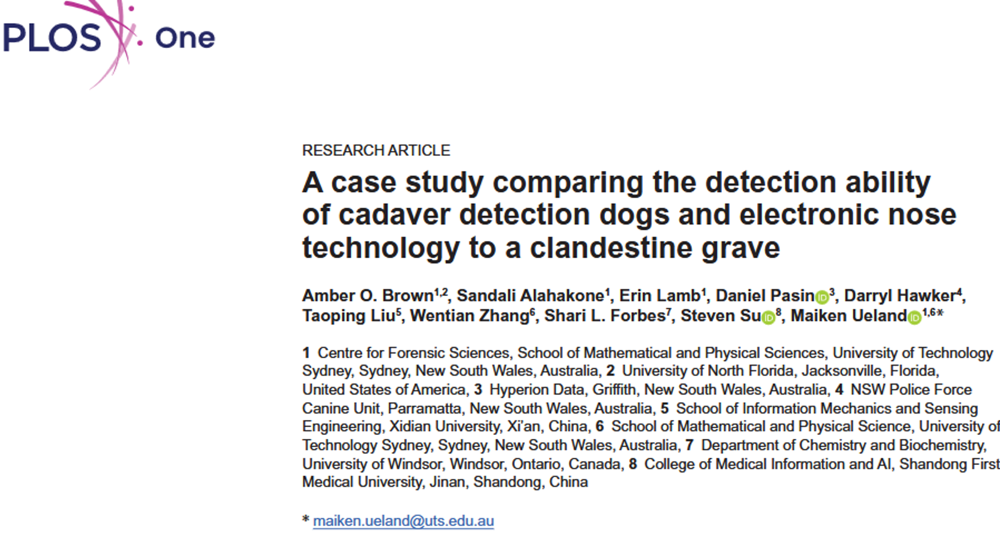

Parlons de : la comparaison des performances des technologies électroniques et des chiens spécialisés dans la détection de cadavres.

## Questions de recherche et objectifs 

Avez-vous déjà été confronté à l'**odeur d'un cadavre** ? Moi ? Eh bien ... oui et non : dans le cadre de mes études, j'ai eu l'opportunité d'assister à une autopsie. Mais (*heureusement je dirais*) la personne était décédée la veille et, l'autopsie le révèlera, de causes naturelles donc sans traumatismes impressionnants. Hormi l'odeur de la salle d'autopsie (la même que celle des hôpitaux, dûe à la stérilisation du matériel d'autopsie), je n'ai donc pas été confrontée à l'odeur de la mort en elle-même :face_exhaling:. Cette expérience me convaincra d'ailleurs que je préfère travailler sur les os :skull: plutôt que des cadavres plus ou moins putréfiés :zombie:.    
Cette odeur, décrite par celles.eux qui l'ont connu comme suffocante, s'explique par la <u>dégradation des tissus par les bactéries et les enzymes</u>, libérant des composés chimiques (aussi appelés *composés organiques volatiles* - **COV**). Toutefois, si le décès est récent, ou si le corps est isolé dans un environnement hermétique (par exemple sous terre), cette odeur peut être plus difficile à percevoir. En tout cas pour le nez humain !   
On peut en effet faire appel à nos amis les **toutous** :dog: dont le système olfactif est si développé qu'il est capable de détecter ces odeurs et peuvent ainsi aider à la détection de cadavres :zombie: (*DeGreeff et al. 2012*, *Rendine et al. 2019*, *Cablk et al. 2012*). Ce n'est toutefois pas le cas pour toutes les races de chien, et nécessite souvent un entrainement régulier.  
Plus récemment, des chercheurs ont développé un *nez électronique* (***NOS.E***) :robot: qui serait lui aussi capable de détecter ces COV associés à la décomposition du corps humain, principalement les composés azotés et soufrés ainsi que les alcools et les aldéhydes (*Brown et al. 2023*, *Karami et al. 2024*, *Sunnucks et al. 2024*).   
Même si l'efficacité des chiens de détection de cadavres :dog: n'est plus discutée, on manque de compréhension sur quels COV entrent spécifiquement en jeu dans cette détection, ou selon quelles concentrations. Or ces informations sont cruciales pour améliorer la formation de ces chiens experts, et assurer la crédibilité de leurs résultats devant le juge :woman_judge:.  

**Cette étude a donc eu pour objectif de comparer les résultats de détection de cadavres :zombie: entre des chiens formés :dog: et un nez électronique :robot:**.

## Une courte présentation de la méthode 

Pour mener cette étude, les auteurs n'ont pas attendu qu'un crime :police_officer: ait lieu ! Nop, ils ont eux-mêmes enterrés un <u>corps donné à la science</u>. La "tombe" a été creusée à environ 60 cm de profondeur et située à plus de 200 m de tout autre reste humain présent sur le site, puis oubliée pendant <u>3 mois</u> pour simuler un cas de personne disparue depuis longtemps :zombie:. Ensuite, le sol a été remué à différents endroits pour permettre à l'air de s'échapper, mimant l'activité des animaux dans un environnement naturel. Deux <u>"tombes" témoins</u> ont aussi été créées, cette fois sans cadavre enterré, mais où le sol a aussi été remué à différentes occasions : pour éviter que la détection des chiens ne soit basée que sur des indices visuels plutôt qu'olfactifs.  
Justement, parlons en de ces toutous :dog: ! 3 chiens de détection de cadavres ont participé à cette étude : 1 Labrador retriever et 2 Springer spaniel anglais. Ils ont visité le site à plusieurs reprise, étant chaque fois libérés de leur laisse à différents endroits. A noter qu'aucun des chiens n'avait déjà participé à la détection de restes humains enfouis, bien que l'un deux avait 6 ans d'expérience en termes de formation (contre 1 et 2 ans pour les deux autres chiens).    
En parallèle, les auteurs ont également parcouru le site avec leur nez électronique *NOS.E* :robot: et enregistré les fois où les capteurs ont détecté des alcools, des alcanes ou des composés azotés ou soufrés.  

Que ce soit pour les chiens ou le *NOS.E*, plusieurs séances de recherche ont été programmées : aux jours 98 (soit 3 mois après l'enfouissement du cadavre, qu'on nommera le moment M), puis à M+7jours, M+2semaines, M+1mois, M+7semaines et M+9semaines.     
Notons que cette étude a été réalisé en Australie, pendant l'hiver, où la température moyenne était alors de 13.4 °C. 

Enfin, les résultats des chiens et du *NOS.E* ont été comparés de la manière suivante : 

| Détection du chien :dog: | Détection du *NOS.E* :robot: | Résultat final |  
| :---: | :---: | :---: |  
| Oui | Oui | "Vrai positif" |  
| Oui | Non | "Faux positif" |  
| Non | Oui | "Faux négatif" |  
| Non | Non | "Vrai négatif" |  

## Résultats: la technologie en soutien plutôt qu'en remplacement 

Parlons d'abord des résultats du ***NOS.E*** :robot: : les capteurs liés à la détection des alcools et alcanes, de l'azote et du souffre ont été les plus réactifs, avec une évolution dans le temps. Ce qui est intéressant, c'est que des COV ont aussi été détectés au-dessus de la "tombe" témoin (c'est-à-dire celle ne contenant pas de corps), principalement des composés azotés et soufrés, probablement d'origine naturelle. Ce ne serait donc pas de bons indices pour la détection de cadavre.  
En ce qui concerne nos **chiens experts** :dog:, sans surprise, ils ont tous réussi à détecter la présence du cadavre. Ils ont systématiquement marqués dans une zone correspondant à la partie supérieure du torse des restes (c'est d'ailleurs aussi ici que les signaux de *NOS.E* étaient les plus forts). C'est assez logique quand on sait que cette région du corps comprend de nombreux organes, émettant donc davantage de volatiles lors de leur décomposition (*Brown et al. 2023*). Parmi les 3 chiens ayant participé à l'étude, celui avec le plus d'expérience n'a jamais produit de "faux positifs" :1st_place_medal: (c'est-à-dire détecter un corps alors que le *NOS.E* ne détectait aucun COV associé à la décomposition).   
Il faut toutefois mentionner le fait que les chiens (voire le *NOS.E*) ont été moins efficaces à détecter la présence du cadavre lorsque la terre n'avait pas été remuée au préalable.  

D'après la comparaison entre les résultats obtenus par les chiens et ceux du *NOS.E*, les auteurs parviennent à la conclusion que **c'est à la fois la présence et la seuil de concentration de certaines combinaisons de COV** (principalement celles du soufre et du nitrogène) **qui expliquent l'efficacité des chiens experts à détecter la présence de restes humains enfouis**.  

Ces premiers résultats prometteurs doivent maintenant être confirmés par une étude de plus grande envergure, en intégrant davantage de cadavres pour prendre en compte l'effet éventuel du poids, du sexe ou de l'âge de la personne décédée, le temps écoulé depuis le décès et l'enfouissement, mais aussi en considérant différents environnements ou conditions météorologiques. 

### :jigsaw: **Tout ce que cela signifie**

Finalement, plutôt que de proposer l'idée que la technologie puisse remplacer les chiens experts dans la détection de cadavres, cette étude démontre qu'elle permet de produire des données qui permettent de mieux comprendre les mécanismes en jeu. Cette compréhension permet de donner plus de pertinence aux résultats obtenus par les chiens, et d'ouvrir des pistes pour améliorer leur formation.  

---
---
---

> **Lire l'article**: Brown AO, Alahakone S, Lamb E, Pasin D, Hawker D, Liu T, et al. (2026) **A case study comparing the detection ability of cadaver detection dogs and electronic nose technology to a clandestine grave**. *PLoS One* 21(10): e0360233 (https://doi.org/10.1371/journal.pone.0360233)

> **Références mentionnées**:  
> - Brown A, Lamb E, Deo A, Pasin D, Liu T, Zhang W, et al. (2023) The use of novel electronic nose technology to locate missing persons for criminal investigations. *iScience*; 26(4):106353. 
> - Cablk ME, Szelagowski EE, Sagebiel JC. (2012) Characterization of the volatile organic compounds present in the headspace of decomposing animal remains, and compared with human remains. *Forensic Sci Int*; 220(1–3):118–25
> - DeGreeff LE, Weakley-Jones B, Furton KG. (2012) Creation of training aids for human remains detection canines utilizing a non-contact, dynamic airflow volatile concentration technique. *Forensic Sci Int*; 217(1–3):32–8. 
> - Karami H, Thurn B, de Boer NK, Ramos J, Covington JA, Lozano J, et al. (2024) Application of gas sensor technology to locate victims in mass disasters – a review. *Nat Hazards*; 121(1):31–60. 
> - Rendine M, Fiore C, Bertozzi G, De Carlo D, Filetti V, Fortarezza P, et al. (2019) Decomposing human blood: Canine detection odor signature and volatile organic compounds. *J Forensic Sci*; 64(2):587–92. 
> - Sunnucks EJ, Thurn B, Brown AO, Zhang W, Liu T, Forbes SL, et al. (2024) Performance of a novel electronic nose for the detection of volatile organic compounds relating to starvation or human decomposition post-mass disaster. *Sensors (Basel)*; 24(18):5918.

