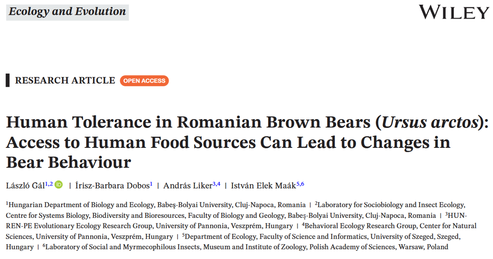

Parlons de: l'accessibilité aux déchets alimentaires contribue à réduire la méfiance des ours bruns envers leur environnement humain.  
 

## Question de recherche et objectifs 

En éthologie (*c'est-à-dire la science qui s'intéresse au comportement des animaux*), **l'habituation** correspond à une forme d'apprentissage où la réponse comportementale d'un specimen se modifie suite à l'exposition répétée à un stimulus (*Rankin et al. 2010*). C'est par exemple le cas lorsqu'on arrive à amadouer un chaton sauvage :cat2: en lui apportant régulièrement de la nourriture, jusqu'à ce qu'il devienne notre nouveau compagnon :face_holding_back_tears:. C'est aussi le cas lorsqu'on entraine des chiens :dog2: à reconnaitre certaines odeurs pour aider à la détection de cadavres :nose: (*je vous invite d'ailleurs à (re)découvrir un précédent post sur le sujet [ici](https://www.whatsupresearch.com/fr/d%C3%A9tection-de-cadavres-robots-versus-chiens/)* :wink:).  
Toutefois cette habituation peut mener à réduire la vigilance ou méfiance des animaux envers l'humain, et parfois aux dépends de la survie de l'espèce : si l'animal ne fuit plus face à la présence humaine, il risque de se faire chasser :bow_and_arrow:, d'attraper des maladies potentiellement mortelles :microbe: (par exemple, un groupe de gorilles de montagnes du parc touristique des Volcans, au Rwanda, a été infecté par le métapneumovirus humain, menant au décès de certains individus, *Palacios et al. 2011*), d'entrer en collision avec des véhicules :oncoming_automobile:, ...  
Cela étant dit, l'expansion croissante des infrastructures humaines dans les milieux naturels rend les interactions entre l'Homme et la faune sauvage de plus en plus inévitables.   

Il convient donc **d'évaluer les facteurs qui pourraient diminuer la vigilance et la méfiance des animaux envers leur environnement humain**. C'était l'objectif du présent papier, qui s'est plus particulièrement intéressé aux ours bruns :bear: (*Ursus arctos*).  

L'ours brun a malheureusement disparu de la plupart des pays européens du fait, justement, que nous avons étendu notre territoire sur le sien, voire l'avons persécuté ... (*je dis "on" mais c'était pas moi hein !*). Certaines régions, comme la Roumanie, ont quant à elles mis en place ces dernières décennies des mesures de conservation et de protection (*Bereczky et al. 2011*, *Stăncioiu et al. 2019*). C'est justement en Roumanie :romania:, et plus précisemment dans la ville de Băile Tușnad, qu'a été réalisé cette étude.  

## Une courte présentation de la méthode 

En Roumanie, la population d'ours bruns est estimé à plus de 6000 individus (*Pop et al. 2012*, *Popescu et al. 2017*). 
Băile Tușnad est la ville la moins peuplée du pays, et une destination touristique (*vous y avez déjà été ??* 👀). Située à 650 m d'altitude, elle est entourée de forêts denses :evergreen_tree: riches en ressources alimentaires naturelles pour l'ours brun. Ces derniers exploitent également les ressources d'origine humaine disponibles à proximité, notamment les cultures agricoles :ear_of_rice: et les arbres fruitiers. 

L'étude s'est ici concentrée à **observer le comportement des ours bruns :bear: à proximité de deux îlots de conteneurs à déchets :put_litter_in_its_place: situés en zone urbaine :houses:**.  
Ces conteneurs disposaient de structures métalliques anti-ours et étaient entourés de clôtures électriques. Le premier îlot était situé entre la lisière forestière et un bâtiment résidentiel; le second se trouvait à proximité de la forêt, d'un garage, de la gare ferroviaire et d'une habitation.   
Enfin, chaque îlot était bordé à l'arrière par une végétation dense (arbustes, arbres et hautes herbes), non éclairée par des lampadaires, pouvant constituer une zone de couvert pour les ours.  

L'activité des ours à proximité de ces îlots a été capturée au moyen de caméras de surveillance :video_camera: et les paramètres suivants ont été mesurés : 
- **le temps d'hésitation** :thinking:, soit l'intervalle de temps entre la première apparition d'un individu dans le champ de la caméra et son entrée dans l'espace des conteneurs (*dans quelle mesure l'ours évalue le risque avant d'aller se nourrir ?*)
- **le comportement de vigilance** :monocle_face:, soit le temps cumulé pendant lequel l'ours interrompt sa recherche de nourriture pour observer son environnement (*dans quelle mesure l'ours reste-t-il vigilant à d'éventuelles menaces ?*)
- **la durée de recherche alimentaire**, soit le temps consacré à chercher ou consommer de la nourriture, d'une part dans l'enclos même, et en dehors (*l'ours préfère-t-il accéder aux ressources en évitant les risques liés à l'entrée dans la zone ?*)

La disponibilité des déchets à l'extérieur des conteneurs ainsi que l'état d'activation des clôtures électriques ont également été prises en compte dans ces analyses.

## Résultats: piquer la nourriture des autres, une prise de risque réfléchie 

Les îlots ont été visités sur une période d'un an par 8 individus, auxquels les chercheurs ont donné de jolis noms : Igor (le seul mâle :male_sign:), Bonbon, Fánk et Pite (toutes des femelles :female_sign:, ayant chacune 3 petits :teddy_bear:), Berkenye (un ours subadulte), ainsi que Rozi (aussi une femelle :female_sign:) et ses 2 petits, Bounty et Snickers :teddy_bear: qui seront plus tard retrouvés sans leur mère :cry:.  
Excepté pour les 2 oursons orphelins, chaque ours venait seul visiter les conteneurs. Même dans le cas des mères accompagnées de leurs petits, ces derniers étaient généralement laissés dans un lieu sûr pendant que l'adulte cherchait de la nourriture.  

Au premier îlot, 179 visites ont été enregistrées. A noter qu'ici la clôture électrique n'a été active qu'un peu plus de 15% du temps - contre 40% pour le second îlot où seuls 32 visites d'ours ont été observées.  
La présence même de ces clôtures a eu toutefois pour effet d'augmenter dans tous les cas le temps d'hésitation.    
Dans la majorité des cas, les visites ont eu lieu pendant la nuit :last_quarter_moon_with_face: (surtout entre minuit et 4h du matin).  
Ces visites ont été moins nombreuses entre octobre et décembre, pour connaître plutôt un pic sur les mois d'été, ce qui correspond au mode de vie cyclique des ours bruns, avec notamment la période d'hibernation.  

A mesure que l'individu revenait sur le site, les chercheurs ont constaté une diminution des comportements d'hésitation et de vigilance, ainsi qu'une augmentation du temps à chercher de la nourriture, surtout si des déchets étaient présents autour des conteneurs. Autrement dit, **à mesure que les ours revenaient visiter les conteneurs, ils devenaient de plus en plus confiant, se préoccupant moins de leur avantage pour passer plus de temps à profiter de l'accès à la nourriture**. 

Les ours bruns sont donc prêt à risquer la rencontre avec des humains afin d'accéder à ces ressources alimentaires, pouvant parfois parcourir jusque 38km dans ce but, comme cela a été précédemment montré dans la littérature (*Rigg 2005*). En effet, les déchets alimentaires d'origine humaine constituent une source de nourriture non négligeable, tant sur le plan calorique que nutritionnel (*Elfström et al. 2014*).  

### :jigsaw: **Tout ce que cela signifie**

Finalement, cette étude a montré que l'exposition répétée aux environnements anthropisés, notamment lors de la recherche de nourriture dans les déchets, peut entraîner chez l'ours brun une diminution des comportements de vigilance et d'évitement, soit une augmentation de leur tolérance envers ces environnements urbains.  
Des mesures préventives simples comme l'installation de clôtures électriques et l'entretien des conteneurs pourraient aider à réduire le risque de confrontation entre les Hommes et les ours bruns.  

---
---
---

> **Pour découvrir l'article**: Gál L, Dobos Í-B, Liker A, and Maák IE. 2026. **Human Tolerance in Romanian Brown Bears (Ursus arctos): Access to Human Food Sources Can Lead to Changes in Bear Behaviour**. *Ecology and Evolution* 16, no. 11: e74359 (https://doi.org/10.1002/ece3.74359)

> **Liste des références citées**:  
> - Bereczky L, Pop M, and Chiriac S. 2011. Trouble-Making Brown Bear Ursus arctos Linnaeus, 1758 (Mammalia: Carnivora) – Behavioral Pattern Analysis of the Specialized Individuals. *Travaux Du Muséum National D'histoire Naturelle “Grigore Antipa”* 54: 541–554
> - Elfström M, Davey ML, Zedrosser A, et al. 2014. Do Scandinavian Brown Bears Approach Settlements to Obtain High- Quality Food? *Biological Conservation* 178: 128–135
> - Palacios G, Lowenstine LJ, Cranfield MR, et al. Human metapneumovirus infection in wild mountain gorillas, Rwanda. *Emerg Infect Dis*. 2011;17(4):711-3
> - Pop MI, Sallay A, Bereczky L, and Chiriac S. 2012. Land Use and Behavioral Patterns of Brown Bears in the South-Eastern Romanian Carpathian Mountains: A Case Study of Relocated and Rehabilitated Individuals. *Procedia Environmental Sciences* 14: 111–122
> - Popescu VD, Iosif R, Pop MI, Chiriac S, Bouroș G, and Furnas BJ. 2017. Integrating Sign Surveys and Telemetry Data for Estimating Brown Bear (Ursus arctos) Density in the Romanian Carpathians. *Ecology and Evolution* 7: 7134–7144
> - Rankin CH, Abrams T, Barry RJ, et al. Habituation revisited: an updated and revised description of the behavioral characteristics of habituation. *Neurobiol Learn Mem*. 2009;92(2):135-8
> - Rigg R. 2005. A Review of Studies on Brown Bear Ecology in Relation to Home Range, Habitat Selection, Activity Patterns, Social Organisation, Life Histories and Population Dynamics. *Oecologia Montana* 14: 47–59
> - Stăncioiu PT, Dutcă I, Bălăcescu MC, and Ungurean ŞV. 2019. Coexistence With Bears in Romania A Local Community Perspective. *Sustainability* 11: 7167

