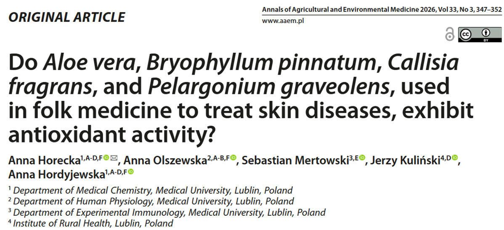
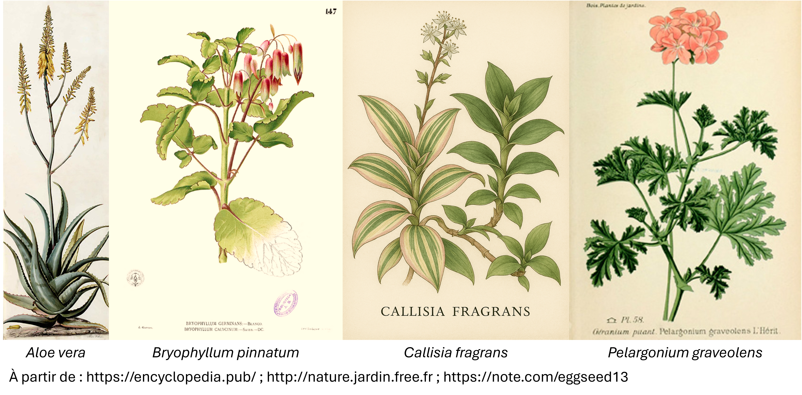

Parlons de : l'évaluation des présumés effets anti-oxidants de certaines plantes médicinales. 

## Question de recherche et objectifs 

Certaines plantes :herb: peuvent être utilisées en médecine du fait de leurs effets bénéfiques sur différentes maladies, comme remède homéopathique (*Sen & Samanta 2015*).   
Dans cette étude, une équipe de recherche polonaise a étudié les effets potentiellement protecteurs de **4 plantes spécifiques contre les maladies cutanées** :
- l'***Aloe vera***, l’une des plantes médicinales les plus connues, qui appartient à la famille des Asphodelaceae et pousse naturellement dans les régions tropicales. Elle contient de nombreux composés biologiquement actifs qui ont démontré des propriétés <u>anti-inflammatoires</u>, <u>antinéoplasiques</u> (*c’est-à-dire agissant contre les cellules cancéreuses*), <u>antifongiques</u> (*c’est-à-dire agissant contre les champignons responsables d’infections*) et <u>antimicrobiennes</u> (*Maan et al., 2018 ; Surjushe et al., 2008*).
- le ***Bryophyllum pinnatum***, qui appartient à la famille des Crassulaceae et est originaire de Madagascar. Elle est traditionnellement utilisée dans le traitement de <u>l’asthme, du diabète, de l’hypertension et de la diarrhée</u>, ainsi que pour <u>favoriser la cicatrisation des ulcères</u> (*Onoja et al., 2018*).
* le ***Callisia fragrans***, qui appartient à la famille des Commelinaceae et pousse naturellement au Mexique. Il a été rapporté que ses substances biologiquement actives peuvent agir contre <u>les virus de l’herpès</u> ou contribuer à <u>réduire la pression artérielle</u> (*Yarmolinsky et al., 2010 ; Le et al., 2022*).
* le ***Pelargonium graveolens*** (également appelé géranium odorant), qui appartient à la famille des Geraniaceae et est originaire d’Afrique du Sud. Il a été associé à des propriétés <u>antiallergiques, anti-inflammatoires, diurétiques et antidiabétiques</u> (*Martins et al., 2017*).

La peau contient de nombreux acides gras polyinsaturés, ce qui la rend particulièrement vulnérable à l’oxydation. Or, lorsqu'il y a oxidation, cela peut endommager les lipides, les protéines et l’ADN, affectant ainsi le collagène, les tissus cutanés et des cellules telles que les fibroblastes, qui jouent un rôle important dans le maintien d’une peau saine (*Ledwożyw et al., 1986 ; Mesquita et al., 2014 ; Koselski et al., 2017*). Ce processus est appelé **stress oxydatif** et peut donc contribuer au développement ou à la progression de certaines **maladies cutanées**.  
Plusieurs facteurs peuvent augmenter le risque de stress oxydatif, notamment l’exposition aux rayonnements ultraviolets (UV), aux champs électromagnétiques, aux rayons X, aux polluants chimiques, ainsi que certains facteurs liés à l’alimentation, aux médicaments, aux produits cosmétiques, à la consommation d’alcool, à la fumée de tabac et au stress psychologique (*Rinnerthaler et al., 2015*).

Compte tenu des propriétés biologiques rapportées pour les plantes 🌿 mentionnées précédemment, l’objectif de cette étude était d’évaluer leur potentielle capacité à protéger les cellules cutanées 🧫 contre le stress oxydatif et les dommages associés (*ou, pour le dire simplement, la question était se savoir si ces plantes possèdent des propriétés antioxydantes susceptibles d’aider à protéger les cellules de la peau contre certaines pathologies ?*).

## Une courte présentation de la méthodologie 

Pour atteindre leur objectif, les auteurs ont préparé des extraits des plantes :herb: à 3 concentrations 🧪 (*ou puissance*) différentes : 0.875 g/ml, 1.75 g/ml and 3.5 g/ml.  
Ils ont utilisé un modèle *in vitro* 🧫 (*ce qui veut dire que l'expérience a été réalisée **en dehors de l'organisme vivant**, dans des conditions contrôlées de laboratoire, et non directement sur l'animal ou l'être humain, comme dans les études <u>in vivo</u>*), à partir d'une lignée spécifique cellulaire de souris. Afin de reproduire un stress oxidatif, ces cellules ont été exposées à du peroxyde d’hydrogène (H2O2).  
Les chercheurs ont ensuite ajouté aux cellules différentes concentration de chacun des extraits de plantes et ont attendus 24h ⏱️ pour observer leur réaction au stress oxidatif induit.  

🔬 À la fin de l’expérience, les éventuelles propriétés anti-oxydantes des plantes testées ont été évaluées en mesurant la capacité anti-oxydante des cellules, ainsi que des marqueurs de l'oxydation des lipides et des protéines.  

## Résultats: attention à *Callisia fragrans* ! 

Les résultats de cette étude confirment les **effets antioxydants de l’*Aloe vera*, du *Bryophyllum pinnatum* et du *Pelargonium graveolens*** : après leur incubation avec les extraits de ces plantes médicinales 🌿, les paramètres du stress oxydatif mesurés dans les cellules ont diminué de manière significative. Ce résultat soutient donc leur utilisation potentielle dans le traitement des maladies cutanées.  
Il convient de noter que ces effets étaient <u>dépendants de la dose</u> : plus la concentration de l’extrait de plante était élevée, plus l’effet protecteur observé dans les cellules était important.  

En revanche, un résultat surprenant a été obtenu avec le *Callisia fragrans* qui, au lieu de protéger les cellules contre le stress oxydatif, n’a montré aucun effet antioxydant significatif voire pourrait même avoir produit l’effet inverse: un **effet pro-oxydant**.  
Ce résultat pourrait s’expliquer par la présence de composés dans la plante (*comme les polyphénols et les flavonoïdes, s'il faut vraiment sortir les grands mots :p*), qui, en fonction de certaines conditions, peuvent soit contribuer à neutraliser les espèces réactives de l’oxygène, soit, au contraire, favoriser leur formation (*Eghbaliferiz & Iranshahi, 2016*).

Il ne faut toutefois pas oublier que ces résultats proviennent d’une étude *in vitro*. Ils ne permettent donc pas, à eux seuls, d’établir directement l’efficacité thérapeutique ou l’innocuité de ces plantes chez <u>l’être humain</u>. Des études supplémentaires sont nécessaires. 

### :jigsaw: **Tout ce que cela signifie**

La conclusion sera assez courte et simple : 
- l'*Aloe vera*, le *Bryophyllum pinnatum* et le *Pelargonium graveolens* ont montré des effets antioxydants prometteurs.
- le *Callisia fragrans* a donné un résultat très différent, ce qui soulève des questions quant à son utilisation potentielle dans le domaine des applications thérapeutiques dans le domaine des pathologies cutanées.

En résumé, le message essentiel est assez simple : ***naturel*** ne signifie pas automatiquement ***bénéfique***.
Alors, oui : prudence avec ce que vous appliquez sur votre peau !
  
---
---
---

Avant de se quitter, je vous propose de voter pour le thème du prochain article que vous souhaitez que je déchiffre pour vous :  

<iframe title="StrawPoll Embed" id="strawpoll_iframe_Dwyo3x4KxyA" src="https://strawpoll.com/embed/Dwyo3x4KxyA" style="position: static; visibility: visible; display: block; width: 100%; flex-grow: 1;" frameborder="0" allowfullscreen allowtransparency>Loading...</iframe>

---
---
---
  
> **Pour lire l'article** : Horecka, A., Olszewska, A., Mertowski, S., Kuliński, J. & Hordyjewska, A. (2026) **Do Aloe vera, Bryophyllum pinnatum, Callisia fragrans, and Pelargonium graveolens, used in folk medicine to treat skin diseases, exhibit antioxidant activity?** *Ann Agric Environ Med*, 33(3), 347–352. (https://doi.org/10.26444/aaem/216269).

> **Les références mentionnées** :  
> - Eghbaliferiz S, Iranshahi M. 2016. Prooxidant Activity of Polyphenols, Flavonoids, Anthocyanins and Carotenoids: Updated Review of Mechanisms and Catalyzing Metals. *Phytother Res* 9:1379–1391 (doi:10.1002/ptr.5643)
> - Koselski M, Olszewska A, Hordyjewska A, et al. 2017. Three Types of Ion Channels in the Cell Membrane of Mouse Fibroblasts. *Physiol Res* 66(1):63–73 (doi:10.33549/physiolres.933358)
> - Le XT, Thi Nguyen LT, Nguyen PT, et al. 2022. Anti-hypertensive effects of Callisia fragrans extract on Reno-vascular hypertensive rats. *Clin Exp Hypertens* 44(5):411–418 (doi:10.1080/10641963.2022.2065286)
> - Ledwożyw A, Michalak J, Stępień A, et al. 1986. The relationships between plasma triglycerides, cholesterol, total lipids and lipid peroxidation products during human atherosclerosis. *Clin Chim Acta*  155(3):275–83 (doi:10.1016/0009-8981(86)90247-0)
> - Maan AA, Nazir A, Khan MKI, et al. 2018. The therapeutic properties and applications of Aloe vera: A review. *J Herb Med* 12:1–10 (doi:10.1016/j.hermed.2018.01.002)
> - Martins CAF, Campos ML, Irioda AC, et al. 2017. Anti-Inflammatory Effect of Malva sylvestris, Sida cordifolia, and Pelargonium graveolens Is Related to Inhibition of Prostanoid Production. *Molecules* 22(11):1883 (doi:10.3390/molecules22111883)
> - Mesquita CS, Oliveira R, Bento F, et al. 2014. Simplified 2,4-dinitrophenyl-hydrazine spectrophotometric assay for quantification of carbonyls in oxidized proteins. *Anal Biochem* 1:458:69–71 (doi:10.1016/j.ab.2014.04.034)
> - Onoja SO, Ihejirika GQ, Nwankudu ON, et al. 2018. Antidiarrheal and Antioxidant Activities of Methanol Extract of Bryophyllum pinnatum Leaf Harvested from South-Eastern Nigeria in Mice. *J Pharm* 6810620 (doi:10.1155/2018/6810620)
> - Rinnerthaler M, Bischof J, Streubel MK, et al. 2015. Oxidative stress in aging human skin. *Biomolecules* 5(2):545–89 (doi:10.3390/biom5020545)
> - Sen T, Samanta SK. 2015. Medicinal plants, human health and biodiversity: a broad review. *Adv Biochem Eng Biotechnol* 147:59–110 (doi:10.1007/10_2014_273)
> - Surjushe A, Vasani R, Saple DG. 2008. Aloe vera: a short review. *Indian J Dermatol* 53(4):163–6 (doi:10.4103/0019-5154.44785)
> - Yarmolinsky L, Zaccai M, Ben-Shabat S, et al. 2010.  Anti-Herpetic Activity of Callissia fragrans and Simmondsia chinensis Leaf Extracts In Vitro. *Open Virol J* 11;4:57–62 (doi:10.2174/1874357901004010057)

