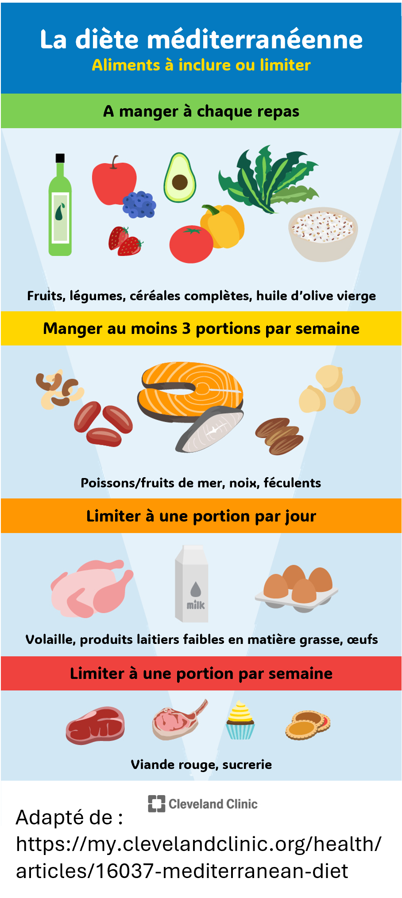

Parlons de : comment votre alimentation joue un rôle dans l'incidence des maladies inflammatoires chroniques.

## Question de recherche et objectifs 

Cette étude a exploré l'association qui peut exister entre le **régime méditerranéen** (qu'on appelera désormais la **MedDiet**) :plate_with_cutlery: et le risque de développer une maladie autoimmune, en se concentrant sur deux d'entre elles en particulier : 
- **La polyarthrite rhumatoïde** :bone:, une maladie chronique qui cause une inflammation dans le corps, surtout dans les articulations et tissus environnants, au point où les mouvements associés à des activités du quotidien comme écrire, tenir un objet ou marche, devient limité ou douloureux. Si laissé sans traitement, cette maladie peut également atteindre d'autres organes comme le coeur, les poumons ou le système nerveux. En 2019, If left untreated, it can also affect other organs including the heart, lung and nervous system. In 2019, La polyarthrite rhumatoïde affectait environ 18 millions de personnes dans le monde, touchant surtout les femmes et les soixantenaires (*GDB 2019*). 
- **Le psoriasis** :red_circle:, une autre maladie inflammatoire chronique, qui touche surtout la peau, et reconnue comme une maladie non transmissible (MNT – c'est-à-dire une maladie grave qui ne se transmet pas d'une personne à une autre) entraînant une défiguration et un handicap graves. Les modifications visibles de la peau causées par la maladie ont un impact significatif sur l'état physique, émotionnel et social du patient, impactant de manière significative sa qualité de vie. Bien qu'il n'existe actuellement aucune manière de soigner le psoriasis, les traitements actuels peuvent aider à contrôler ses symptômes et les potentielles comorbiditées qui lui sont associées. Environ 60 millions dans le monde seraient affectés par cette maladie, avec de plus fortes prévalences rapportées dans les zones à fort revenu et les populations plus âgées (*WHO 2016*, *Parisi et al. 2020*).  

Dans ces deux pathologies, la régulation du système immunitaire est perturbée, ce qui conduit celui-ci à attaquer par erreur les propres tissus de l'organisme. Ce dérèglement peut bien sûr être influencé par la génétique, mais il est également connu que des facteurs environnementaux ou liés au style de vie, particulièrement les <u>habitudes alimentaires</u>, jouent aussi un rôle important (*Maydani et al. 2020*).  

L'alimentation moderne est principalement composée <u>d'aliments utra-transformés, des graisses saturées et des sucres rafinés</u>, qui sont connus pour perturber l'équilibre de la flore intestinale et affaiblir la barrière protectrice de l'intestin, ce qui pourrait augmenter le risque d'inflammation (*Manzel et al. 2014*, *Rondinella et al. 2026*).  
On pourrait donc supposer qu'une alimentation qui met davantage en avant des <u>aliments d'origine végétale peu transformés</u> seraient associés à une plus faible incidence de ces pathologies inflammatoires.  

Le **régime méditerranéen** est une de ces formes de régime alimentaire apparemment sain. Comme son nom l'indique, la MedDiet s'inspire des habitudes alimentaires traditionnelles des populations vivant autour de la mer Méditerranée. Malgré des variations d'un pays à l'autre dues à des différences culturelles, ethniques, religieuses, économiques ou géographiques, tous ces régimes méditerranéens partagent certaines caractéristiques communes, tels que : 
- De grands apports en légumes :carrot: et fruits :apple:, céréales complètes :baguette_bread:, et d'huile d'olive :olive:;
- La consommation régulière de poisson :fish:;
- Des apports réduits à modérés en viande :meat_on_bone: et produits laitiers :cheese:;
- Une consommation vraiment limitée de produits transformés :hamburger: ou sucrés :candy:.

Il existe déjà un certain nombre de preuves démontrant les effets positifs de la MedDiet sur la santé (certaines d'entre elles étant citées dans l'étude, je vous invite donc à jeter un coup d'oeil à l'article complet si ça vous intéresse *voir le lien en bas de page*). Toutefois, la plupart des précédentes études n'utilise par de <u>cohorts longitudinales</u> (c'est-à-dire des données collectées chez des individus suivis sur une longue période de temps). De plus, parce que la MedDiet est généralement considérée dans sa globalité, <u>la contribution spécifique des composants individels</u> n'est pas totalement compris.  

Pour résumer, l'objectif de cette étude a donc été d'explorer si l'incidence de la polyarthrite rhumatoïde :bone: et du psoriasis :red_circle: est potentiellement plus basse chez les personnes ayant suivi la MedDiet :plate_with_cutlery: sur plusieurs années. Les auteurs ont également cherché à identifier quels groupes d'aliments pourraient expliquer le mieux cette réduction de risque.  

## Une courte présentation de la méthode 

L'étude a impliqué des participants du *Projet SUN*. Il s'agit d'une cohorte :busts_in_silhouette: prospective et dynamique (toujours en cours) établie en 1999 pour explorer l'impact de la nutrition et du style de vie sur le développement de pathologies chroniques, en recrutant des alumni d'universités espagnoles :mortar_board: (*et gardons ce critère de recrutement en tête pour plus tard*).  
Pour cette étude, les auteurs ont exclus les participants qui avaient été suivi sur moins de 2 ans, ainsi que ceux qui avaient déjà une polyarthrite rhumatoïde, un psoriasis, un vitiligo (une autre maladie de la peau autoimmune, inflammatoire et chronique), un cancer, du diabète ou une maladie cardiovasculaire au cours des 2 premières années de leur suivi. L'échantillon final a ainsi inclut  **15,874 participants** (seulement ! :stuck_out_tongue_winking_eye:), qui ont été suivi sur une période moyenne de **15.1 ans**.

Au recrutement, les participants ont fourni des informations détaillées concernant des variables potentiellement confondantes (c'est-à-dire des variables susceptibles d'introduire un biais dans la relation étudiée, car elles sont liées à la fois à l'exposition et au résultat) : 
- Leur <u> profil sociodémographique</u>: âge, sexe, niveau d'éducation (années d'école) et IMC.
- Leurs <u>antécédents médicaux</u> en termes de stress, anxiété, dépression et d'autres pathologies chroniques. 
- Leur <u>style de vie</u>: s'ils sont fumeurs, le niveau d'activité physique pratiqué chaque semaine, le comportement sédentaire (évalué selon s'ils regardaient la TV pendant plus de 2h chaque jour), la durée de sommeil (<6, 6-8 ou >8h par nuit) et le temps moyen consacré à prendre le soleil.
- Certaines de leurs <u>habitudes alimentaires</u>, notamment la consommation d'alcool (grammes/jour), l'apport énergétique total (kcal/jour), le fait de suivre ou non un régime alimentaire particulier et l'habitude de grignoter entre les repas.  

Des modifications dans le style de vie et l'émergence de nouveaux diagnostics cliniques ont ensuite été évalués tous les deux ans, et l'alimentation a été évalué lors du suivi à 10 et 20 ans.  
Enfin, les chercheurs ont évalué dans quelle mesure chaque participant suivait le régime méditerranéen à l'aide du ***Mediterranean Diet Score*** (MDS). Un score élevé indiquait une meilleure adhésion au régime. Les participants ont ensuite été répartis dans les catégories T1, T2 et T3 (correspondant respectivement au niveau d'adhésion le plus faible, intermédiaire et le plus élevé).

## Resultats: que de bonnes choses dans l'assiette ! 

D'abord le plus intéressant : **les participants qui adhèrent le plus fortement à la MedDiet :plate_with_cutlery: ont moins de risque de développer une polyarthrite rhumatoïde :bone: ou un psoriasis :red_circle:**.  

Pour la polyarthrite rhumatoïde :bone:, la différence était particulièrement remarquable puisque le risque de développer la maladie était <u>réduit de moitié</u> chez les participants avec la plus forte adhésion à la MedDiet en comparaison avec ceux qui présentaient la plus faible adhésion.  
Une réduction similaire dans le risque de développer un psoriasis :red_circle: a été observé chez les partipants avec la plus forte adhésion à la MedDiet, bien que les résultats soient cette fois-ci <u>non significatifs statistiquement</u> (ce qui veut dire que les auteurs ne peuvent pas exclure la possibilité que ce résultat soit uniquement due à la chance et pourrait donc être appliqué à la population générale).  

Il convient de noter que ces participants qui présentaient les scores MDS les plus élevés avaient également tendance à adopter <u>des comportements sains</u> : ils étaient plus actifs physiquement, moins susceptibles d’être des fumeurs et évitaient plus souvent de grignoter entre les repas que les participants ayant des scores MDS plus faibles. Toutefois, ils <u>consommaient également plus d’alcool</u> (*mais ce serait aller un peu vite en besogne que d’affirmer que la consommation d’alcool est bénéfique pour la santé* :woozy_face:). Ces différences sont importantes, car on pourrait supposer qu'elles pourraient également influencer le risque de développer une maladie (*une hypothèse testée et vérifiée, comme nous le verrons plus loin* :arrow_heading_down:).  
Comme indiqué dans l'introduction, la polyarthrite rhumatoïde et le psoriasis sont plus fréquents chez les personnes âgées. Pourtant, dans cette étude, les participants présentant la plus forte adhésion au régime méditerranéen — et donc les taux d'incidence les plus faibles de polyarthrite rhumatoïde et de psoriasis — étaient <u>plus âgés</u> que les participants ayant un score MDS plus faible, avec un âge moyen de 40,3 ans.  

Ce qui est aussi intéressant, c'est que ce lien entre l'adhésion au régime méditerranéen et la réduction du risque de développer les maladies auto-immunes et inflammatoires chroniques étudiées ne semble pas être influencé par l’une ou l’autre de ces caractéristiques spécifiques. **En d’autres termes, quels que soient votre âge, votre sexe ou votre mode de vie, plus vous suivez strictement le régime méditerranéen, moins vous risquez d’être atteint de polyarthrite rhumatoïde ou de psoriasis.**

Aucun aliment en particulier ne semblait expliquer au mieux ce lien avec les taux d’incidence des maladies, ce qui suggèrerait que **c’est le régime alimentaire dans sa globalité qui serait le plus important**. Néanmoins, les auteurs ont constaté que les participants présentant un risque plus faible de polyarthrite rhumatoïde ou de psoriasis avaient tendance à consommer davantage de fruits, de noix et de légumes, tout en consommant moins de viande.  
Ce résultat n'est pas surprenant puisqu'il a déjà été démontré que <u>les aliments d'origine végétale</u> sont riches en polyphénols et en antioxydants susceptibles de contribuer à réguler l'inflammation dans l'organisme (*Martínez-González et al. 2003*, *Martínez-González et al. 2014*). Au contraire, certaines substances présentes dans <u>les viandes rouges et les viandes transformées</u> ont été quant à elles associées à des réponses inflammatoires systémiques (*Libera et al. 2021*).  

Malgré la grande qualité de cette étude, notamment dans le fait qu'elle inclut un très grand échantillon ainsi qu'un grand nombre de potentielles variables confondantes, une limitation soulevée par les auteurs doit toutefois être gardée à l'esprit : tous les participants étaient des diplômés d'université, et plus de la moitié d'entre eux travaillaient dans le secteur de la santé. Si cela a sans doute amélioré la qualité de leurs réponses au questionnaire, cela pourrait également limiter à quel point ces résultats seraient valables pour des personnes ayant des niveaux d'éducation ou des origines socio-économiques différents. Dans le futur, des études impliquant des participants plus diversifiés sont donc nécessaires pour déterminer si ces résultats s'appliquent à une population plus large.  

### :jigsaw: **Tout ce que cela signifie**

La conclusion est plutôt simple : **la santé est dans l'assiette !** Soyez conscient de ce que vous mangez, puisque votre alimentation a une grande influence sur votre santé. Nous savions déjà que notre alimentation peut contribuer au développement de certaines pathologiques, mais ce que cette étude nous apprend, c'est qu'elle peut également aider à réduire le risque que d'autres se développent.  
En effet, le principal résultat de cette étude est que suivre un régime méditerranéen :plate_with_cutlery: contribue à réduire l'incidence de deux maladies chroniques spécifiques, à caractère auto-immunitaire et inflammatoire (la polyarthrite rhumatoïde et le psoriasis). Plus précisément, augmentez votre consommation de fruits et de noix et réduisez votre consommation de viande (ce qui sera d'ailleurs bénéfique tant pour votre santé :sparkling_heart: que pour la planète :earth_africa: ^^)  
Sur ce, bon appétit !! :yum:
  
---
---
---
  
  
> **Lire l'article**: Menezes-Júnior L, Martinez-Gonzalez MA, Bullón-Vela V, González-Cantero Á, Martin-Gorgojo A, Bes-Rastrollo M (2026) **Long-term adherence to the Mediterranean Diet and risk of rheumatoid arthritis and psoriasis: 20-year follow-up of the SUN project.** *Am J Clin Nutr* 101511 (https://doi.org/10.1016/j.ajcnut.2026.101511).

> **Autres références mentionnées**:  
> - https://www.health.harvard.edu/healthy-aging-and-longevity/guide-to-the-mediterranean-diet
> - Global burden of 369 diseases and injuries in 204 countries and territories, 1990–2019: a systematic analysis for the Global Burden of Disease Study 2019. (https://vizhub.healthdata.org/gbd-results/)
> - Libera J, Iłowiecka K, Stasiak D. 2021. Consumption of processed red meat and its impact on human health: a review. *Int J Food Sci Technol* 56(12):6115–23
> - Manzel A, Muller DN, Hafler DA, Erdman SE, Linker RA, Kleinewietfeld M. 2014. Role of “Western diet” in inflammatory autoimmune diseases. *Curr Allergy Asthma Rep* 14(1):404
> - Martínez-González MA, Alonso A, Fernández-Jarne E, De Irala J. 2003. What is protective in the Mediterranean diet? *Atherosclerosis* 166(2):405–7
> - Martinez-Gonzalez MA, Bes-Rastrollo M. 2003. Dietary patterns, Mediterranean diet, and cardiovascular disease. *Curr Opin Lipidol* 25(1):20–6.483
> - Meydani SN, Guo W, Han SN, Wu D. 2020. Nutrition and autoimmune diseases. In: Present Knowledge in Nutrition: Clinical and Applied Topics in Nutrition. 11th ed.Elsevier; 549–68
> - Parisi R, Iskandar IYK, Kontopantelis E, et al. 2020. National, regional, and worldwide epidemiology of psoriasis: Systematic analysis and modelling study. *BMJ* 369:m1590 
> - Rondinella D, Margarita E, Raoul PC, Galli FS, Severino A, Porcari S, Mele MC, Gasbarrini A, Cammarota G, Rinninella E, et al. 2026. The impact of diet on gut microbiome composition: Implications for immune-mediated diseases. *Clin Immunol Commun* 9:1–11

