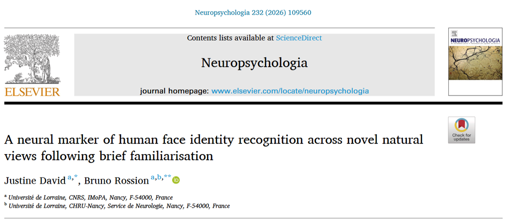

Parlons de: l'identification des marqueurs neurologiques en jeu dans la reconnaissance de visages familiers.  
 

## Question de recherche et objectifs 

Êtes-vous quelqu'un de **physionomiste** ou souffrez-vous de **prosopagnosie** (trouble neurologique aussi appelé "*cécité faciale*" qui se caractérise par l'incapacité à reconnaître ou à mémoriser les visages humains, y compris ceux de ses proches ou son propre reflet dans le miroir) ?  D'après l'étude de *Jenkins et al. 2018*, les adultes neurotypiques seraient capables de reconnaitre une centaine de visages. Un chiffre assez impressionnant quand on considère que ces visages sont rencontrés dans différents environnements et qu'une même personne peut se présenter de différentes manières (par exemple, une autre coupe de cheveux, de profil ou de face, avec une expression de joie ou de colère, ...).  
C'est parce que cette compétence de **reconnaissance faciale** 🙂😎🤓🥸 est intrigante que des chercheurs ont cherché à mieux comprendre quels sont les mécanismes neurologiques :brain: en jeu. 

## Une courte présentation de la méthode 

Pour investiguer cette question, les auteurs ont mis en place une étude expérimentale sur volontaires, en l'occurrence 28 adultes (principalement des femmes ♀️) sans troubles neurologiques.  

Les participants ont été soumis à une expérimentation qui s'est découpée en deux grandes étapes : 
- une première étape dite de <u>familiarisation</u> ou d'<u>apprentissage</u> d'une durée de **7 minutes** au cours de laquelle les participants apprenaient un set ciblé de 3 visages grâce à une association sémantique : chaque visage était associé à un prénom, un métier et un trait de caractère.  
- ensuite, une étape dite de <u>**stimulation visuelle périodique rapide**</u> (*Adrian & Matthews 1934*, *Regan 1966*). Lors de cette étape, un succession de visages inconnus défilaient rapidement sur un écran, selon un rythme régulier de 6 images par seconde. Toutes les 5 images, apparaissait l'un des visage auxquels les volontaires avaient été préalablement familiarisés. De cette manière, les auteurs ont été capable d'associer une réaction particulière du cerveau à la visualisation d'un visage familier. Cette méthode permet de ne pas dépendre uniquement des réponses verbales du participant et donc de proposer une mesure objective de la reconnaissance faciale.   
Pendant cette deuxième étape de l'expérimentation, <u>l'activité cérébrale</u> des volontaires a été enregistrée au moyen d'un **électroencéphalogramme** (EEG). Les <u>mouvements des yeux</u> ont également été capté via un **électro-oculopramme** (EOG), permettant de s'assurer que le regard était toujours porté sur le visage, présenté au centre de l'écran.  

A noter que tous les visages présentés étaient ceux d'individus caucasiens du sexe masculin ♂️ (*des mâles blancs quoi*) qui ne sont pas des célébrités connues des français. Pour chaque visage, plusieurs clichés étaient présentés, variant en terme d'angle de prise de vue, d'expression, d'éclairage, de l'orientation du visage et de l'arrière-plan.   
A noter également que les participants n'étaient pas informé que les personnes qu'ils avaient appris à reconnaitre pendant la phase de familiarisation allaient réapparaitre dans la séquence de stimulation visuelle rapide. Les auteurs sont même allé plus loin en détournant les volontaires de l'objectif réel de l'étude puisqu'il leur était demandé d'effectuer une petite tâche de détection visuelle : indiquer lorsque les barres verticales encadrant le visage changeaient simultanément de couleur. 

Finalement, les chercheurs ont réalisé une <u>analyse fréquentielle des signaux cérébraux</u> afin d'identifier les réponses associées à la fréquence de présentation des visages familiarisés. Ces réponses cérébrales ont été comparées à celles obtenues pour les visages inconnus, auxquels les participants n'avaient pas été préalablement familiarisés. 

## Résultats: une familiarisation brève suffit à façonner la reconnaissance faciale 

Des <u>pics</u> ont été clairement distingués dans l'enregistrement EEG aux harmoniques de 1,2 Hz, soit au moment où les visages familiers apparaissaient à l'écran, avec une activité principalement localisée dans les <u>régions occipito-temporales du cerveau</u> (*soit à l'arrière et sur les côtés du cerveau, une région qui joue un rôle important dans le traitement des informations visuelles*).  
**Ces résultats démontrent la compétence du cerveau à reconnaitre des visages auxquels il a été préalablement familiarisé, bien que de manière rapide (moins de 10 min) et même si ces visages présentaient quelques différences avec ceux présentés lors de la période d'apprentissage (différentes orientations, expressions, arrière-plans, ...).**  

Bien que cette capacité de reconnaissance faciale soit déjà documentée dans la littérature, cette étude apporte plusieurs nouvelles contributions méthodologiques : 
- les auteurs ont proposé une méthode objective pour la caractériser, fondée sur <u>la stimulation visuelle périodique rapide</u>.
- ils ont montré que cette capacité peut être démontrée après une <u>courte période de familiarisation</u> (7 min), contre 40 min chez *Kaufmann et al 2009*, 2,5 h chez *Herzmann & Sommer 2010* ou même 2 mois chez *Campbell & Tanaka 2021*.
- les auteurs ont présenté <u>différentes configurations de visages</u> pour une même identité à chaque participant, alors que dans les précédentes études, soit seule une photo par identité était testée (*Paller et al 2000*, *Schulz et al 2012*, *Tanaka et al 2006*), soit la même configuration de visage entre la période de familiarisation et celle de test (*Paller et al 2000*, *Tanaka et al 2006*, *Herzmann & Sommer 2010*). 

### :jigsaw: **Tout ce que cela signifie**

Si reconnaître un visage nous semble intuitif, comprendre précisément comment notre cerveau y parvient reste un défi scientifique passionnant. En explorant les mécanismes cérébraux de cette capacité, les chercheurs ne cherchent pas seulement à comprendre comment nous reconnaissons les autres : ils cherchent aussi à percer certains des secrets les mieux gardés de notre cerveau.

---
---
---

> **Pour découvrir l'article**: David J, Rossion B (2026) **A neural marker of human face identity recognition across novel natural views following brief familiarisation**. *Neuropsychologia* 232: 109560 (https://doi.org/10.1016/j.neuropsychologia.2026.109560)

> **Liste des références citées**:  
> - Adrian, E.D., Matthews, B.H.C., 1934. The berger rhythm : potential changes from the occipital lobes in man. *Brain: J Neurol*. 57, 355–385
> - Jenkins, R., Dowsett, A.J., Burton, A.M., 2018. How many faces do people know? *Proc Biol Sci*. 285 (1888), 20181319
> - Regan, D., 1966. Some characteristics of average steady-state and transient responses evoked by modulated light. *Electroencephalography and Clinical Neurophysiology* 20 (3), 238–248
> - Kaufmann, J.M., Schweinberger, S.R., Burton, A.M., 2009. N250 ERP correlates of the acquisition of face representations across different images. *J Cognit Neurosci*. 21 (4), 625–641
> - Herzmann, G., Sommer, W., 2010. Effects of previous experience and associated knowledge on retrieval processes of faces : an ERP investigation of newly learned faces. *Brain Res*. 1356, 54–72
> - Campbell, A., Tanaka, J.W., 2021. When a stranger becomes a friend : measuring the neural correlates of real-world face familiarisation. *Vis Cogn*. 29 (10), 689–707
> - Paller, K.A., Gonsalves, B., Grabowecky, M., Bozic, V.S., Yamada, S., 2000. Electrophysiological correlates of recollecting faces of known and unknown individuals. *Neuroimage* 11 (2), 98–110
> - Schulz, C., Kaufmann, J.M., Kurt, A., Schweinberger, S.R., 2012. Faces forming traces : neurophysiological correlates of learning naturally distinctive and caricatured faces. *Neuroimage* 63 (1), 491–500
> - Tanaka, J.W., Curran, T., Porterfield, A.L., Collins, D., 2006. Activation of preexisting and acquired face representations : the N250 event-related potential as an index of face familiarity. *J Cognit Neurosci*. 18 (9), 1488–1497

