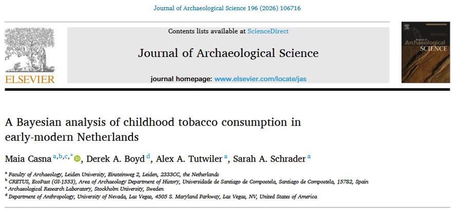
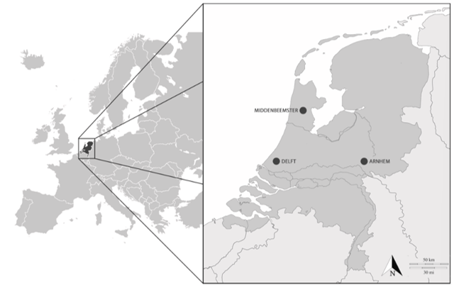
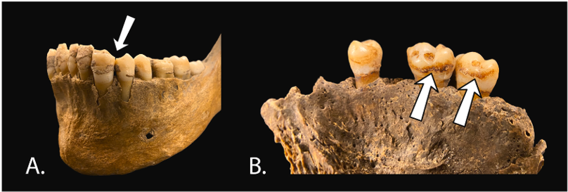

Parlons de: l'analyse de restes osseux d'individus non-adultes datant de la période post-médiévale néerlandaise pour attester de leurs habitudes de fumeur.  
 

## Question de recherche et objectifs 

On sait aujourd'hui que le tabagisme :smoking: endommage quasi tous les organes du corps humain et entraîne chaque année la mort de plus de 7 millions de personnes. Il existe d'ailleurs de nombreuses campagnes visant à encourager l'arrêt du tabac, voire à prévenir l'initiation au tabagisme. Pourtant, on estime encore à **plus d'un milliard le nombre de fumeurs dans le monde**. Les enfants, les adolescents et les jeunes adultes sont particulièrement vulnérables aux effets du tabagisme sur la santé : la nicotine affecte le développement de leur cerveau, favorise une dépendance à long terme et augmente les risques cardiovasculaires (source : [OMS](https://www.who.int/news-room/fact-sheets/detail/tobacco) ; *Hafström et al. 2005*, *Patel 1999*, *Gibbs et al. 2016*, *McGrath-Morrow et al. 2020*, *Thomson et al. 2020*).  
Le tabac (*Nicotiana tabacum* et *Nicotiana rustica* de son nom latin) est une plante originaire des Amériques, dont la culture remonterait à environ 5000–3000 av. J.-C. Son introduction en Europe date du **XVIe siècle**, après sa découverte par Christophe Colomb et son équipage lors de leur arrivée aux Bahamas et à Cuba (*Musk et de Klerk 2003*). **L'usage du tabac dans les sociétés anciennes est aujourd'hui bien documenté** grâce à une grande diversité de sources : les documents historiques (*Goodman 2005*, *Snelders 2021*), la culture matérielle (par exemple, les tabatières et les pipes, voir *McShane 2021*), l'analyse macroscopique des restes squelettiques humains (*Casna et al. 2024*), ainsi que les données biomoléculaires permettant de détecter des résidus de nicotine dans les os et les dents (*Badillo-Sanchez et al. 2023*, *Bartholdy et al. 2024*).

**Cette étude a souhaité apporter sa pièce du puzzle :jigsaw: en s'intéressant à un groupe social jusqu'ici mis de côté des études consacrées aux pratiques du tabagisme : les individus non adultes.**  
Pour les périodes plus récentes, comme le XXe siècle, nous savons déjà que le tabagisme chez les enfants était une pratique relativement courante et qui n'était pas encore condamnée (que ce soit moralement ou légalement). En effet, un rapport publié en 1914 par l'*Association des enseignants néerlandais* indiquait que la <u>moitié des enfants scolarisés dans le primaire consommaient du tabac</u> (*BvNO 1914*), et plusieurs publications contemporaines témoignent de l'attention portée à ce phénomène (par exemple, *Le Rütte 1917*, *Van Berken 1914*).  

Mais qu'en était-il dans les **Pays-Bas de l'époque post-médiévale** (soit entre le XVIIe et le XIXe siècle) ?

## Une courte présentation de la méthode 

Les restes osseux étudiés proviennent de **trois sites** : *Arnhem* (Eusebiuskerk), *Delft* (Nieuwe Kerk) et *Middenbeemster* (Keyserkerk) — *des noms de villes plus faciles à écrire qu'à prononcer* 😅 !  
Bien que ces trois sites soient tous datés de la même période chronologique (entre 1624 et 1850), ils représentent différentes régions des **Pays-Bas** :netherlands:, ainsi que des environnements de vie et des contextes socio-économiques distincts (voir respectivement la carte ci-dessous, extraite de l'article, et le tableau suivant).

| Site :pushpin: | Période chronologique :spiral_calendar: | Environnement de vie :cityscape: | Status socioéconomique :moneybag:
| :--- | :---: | :--- | :--- | 
| Arnhem, Eusebiuskerk | 1626-1829 | Urbain | Faible | 
| Delft, Nieuwe Kerk | 1624-1821 | Urbain | Haut | 
| Middenbeemster, Keyserkerk | 1829-1866 | Rural | Moyen-bas |         

 

Bien que l'archéologie et l'anthropologie biologique aient déjà mis en évidence des traces de consommation de tabac chez les adultes (*Bartholdy et al. 2024*, *Casna et al. 2024*, *Inskip et al. 2023*, *Williams 2022*, *Zielman & Baetsen 2020*), les données concernant les **individus non adultes** restent quant à elles lacunaires.  
Les auteurs ont donc concentré leurs analyses sur **103 individus** dont l'<u>âge au décès était estimé à moins de 20 ans</u>. Cet âge a été déterminé à partir de l'observation classique des <u>schémas de développement et d'éruption dentaires 🦷, ainsi que de la fusion épiphysaire 🦴</u> — *un processus biologique de croissance au cours duquel le cartilage situé à l'extrémité des os longs est progressivement remplacé par du tissu osseux* (*AlQahtani et al 2010*, *Cunningham et al 2016*, *Demirjian et al 1973*, *Moorrees et al 1963*, *Schaefer et al 2009*).

La consommation de tabac a été évaluée à partir de l'observation de deux marqueurs spécifiques sur la dentition des individus 🦷 (*Davies-Barrett & Inskip 2024*) :
- **Les *pipe-notches*** (A): des sillons caractéristiques, arrondis ou en forme de V, observés sur les dents antérieures, qui résultent de l'utilisation répétée d'une pipe, dont le tuyau était maintenu entre les dents pendant le tabagisme.
- **Les colorations dentaires** observées sur les faces linguales des dents (B).

## Résultats: Fumer n'était pas réservé aux adultes 

Parmi les 103 individus étudiés, 21 (20,4 %) présentaient des indices dentaires associés à la consommation de tabac. Ces résultats suggèrent que **le tabagisme durant l'enfance était une pratique relativement répandue dans la société néerlandaise de l'époque post-médiévale**. Il est par ailleurs probable que cette proportion soit sous-estimée, dans la mesure où l'absence de marqueurs associés au tabac chez des individus décédés en bas âge ne peut être interprétée avec certitude comme des une démonstration réelle de non consommation.  
La prévalence la plus élevée a été observée à Delft, tandis que Middenbeemster présentait la plus faible (24,1% contre 18,8%). À Delft, les individus présentant des marqueurs de consommation de tabac étaient également plus jeunes, avec des âges au décès estimés entre 5,5 et 7 ans.  
Face à ces différences de prévalence, et compte tenu des environnements de vie et des contextes socio-économiques associés à ces sites, les auteurs ont proposé les interprétations suivantes :
- **Dans les environnements ruraux** :farmer: (comme à *Middenbeemster*), les enfants auraient été exposés au tabac lors de leur intégration au travail agricole. Le tabac était alors à la fois une activité de loisir et un moyen de socialisation au sein des groupes de travailleurs adultes. Cela pourrait expliquer pourquoi les marqueurs associés au tabac ont principalement été observés chez les individus les plus âgés, et probablement plus particulièrement chez les garçons (*bien que l'estimation du sexe n'ait pas été réalisée, les méthodes actuellement disponibles n'étant pas suffisamment fiables pour les restes ossuex de non-adultes* ; *Cunningham et al. 2016*). En effet, dans les Pays-Bas de l'époque post-médiévale, les enfants des milieux ruraux commençaient généralement à travailler entre six et neuf ans (*Schenkeveld 2008*).
- **Dans les environnements urbains :city_sunset:, et notamment au sein des foyers aisés :moneybag:** (comme à *Delft*), le tabagisme faisait partie intégrante de la vie domestique (*Brongers 1964*). Les enfants passant une part importante de leur temps en compagnie des adultes, ce mode de vie a augmenté leur exposition précoce au tabaisme, tant de manière passive qu'active (*Heywood 2017*, *Filippidis et al. 2015*).

### :jigsaw: **Tout ce que cela signifie**

Finalement, ces résultats confirment que les enfants étaient également des consommateurs de tabac :smoking: dans la société néerlandaise de l'époque post-médiévale. Cette pratique était largement influencée par les environnements dans lesquels ils vivaient, travaillaient et côtoyaient les adultes.  
Ces observations montrent également que les enfants étaient amenés à adopter des comportements généralement associés à l'âge adulte, et ce parfois de manière remarquablement précoce. 

---
---
---

> **Pour découvrir l'article**: Casna M, Boyd DA, Tutwiler AA, Schrader SA, et al. (2026) **A Bayesian analysis of childhood tobacco consumption in early-modern Netherlands**. *Journal of Archaeological Science* 196(2026): 106716 (https://doi.org/10.1016/j.jas.2026.106716)

> **Liste des références citées**:  
> - AlQahtani, S.J., Hector, M.P., Liversidge, H.M., 2010. Brief communication: the London atlas of human tooth development and eruption. *Am. J. Phys. Anthropol.* 142 (3), 481–490
> - Badillo-Sanchez, D., Ruber, M.S., Davies-Barrett, A.M., Sandhu, J.K., Jones, D.J.L., Hansen, M., Inskip, S.A., 2023. Examination of human osteoarchaeological remains as a feasible source of polar and apolar metabolites to study past conditions. *Sci. Rep*. 13 (1), 696
> - Bartholdy, B.P., Hasselstrøm, J.B., Sørensen, L.K., Casna, M., Hoogland, M., Beemster, H. G., Henry, A.G., 2024. Multiproxy analysis exploring patterns of diet and disease in dental calculus and skeletal remains from a 19th century Dutch population. *Peer Community J*. 4, e46
> - Brongers, G.A., 1964. Nicotiana tabacum - the history of tobacco and tobacco smoking in the Netherlands. Theodorus Niemeyer N.V.
> - BvNO/Bond van Nederlandsche Onderwijzers Afdeling Rotterdam, 1914. Het Rooken Door Kinderen: Rapport, Opgemaakt Naar Aanleiding Van Een Onderzoek, Omtrent Het Rooken Door Schoolkinderen, Gehouden Door De Afd. Rotterdam Van Den Bond Van Nederlandsche Onderwijzers. Uitgegeven door de gemeente Rotterdam
> - Casna, M., Davies-Barrett, A.M., Schrader, S.A., 2023. Exploring the impact of tobacco consumption on the respiratory health of two Dutch skeletal populations (1300–1829 CE). *World Archaeol*. 55 (5), 508–525
> - Cunningham, C., Scheuer, L., Black, S., 2016. Developmental Juvenile Osteology. Academic Press.
> - Davies-Barrett, A.M., Inskip, S., 2024. Who smokes anymore? Documentary, archaeological and osteological evidence for tobacco consumption and its relationship to social identity in industrial England (AD 1700-1850). In: Craig-Atkins, L., Harvey, K. (Eds.), The Material Body: Embodiment, History and Archaeology in Industrializing England, 1700-1880. Manchester University Press, pp. 133–169
> - Demirjian, A., Goldstein, H., Tanner, J.M., 1973. A new System of dental age assessment. *Hum. Biol.* 45 (2), 211–227
> - Filippidis, F.T., Agaku, I.T., Vardavas, C.I., 2015. The association between peer, parental influence and tobacco product features and earlier age of onset of regular smoking among adults in 27 European countries. *Eur. J. Publ. Health* 25 (5), 814–818
> - Gibbs, K., Collaco, J.M., McGrath-Morrow, S.A., 2016. Impact of tobacco smoke and nicotine exposure on lung development. *Chest* 149 (2), 552
> - Goodman, J., 2005. Tobacco in History: the Cultures of Dependence. Taylor & Francis
> - Hafström, O., Milerad, J., Sandberg, K.L., Sundell, H.W., 2005. Cardiorespiratory effects of nicotine exposure during development. *Respir. Physiol. Neurobiol*. 149 (1–3),325–341
> - Heywood, C., 2017. A History of Childhood, second ed. Polity
> - Inskip, S., Zachary, L., Serrano Ruber, M., Hoogland, M., 2023. Pipe smoking and oral health in males from the Netherlands during the 18th–19th century. *Post Mediev.Archaeol.* 1–14
> - Le Rütte, J.C.G.A., 1917. Het tabaksmisbruik bij de Nederlandsche schooljeugd. Vragen van de dag. Maanschrift Voor Nederland En Koloniën 32, 930–941
> - McGrath-Morrow, S.A., Gorzkowski, J., Groner, J.A., Rule, A.M., Wilson, K., Tanski, S.E., Collaco, J.M., Klein, J.D., 2020. The effects of nicotine on development. *Pediatrics* 145 (3), e20191346
> - McShane, A., 2021. Tobacco-Taking and Identity-Making in Early Modern Britain and North America. *Historical J*. 65 (1), 108–129
> - Moorrees, C.F.A., Fanning, E.A., Hunt, E.E., 1963. Age variation of Formation stages for ten permanent teeth. *J. Dent. Res.* 42 (6), 1490–1502
> - Musk AW, de Klerk NH. (2003) History of tobacco and health. *Respirology*;8(3):286-90
> - Patel, D.R., 1999. Smoking and children. *Indian J. Pediatr*. 66 (6), 817–824
> - Schaefer, M., Black, S., Scheuer, L., 2009. Juvenile Osteology. A Laboratory and Field Manual. Academic Press
> - Schenkeveld, W., 2008. Children's work in Dutch agriculture (1800-1913). *Tijdschr. Soc. Econ. Geschied.* 5 (2), 28–54
> - Snelders, S., 2021. Normalisation and ambivalence: tobacco in the seventeenth-century Dutch republic. *The Journal of the Social History Society* 20, 11–26
> - Thomson, B., Emberson, J., Lacey, B., Peto, R., Woodward, M., Lewington, S., 2020. Childhood Smoking, Adult Cessation, and cardiovascular mortality: prospective study of 390 000 US adults. *J. Am. Heart Assoc*. 9 (21), e018431
> - Van Berken, T., 1914. Jongens Die Rooken: Een Verhaal. H. J. W. Becht
> - Williams, G.L., 2022. Opgraving Delft, Nieuwe Kerk. ADC ArcheoProjecten.
> - Zielman, G., Baetsen, W.A., 2020. Wat De Nieuwe Sint Jansbeek Boven Water Bracht: Dood En Leven in Het Arnhemse Verleden: Archeologisch Onderzoek Sint Jansbeek Te Arnhem. RAAP-rapport 4476

