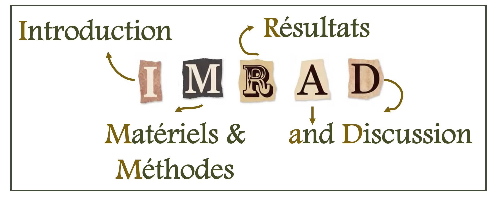
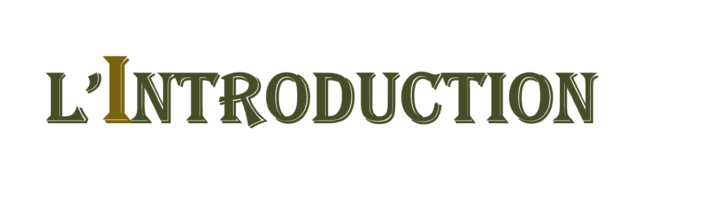
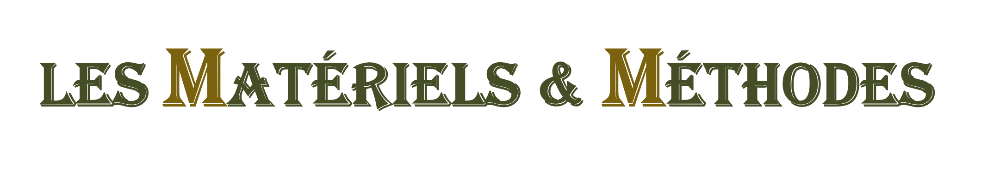

Cette semaine, plutôt que déchiffrer le contenu d'un article publié par d'autres scientifique, je souhaite vous proposer mes conseils, trucs et astuces pour rédiger un article afin d'apporter, sur la base de vos propres travaux, votre pierre à l'édifice. 

## Pourquoi est-ce important de publier ? 

Ca y est ! :partying_face: Vous avez fini d'analyser vos données et su répondre à vos hypothèses de départ (ou bien identifié un phénomène particulier), et vous souhaitez porter tout cela à la connaissance de vos pairs.  
Pour ce faire, outre les présentations dans des congrès, et généralement avant de passer à l'étape de la vulgarisation auprès du grand public, cette communication passe par la publication d'un **article scientifique** :bookmark_tabs:.  

La valorisation de ses travaux de recherche, quelle que soit la forme, est un des devoirs du.de la chercheur.e : tout résultat non publié est perdu, gâché. 
On pourrait aussi considérer que ne pas porter à la connaissance de la communauté les résultats de travaux, est peu éthique, voire un manque de respect pour celles et ceux qui y ont contribué. Je fais allusion ici, par exemple, aux volontaires ayant participé à l'étude ou bien aux impôts - crédits de recherche - ou dons à des fondations de recherche qui ont financé nos travaux (un point d'autant plus important dans une époque où les fonds alloués à la recherche par le gouvernement sont de plus en plus réduits :moneybag:).  
Toute contribution, même mineure, mérité d'être valorisée. D'ailleurs, même un résultat négatif doit être publié (même si ça peut malheureusement être plus compliqué car certaines revues vont trouver ça moins *fancy*). Pourtant, un résultat négatif, c'est aussi de la connaissance : savoir qu'une méthode ne fonctionne pas dans des conditions spécifiques, qu'une population ne répond pas à une certaine expérimentation, ... C'est savoir fermer des portes - mais aussi en ouvrir d'autres ! De nouvelles questions peuvent être soulevée, il faut savoir les mettre en avant ! 

Cette étape de publication est d'autant plus importante que la carrière d'un.e chercheur.e se définit aujourd'hui (*et malheureusement de plus en plus*) par la quantité (*davantage que par la qualité, souvent l'un étant fait au détriment de l'autre, là encore malheureusement*) de ses productions scientifiques. C'est la triste règle du ***publish or perish***. 

## Comment préparer, rédiger et publier son article ? 

### ***D'abord, choisir sa revue*** 

Généralement, avant de passer à la rédaction de l'article en tant que tel, il est recommandé d'**identifier la revue** :notebook: (*aka le journal*) dans lequel on souhaite publier.  
Que son papier soit accepté au premier essai peut être assez rare : parce jugé *hors scope* par la revue, surtout lorsque le sujet est interdisciplinaire; parce que jugé pas assez innovant ou trop focalisé sur la méthode; parce que jugé de qualité trop insuffisante pour être publié dans l'état; ou juste parce que la revue souhaite donner la priorité à d'autres études en cas de trop nombreuses soumissions reçues. Puis parfois la raison reste obscure ... Ne vous découragez pas ! D'autant plus si on sait que les revues internationales avec comité de lecture ont généralement des taux d’acceptation se situant entre 25 % et 50 %.  

Je recommanderai donc d'identifier plusieurs revues potentielles, avec un ordre de préférence.   
Et le choix est large : on compterait aujourd'hui près de **60 000 revues** dans le monde ! Parmi elles, des revues anglaises (la majorité) ou spécifiques à chaque langage, des revues généralistes ou spécialisées (c'est-à-dire spécifique à une discipline), ... Pour la faire simple, votre choix sera défini par vos préférences en termes de portée : est-il plus pertinent de faire connaitre vos travaux à l'échelle internationale, européenne ou plus locale ? De cibler des spécialistes de votre domaine ou un aspect spécifique de votre question de recherche ? Ou, au contraire, souhaitez-vous avoir une portée la plus large possible en choisissant une revue qui inter-disciplinaire ? Votre choix sera également orienté par des conditions plus *pratiquo-pratiques* tels que les délais de reviewing (entre la soumission et le premier retour d'avis), l'acceptation puis la publication de votre article (généralement de 6 mois voire 1 an).   
Outre ces questions, je vous recommanderai également de privilégier les revues dites ***open access***, c'est-à-dire qui proposent une gratuité de la publication (pour les auteurs) et/ou une gratuité de l'accès (pour les lecteurs).  
*A ce sujet, pour boycotter ces revues payantes qui limitent la dissémination de la recherche, il existe des outils qui permettent de retrouver des articles gratuitement : les sites [sci.hub](https://sci-hub.su/). Un boycott d'autant plus significatif qu'un.e chercheur.e n'est pas payé pour la publication de ses articles et les reviewers (les experts qui relisent les articles soumis pour donner leur avis sur l'acceptation ou non à la publication) ne sont pas payé pour leur temps d'expertise...*  
Je recommande également les revues dites *peer-reviewed* :busts_in_silhouette:, c'est-à-dire avec comité de relecture (les reviewers que je viens de mentionner, au nombre de 2 ou 3), car cela donne généralement plus de valeur à l'article finaelement publié : parce que l'auteur aura reçu des commentaires lui permettant d'améliorer la qualité de présentation de ses résultats, voire méthodologiques, et de leur discussion vis à vis de la littérature. Ce reviewing peut par ailleurs être réalisé à l'aveugle (on parle de *blind review*), où les reviewers ne connaissent pas l'identité des auteurs, et inversement; Ce processus est intéressant pour limiter les problèmes de conflit d'intérêt (où un reviewer pourrait se risquer à favoriser un collègue en acceptant plus facilement sa contribution ou, au contraire, en bloquant celle d'un autre "concurrent").  
Certain.e.s pourront vous dire de privilégier les revues à haut *Impact Factor* (*IF*), cet indice basé sur le taux de citation et principal indicateur de la portée de la revue. Personnellement, je n'en ferai pas une règle absolue car cet *IF* dépend également de votre discipline : si vous êtes dans un domaine *niche*, normal que le nombre de publications - et donc de citations - soit réduit, ce qui se répercutera dans la valeur de l'*IF*.  
Il existe aussi des astuces pour vous aider dans le choix de la revue : vous pouvez déjà vous baser sur vos propres références bibliographiques pour identifier les revues qui sont le plus intéressées par le sujet. Sinon, vous pouvez vous aider d'outils tels que https://jane.biosemantics.org/ où vous pouvez, à partir du titre et/ou du résumé de votre article, trouver les reviews qui corresponderaient la plus à votre recherche.  

Bref, mais pourquoi ce besoin d'identifier la revue en amont de rédiger son article ? Et bien parce que la plupart impose leurs propres règles de formattage : nombre de mots, nombre et ordre des sections, format des citations bibliographiques, règles sur les illustrations, tableaux et potentielles annexes (les *supplementary materials*), ... Ce travail de formattage peut être laborieux (d'autant plus si il doit être repété en cas de refus) mais primordial si on ne souhaite pas de faire rebuter notre article dès la première étape ! Ces règles sont généralement listées dans les *guidelines to authors* sur le site de la revue.  
  
  
### ***Ensuite, rédiger !*** :fountain_pen:

Une fois la revue identifiées et ses règles de publication connues, on peut se lancer dans la rédaction ! Etape plutôt fun si on la considère comme la structuration de nos résultats de manière à en faire ressortir en quoi notre travail apporte sa pierre à l'édifice qu'est la science.  
Pour se lancer dans la rédaction, là encore, plusieurs méthodes, aucune recette miracle. Chacun doit trouver la sienne et se l'approprier, la seule règle étant d'OSER ! N'ayez pas peur de la page blanche (*plus facile à dire qu'à faire, je sais*), petit à petit les idées et les mots vous viendront, vous pourrez toujours améliorer petit à petit vos formulations :kissing:. Certains prèfereront commencer par le bullet plan, d'autres de se lancer directement dans la rédaction des sections, dans l'ordre ou non, ... A vous de voir !  

Dans tous les cas, la majorité des articles se structurent de la même façon, à savoir selon le plan IMRAD. 

A savoir que d'autres plans existent : par exemple, certaines revues demandent de mettre les méthodes après les résultats ou bien de mélanger les résultats avec la discussion. Certaines revues souhaiteront un encart avec les *key messages* et d'autres une conclusion distincte de la discussion. D'où l'intérêt, là encore, d'avoir identifié la revue en amont pour être sûr que son plan de rédaction.  
En tout cas ce plan peut également s'appliquer dans le cas d'une rédaction de mémoire ou d'un rapport de recherche quelconque donc n'hésitez pas à vous emparer ! 
  
  

  

L'objectif de l'introduction est d'expliquer **pourquoi** ce travail a été réalisé. Attention, il ne s'agit pas non plus de raconter la genèse du projet, mais plutôt de **justifier** la pertinence de votre question de recherche et de vos hypothèses.  
Cette justification se base principalement sur la littérature dont on s'attend que vous ayez fait, en amont, une revue la plus exhaustive possible possible (sans qu'elle soit nécessairement systématique puisqu'il s'agit là d'une méthode de recherche en soi - *on en reparlera plus tard* :wink:). Vous devez savoir expliqué ce qui a été fait jusqu'ici et, surtout, qu'est ce qui est actuellement manquant que vous souhaitez comblé ? Ca peut être une nouvelle méthode, un nouveau contexte, un nouveau test, de nouvelles variables, ...  
Cette revue de la littérature vous permet d'introduire votre question de recherche (ou **problématique**), que vous devez ensuite préciser sous la forme d'**objectifs** et d'**hypothèses**. La différence entre ces 3 concepts peut parfois être difficile à appréhender. Pour la faire simple, 
- le constat (*inventé hein, c'est pour l'exemple* :wink:) : Un étudiant a tendance à repousser ses révisions pendant trois heures pour ranger un désordre qu'il n'avait pas remarqué depuis six mois. Mais la littérature ne semble pas fournir d'éléments pour expliquer pourquoi.
- la problématique qui en découle (et qui doit s'exprimer sous la forme d'une <u>question</u>) : dans quelle mesure le stress lié aux examens influence-t-il la tendance des étudiants à procrastiner leurs révisions en réalisant des tâches ménagères ?
A noter qu'il est préférable d'opter pour une question ouverte ("comment", "pourquoi", "dans quelles mesures", ...) plutôt qu'une question à laquelle on pourrait uniquement répondre oui ou non.
- les objectifs (généralement un principal et des secondaires, qui s'expriment avec des <u>verbes d'action</u> : démontrer, quantifier, évaluer, ...) :
    - Objectif principal : comprendre les raisons qui poussent les étudiants à privilégier d'autres tâches que les révisions à l'approche des examens.
    - Objectif secondaire 1 : identifier les activités de substitution les plus fréquentes (ménage, cuisine, rangement, etc.)
    - Objectif secondaire 2 : analyser le lien entre le niveau de stress ressenti et la fréquence de ces comportements.
- les hypothèses (doivent être spécifiques et orienter vers les <u>résultats attendus</u>) : 
    - Plus le niveau de stress lié aux examens est élevé, plus les étudiants ont tendance à réaliser des tâches ménagères au lieu de réviser.
    - Les étudiants qui perçoivent les révisions comme difficiles ou décourageantes consacrent davantage de temps à des activités domestiques secondaires.

**Donc, en Introduction, on présente le connu (revue de la littérature), l'inconnu (un manque de connaissances précis identifié dans votre état de l'art), et sa question de recherche (problématique, déclinée sous la forme d'objectifs et d'hypothèses).**

  

Ici, l'objectif est d'expliquer **comment** vous avez réalisé votre recherche pour tester vos hypothèses de départ et répondre à vos objectifs de recherche.  
Il convient dans un premier temps de préciser le <u>design de l'étude</u> : prospective ou rétrospective, expérimentale, avec randomisation et/ou groupe controle ou non, revue de la littérature avec ou sans méta-analyse, ... (*je vous ferai une présentation plus exhaustive des différents designs d'étude et de leur définition dans un prochain post* :wink:)
Cette présentation s'oriente ensuite autour de deux axes : 
- le **matériel** : 
    - Quel est votre <u>échantillon</u> ? Quels ont été vos critères d'inclusion, de non-inclusion et d'exclusion (*j'expliquerai aussi ces différents termes dans un prochain post* :wink:) ? Il faut démontrer que notre échantillon représente notre population d'étude : dans l'exemple précédent, il est facile à comprendre qu'il serait impossible d'étudier la procrastination de tous les étudiants du monde. L'idée est ici de donner suffisamment d'éléments pour démontrer que bien que non exhaustif, votre échantillon reste représentatif d'une certaine frange de cette population (par exemple, étudiants français, en incluant différentes disciplines, secteurs socio-économiques, mode de vie - étudiant en résidence, en colocation, en appartement seul, chez sa famille, ...). 
    - Quelles <u>variables</u> avez-vous collectées ? On voudra que ces données soit présentées de la manière la plus détaillée possible pour faciliter leur compréhension. On justifiera également leur lien avec la problématique de recherche. On prendra également soin à considérer les potentielles variables confondantes, c'est-à-dire des variables susceptibles d'introduire un biais dans la relation étudiée, car elles sont liées à la fois à l'exposition et au résultat.
    - Comment avez-vous collecté ces données (<u>le protocole expérimental</u>) : donner le plus de détails possibles sur la méthodologie de recueil permet d'assurer la <u>reproductibilité</u> de l'étude, c'est-à-dire la possibilité qu'un.e autre chercheur.e soit capable d'appliquer la même méthode.   
N.B. : on prendra soin, le cas échéant, de préciser que la recherche a été réalisé en respectant l'éthique de la recherche (et j'espère que c'est le cas !!) : autorisation des comités d'éthiques compétents, respect des principes de consentement et d'anonymat, ...  
- les **méthodes** : il s'agit là de l'ensemble des <u>analyses statistiques</u> que vous avez appliqué à vos données pour tester vos hypothèses (*encore un spoil : je vous présenterai les principaux tests à votre disposition dans un prochain post* :wink:)

Cette présentation pourra être plus ou moins détaillée : nom des outils de mesure et/ou logiciels utilisés pour la collecte des variables et les analyses statistiques (avec les numéros de version), éventuellement références bibliographiques si vous vous inspirez d'une méthode déjà publiée, informations sur l'éventuelle évaluation intra- et inter-observateur de votre méthode qui permet d'assurer la fiabilité des résultats, ...  
A noter que si l'article porte essentiellement sur le développement d'une nouvelle méthode, on préferera la publication sous forme d'article méthodologique dont le format diffère du plan IMRAD classique. Si c'est le cas, je vous invite à lire les *guidelines to authors* de la revue qui vous donnera plus de détails à ce sujet.  

**Finalement, la section Matériels & Méthodes consiste à définir son échantillon, et présenter l'ensemble des détails méthodologiques qui permettront d'évaluer la fiabilité de l'étude et de la reproduire.**

  

Cette section va comporter l'ensemble de vos résultats, présenter de manière <u>brute</u>, sans interprétation. L'idéal est de commencer à organiser les résultats selon l'objectif et/ou les hypothèses auxquels ils répondent précisément. Cette organisation permet d'ailleurs de faire un tri éventuel dans l'ensemble des analyses que vous avez réalisé dans votre projet de recherche : certaines servaient peut-être uniquement à vérifier la qualité de vos données, à faire des tests préliminaires, ... Tout n'est pas forcément pertinent à présenter : focalisez vous uniquement sur ce qui sert à répondre à votre problématique.   
Cela comprend également la présentation des caractéristiques de l'échantillon : nombre d'individus, fourchette d'âge, répartition par genre et autres classes qui vous semblent pertinentes, ... Dans le cas d'une étude longitudinale, on aura l'habitude d'utiliser une *flow chart* qui rend compte de l'évolution de l'effectif à mesure du déroulé de l'étude (nombre d'individus à l'inclusion initiale puis potentielle perte de vue).  
Puis il faudra présenter les résultats des tests statistiques exposés dans la section précédente : coefficients de corrélation, p.values évaluant la significativité des différences, coefficients de régression, ... Avant cela, il faudra également présenter la distribution de vos variables : moyennes et écart-types en cas de variables quantitatives, effectifs et fréquences pour les variables qualitatives.  

Un conseil : n'hésitez pas à vous aider de <u>figures et tableaux</u> !! Sans nécessairement faire une répétition dans le texte, sinon pour les éléments les plus significatifs. Mais attention à l'inverse : si les résultats peuvent être présentés en quelques lignes seulement, mieux vaut ne pas utiliser les graphiques qui prennent de la place (et sont parfois limités en nombre selon la revue). Ces derniers permettent toutefois de limiter le nombre de mots (utile selon la revue), et de réduire le temps de lecture en mettant en avant des tendances ou les principales découvertes. 
Attention aussi à ne pas répéter des informations du texte dans les tableaux ou graphiques, et inversement : les tableaux, les figures et le texte se complètent, ils ne se répètent pas.  

Les graphiques conviennent surtout pour les analyses multivariées, lorsque vous souhaitez mettre en évidence une évolution des données dans le temps ou des différences en fonction de facteurs spécifiques (ex. pour représenter les différences en terme de niveau de stress chez les étudiants en fonction de la discipline, les *boxplots* ou boites à moustaches peuvent aider). 
*Bon, vous commencez à vous en douter, la question de la présentation graphique des résultats fera également l'objet d'un prochain post* :wink: Mais sachez d'ores et déjà que la liste est longue : nuages de points, courbes, histogrammes (ou diagrammes en bâtons), diagrammes en secteurs (camemberts), ...  

Que ce soit pour les graphiques ou les tableaux, il faudra veiller à y présenter suffisamment de détails pour que les informations à en tirer soit faciles à interpréter : légende des axes, des couleurs ou format de points, unités.  
A noter qu'en fonction de la revue, vous pouvez également déporter certains résultats (généralement les moins significatifs - importants - pour votre étude) dans des annexes : les *supplementary materials*. D'ailleurs, dans un souci de science ouverte, je vous recommande fortement de laisser l'accès libre à vos données brutes (et anonymisées) : soit en permettant aux autres chercheur.e.s de vous contacter, soit en les déposant sur répertoire officiel permettant d'associer votre base de données à un DOI (identifiant unique qui permet la protection des droits d'auteur et un renvoie en citation bibliographique, vous permettant de suivre son exploitation).  

Enfin, n'ométtez pas de mentionner des résultats même négatifs (c'est-à-dire qui n'iraient pas dans le sens de vos hypothèses de départ) : soyez toujours honnêtes et transparent.e.s ! La prochaine section vous permettra d'ailleurs d'expliquer cet éventuel écart aux résulats attendus et/ou de proposer des perspectives pour investiguer davantage cette issue.  

**Donc, dans la section Résultats, on fait une présentation brutes de ses données (distribution, moyennes et écart-types) et des sorties des tests statistiques, sans interprétation.**

  

Nous voilà arrivé à la dernière partie de l'article et, probablement, la plus importante aussi. C'est ici que vous pourrez, sur la base de vos résultats, donner <u>la réponse concrète</u> à votre problématique en reprenant une à une chacune des hypothèses de départ.  
Dans cette partie encore, de même que pendant l'introduction, une importance particulière est accordée à la revue de la littérature puisque vous devrez <u>confronter vos résultats</u> à ceux des précédentes études. Si, d'ailleurs, il y a un écart entre vos conclusions et celles relevées dans la littérature, vous devrez prendre soin à les expliquer : est-ce que c'est dû, par exemple, à un échantillon différent ? A vos variables ? Votre méthode de collecte ou d'analyse ? etc  
Il est généralement conseillé de commencer la discussion avec un premier paragraphe reprenant la problématique de l'étude et la réponse globale à cette question de recherche. Dans les paragraphes suivants, on déroulera ensuite chaque hypothèse de départ et leurs réponses spécifiques, avec une démonstration appuyée sur les résultats exposés dans la section précédente, et avec une discussion au vu de la littérature.   
Outre la présentation de vos conclusions, cette section doit également comprendre un paragraphe pour présenter les <u>limitations</u> de votre étude : aucune démarche n'est parfaite, il faut être conscient et honnête de ses limites pour assurer la crédibilité de nos conclusions. C'est notamment l'occasion de discuter de la représentativité de l'échantillon ou encore de la fiabilité de nos mesures. On pensera également à présenter des pistes d'amélioration, le cas échéant.  
N'hésitez pas non plus à montrer les points forts de votre étude - tout au long de la discussion ou bien dans un paragraphe dédié : nouvelle approche, nouvelles données, nouvelles perspectives, résultats innovants, ... 

Enfin, certaines revues autorisent - ou obligent - une dernière section de <u>conclusion</u>. Celle-ci, qui doit être très courte (4/5 phrases maximum) permettra de répondre définitivement à la question de recherche, de donner la confirmation / l'infirmation des hypothèses de départ et d'expliquer en quoi ce travail participe à l'avancée des connaissances dans le domaine spécifique de l'étude. On pourra également y mentionner de potentielles perspectives de recherches qui permettraient de combler les limites précédemment exposées et de mettre encore en avant que votre travail s'inscrit dans une démarche de recherche plus large qu'il convient de poursuivre.  

**Finalement, dans la Discussion, on vient apporter la réponse à la problématique et aux hypothèses de départ, en s'appuyant toujours sur ses résultats, on vient les confronter à la littérature, puis on présente les limitations de l'étude et on propose une ouverture de perspectives.**

## Et maintenant l'article écrit, on fait quoi ? 

Ok ok, vous avez le fond de votre article mais tout n'est pas fini ! :sweat_smile: Il reste encore quelques petits compléments de forme à apporter : 
- trouver un **titre** (ben ouais !)  
  Ici, plusieurs écoles : favoriser un titre *catchy* qui pousse au clic, quitte à enjoliver la réalité de vos résultats (par exemple, via un jeu de mots), ou bien mettre plutôt en avant la méthodologie ("une étude randomisée contrôlée pour ..."), ou encore présenter d'ores et déjà le principal résultat de votre étude (par exemple, tous ces articles "le plus ancien..." en préhistoire). Dans tous les cas, choisissez un titre court qui donne suffisamment d'informations sur - a minima - le thème de votre recherche.  
  Dans tous les cas, je conseillerais de choisir un titre clair, précis, informatif et pas trop long. Il doit susciter la curiosité du lecteur tout en étant juste, et comporter les mots-clés adéquats au sujet de votre recherche. 
- écrire un résumé (l'***abstract***) et ses mots-clefs (***keywords***)  
  Là encore, l'idée du résumé est de donner suffisamment d'informations sur votre étude pour inciter le lecteur à prendre connaissance de votre étude. Généralement les revues imposent un nombre limite de mots (500 la majorité du temps).  
  Il doit reprendre le plan IMRAD : présentez l'objectif global de votre étude et éventuellement sa justification vis à vis de l'état de l'art ; donnez a minima le design de votre étude, les grandes caractéristiques de l'échantillon et une présentation rapide de votre protocole ; là vous pouvez mélanger vos résultats à votre discussion pour mettre en avant les éléments permettant de répondre à vos hypothèses de départ ; s'il vous reste de la place, re préciser en quoi votre étude contribue à l'avancée de votre discipline, voire ouvrez des perspectives futures.  
  Certaines revues demandent de structurer le résumé, en affichant le titre des sections, pour d'autres le format est plus libre. Il est parfois possible de proposer un résumé graphique (*graphical abstract*) qui, comme son nom l'indique, permet de résumer les objectifs et principaux résultats de l'étude au moyen d'une figure qui doit être la plus simple et compréhensible possible sans utilisation d'un texte adjoint.  
  En ce qui concerne les mots-clefs, ils sont généralement au nombre de 3 à 10. Ils résument le thème de votre article. Voyez un peu cela comme les #hashtags qui référencient vos posts instagram !  
- la liste des **auteurs**  
  C'est-à-dire de toutes les personnes ayant participé à la réalisation de l'étude, depuis la mise en place du protocole, le recrutement de l'échantillon, la collecte des données, leur analyse et leur interprétation. Et l'ordre compte ! La première et la dernière personne sont celles ayant investi le plus de temps sur la réalisation de la recherche et la rédaction de l'article ou l'ayant supervisé ; entre les deux, l'ordre dépend du taux d'investissement. D'ailleurs ces auteurs doivent être tenus au courant de l'avancée de l'article et donner leur avis sur le contenu avant publication, à défaut de concrètement participer à sa rédaction.    
  Pour chaque auteur, on précisera l'affiliation, c'est-à-dire son rattachement professionnel, que ce soit à une université, un établissement hospitalier ou clinique, un institut de recherche, une société, ...   
  Il faudra aussi choisir un.e "auteur.rice correspondant.e" (ou *corresponding author*), c'est-à-dire la personne qui pourra être contacté en cas de demandes sur l'article. 
- insérer les **citations bibliographiques** et la liste complète des références  
  Les revues imposent chacune leur style. Allez donc vous réferer aux *guidelines to authors* pour savoir si vos références bibliographiques doivent être mentionnées dans le texte sous la forme de chiffres (1), d'un exposant² ou sous le format "nom du premier auteur et al. année de publication (Remy et al. 2026) ou encore sous un format plus détaillé.   
  Il en est de même pour la liste complète des références à ajouter à la fin de votre article : nombre d'auteurs à nommer avant l'ajout du "et al." (*qui signifie "et collaborateurs" soit dit en passant*), si le nom de la revue doit être écrit en entier ou sous son format abbrégé (par exemple, "International Scientific Research Journal" a pour abréviation "Int. Sci. Res. J."), place de l'année de publication dans la citation (après le nom des auteurs ou à la fin de la citation), format du numéro de volume et des numéros de pages, ...  
  Petits conseils : attention au nombre ! Même s'il n'y a pas de nombre magique, trop peu démontrerait un manque de connaissance de l'état de l'art, mais un trop grand nombre risque également de masquer le côté innovant de votre recherche. Limitez vous donc uniquement aux références les plus pertinentes et les plus récentes. Privilégiez les articles publiés dans des revues dont la crédibilité scientifique est assurée (pas d'articles de vulgarisation scientifique, mais vous pouvez citer des notes, des thèses, des rapports de fouille, des chapitres d'ouvrage, ... ) et ne mentionnez que les articles que vous aurez lu. Evitez l'effet "boule de neige", c'est-à-dire citer un article qui lui-même se reposait sur une autre publication : ne citez que l'article à l'origine de l'information que vous mentionnez.   
  Enfin, n'hésitez pas à utiliser des gestionnaires de citation comme *Zotero* ou *EndNote*. Leur prise en main est vraiment facile et permet d'automatiser l'export de la citation à partir d'internet et de l'import sur votre fichier Word, sous un format spécifique à la revue de votre choix.  
- ajouter quelques **sections supplémentaires** : sources de financement et potentiels conflits d'intérêt, remerciements  
  Certaines revues demandent également d'ajouter des informations quant aux sources de financement et une attestation sur l'honneur des auteurs qu'ils n'ont pas de conflits d'intérêt (par exemple, ça pourrait être le cas si un auteur est financé par une firme pharmaceutique alors que l'objectif de l'article est justement de tester l'efficacité d'un médicament).  
  Enfin, à la discrétion des co-auteurs, il est possible de mentionner des personnes à remercier pour leur participation à l'étude, que ce soit, par exemple, en tant que volontaires, qu'analystes (mais dont l'investissement était trop limité pour l'inclure dans la liste des auteurs), pour l'accès à des données, ...

### ***On soumet ?*** 

Une fois l'ensemble de l'article rédigé et son format ajusté aux recommandations de la revue, il est temps de le soumettre !! :partying_face:  
Une étape malheureusement parfois laborieuse selon l'interface de la revue ... :face_with_peeking_eye: Puis cliquer sur le bouton "soumettre" !! ^^ Bravo à vous pour être arrivé là !!   
Les prochains jours seront longs, à attendre la réponse de l'éditeur (votre article suit-il suffisamment bien les *guidelines* de la revue, son thème est-il suffisamment dans le *scope* de la revue ?) puis le retour des reviewers ... Cela peut prendre plusieurs semaines voire plusieurs mois, alors armez-vous de patience !!   
Pour les reviewers, 3 choix possibles : 
- accepter l'article tel quel (rarement du premier coup)
- accepter l'article sous condition d'y apporter des modifications mineures ou majeures (la distinction entre les deux étant généralement assez floue, mais où ces dernières demandent généralement un travail supplémentaire assez conséquent)
- refuser l'article 

Et puis un jour la notification de la boîte mail :mailbox: sonne : vous avez reçu les commentaires des reviewers ! Il va falloir les lire, ne pas déprimer (surtout !) et prendre le temps de répondre à chacune des remarques.... En 2 semaines :face_with_diagonal_mouth:   
*Bah ouais ! La science ça perd pas de temps ('fin ça dépend de qui doit travailler :shushing_face:). Bon, maintenant que je suis passée de l'autre côté, étant moi-même sollicitée pour reviewer des articles, je suis bien contente d'avoir une large période de temps pour prendre le temps de lire l'article et faire des remarques les plus constructives possibles (ce que je vous souhaite plutôt qu'un simple "non suffisant" ou "je ne suis pas d'accord"). Sachant, encore une fois, qu'un reviewer n'est pas payé pour ce temps d'expertise et doit l'insérer parmi ses tâches quotidiennes.*  

Quoiqu'il en soit, ce retour aux reviewers doit prendre la forme suivante : 
- un premier fichier qui reprend les commentaires des reviewers auxquels vous répondez, point par point. N'hésitez pas à le "brosser dans le sens du poil" avec des formules de politesse comme "vous avez tout à fait raison", "merci pour cette excellente remarque", "merci pour le temps et votre expertise", ... (*perso ça me touche pas trop mais c'est ce qu'on m'a toujours conseillé de faire, puis au moins ça montre que vous avez pris le temps de lire le commentaire et d'y répondre*)
- un deuxième fichier qui correspond à l'article initial auquel vous avez ajouté les modifications suite aux commentaires des reviewers. Pensez à mettre en avant ces modifications pour qu'elles soient facilement identifiables (soit avec un code couleur différent, soit via le mode suivi de correction de word si la revue le permet)
- l'article final, c'est-à-dire avec les modifications intégrées, de manière uniforme
Une fois votre révision terminée, vous pouvez soumettre votre nouvelle version et ... attendre :p et espérer que vos retours étaient suffisant pour une acceptation dans l'état, sinon recevoir les nouvelles critiques et vous préparer à y répondre.  

Et enfin, vous pourrez célébrer la publication de votre article, fruit d'un dur labeur entre la réalisation de votre recherche et la rédaction du papier, son formattage aux règles de la revue, votre patience vis-à-vis des retours des reviewers et le final *proof-reading* (étape finale proposée par la revue après l'acceptation de votre article pour publication, où vous devez vérifier les informations fournies et la mise en page).  
Beau travail à vous ! Vous pouvez être fier.ère de cette nouvelle ligne sur votre CV ! :kissing_heart:  
D'ailleurs, n'hésitez pas à partager par ici (ou sur mon compte instagram @OwlyFlow) vos productions, je serai ravie de pouvoir les relayer à mon tour - voire d'en proposer un décryptage de vulgarisation ^^ 

