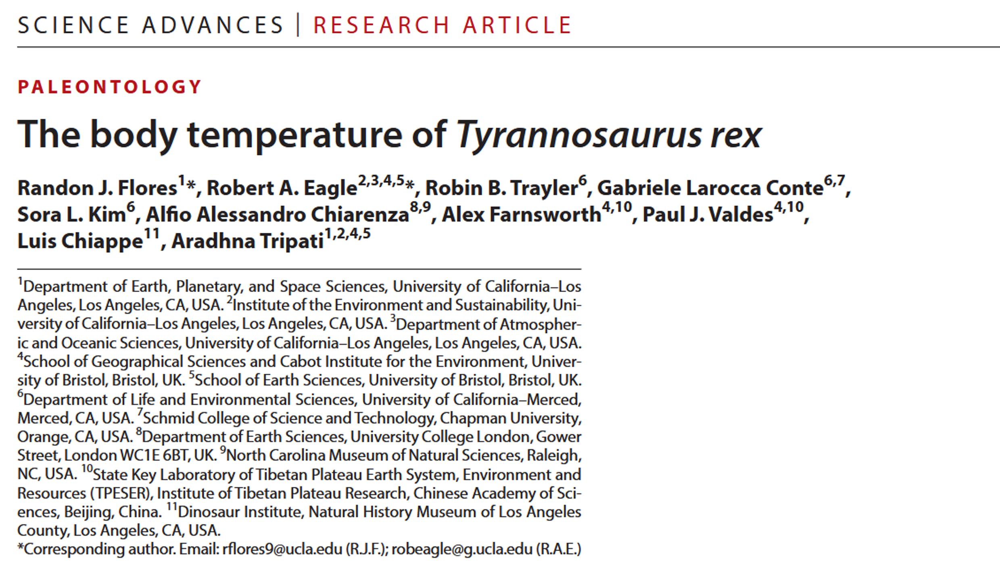

Parlons de : comment les scientifiques ont démontré que le *T. rex* était un animal à sang chaud, avec une température corporelle étonnamment proche de celle des humains.

## Questions de recherche et objectifs 

Les scientifiques ont différentes méthodes à leur disposition pour inférer, à partir de restes fossiles, sur la **thermopysiologie** d'espèces disparues, c'est-à-dire **la manière dont elles régulaient leur température corporelle**. Parmi elles : <u>les études anatomiques</u>, <u>l'histologie osseuse</u> (étude du tissu osseux et de sa microstructure), la modélisation mathématique de la production, du transfert, du stockage et de la consommation d'énergie (<u>modélisation énergétique</u>), <u>la phylogénétique</u> (étude des relations évolutives entre les organismes en fonction de leurs similitudes ou différences génétiques), <u>la répartition géographique</u> et les méthodes basées sur la composition isotopique des fossiles, des roches et des minéraux (<u>paléothermométrie isotopiqu</u>).  

Des études précédentes utilisant ces outils ont démontré que certains groupes de dinosaures étaient **endothermes** (*ou, pour le dire plus simplement, à "sang-chaud"*). De même que certains oiseaux et mammifères modernes, les espèces endothermes sont capables de produire de la chaleur via des processus métaboliques, leur permettant de maintenir une température corporelle relativement stable, même lorsque la température environnante varie (*Codd et al. 2008*, *Bailleul et al. 2019*, *Clarke 2013*, *Valdes et al. 2024*, *Chiarenza et al. 2022*, *Amiot et al. 2006*, *Fricke & Rogers 2000*, *Dawson et al. 2020*, *Eagle et al. 2011*, *Eagle et al. 2015*, *Laskar et al. 2020*, *Tagliavento et al. 2023*).  

L'objectif de cette étude était d'investiguer davatange ces précédentes démonstrations et, plus spécifiquement, d'estimer la **température corporelle** :thermometer: du ***Tyrannosaurus rex*** :t-rex: (*T. rex*). 

:bangbang: *Note: *Bien que les oiseaux soient techniquement des dinosaures, la seule lignée ayant survécu à l'extinction de masse survenu il y a 66 millions d'années, ont les distingue généralement des dinosaures non aviaires qui ont, quant à eux, complètement disparu. Mais, par souci de simplicité, le terme général "dinosaure" utilisé dans ce post fera référence uniquement aux dinosaures non-aviaires*

## Une courte présentation de la méthode 

Pour estimer la température corporelle :thermometer: du *T. rex* :t-rex:, les auteurs ont utilisé une technique appelée **thermométrie par isotopes agglomérés** :atom_symbol:. Cette méthode repose sur la mesure de la fréquence à laquelle certaines formes lourdes de carbone et d'oxygène (¹³C and ¹⁸O) sont liées entre elles dans les minéraux carbonatés. Puisque ce schéma de liaison dépend de la température à laquelle le minéral s'est formé, les scientifiques peuvent **estimer les températures du passé** et, dans le cas de dents fossilisées, inférer sur la température corporelle d'espèces disparues (*Eagle et al. 2011*, *Deak et al. 2025*, *Griffiths et al. 2023*, *Löffler et al. 2019*).  

Pour leurs analyses, les auteurs ont utilisé **3 dents :tooth: de *T. rex*** :  
- une dent isolée et incomplète du specimen LACM 151468 (où LACM fait référence à la collection du *Los Angeles Couty Museum* d'où sont issus ces fossiles)
- deux dents associées au specimen LACM 150167 (aussi surnommé Thomas - *plus facile à retenir, n'est ce pas ? :p* - qui est un jeune adulte bien préservé et qui pesait probablement plus de 3000 kg de son vivant, *Carr 2020*)  
Ces specimens ont été decouverts sur un site situé au sud-est d'Ekalaka, dans le comté de Carter, au Montana (une région assez rurale et isolée au nord-ouest des Etats-Unis). Ils proviennent de la **formation Hell Creek du Crétacé supérieur**, une formation géologique datant d’environ 66 à 67 millions d’années, soit peu avant l’extinction massive qui a exterminé les dinosaures non aviaires.  

Pour estimer la température corporelle du *T. rex*, les auteurs ont comparé leurs résultats avec ceux obtenus pour des restes de **crocodiliens** contemporains :crocodile:. Ils ont ainsi analysé **5 dents** :tooth: prélevées sur un site proche de McGuire Creek, dans le Conté de McCone, au Montana, et datant de la toute fin du Crétacé, il y a environ 66 millions d'années (une période aussi connue sous le nom de *Maastrichtien supérieur*). 
Les crocodiliens sont **ectothermes** (ou à *sang froid*), ce qui signifie qu'ils dépendent largement de sources de chaleur externes pour maintenir leur température corporelle dans une fourchette adaptée à la température ambiante. Ils peuvent également contrôler activement leur température corporelle grâce à des adaptations comportementales, comme se déplacer entre des zones ensoleillées et ombragées ou alterner entre l'eau et la terre ferme pour se réchauffer ou se rafraîchir (*Grigg et al. 1998*, *Seebacher et al. 1997*).  

Plus préciément, l'étude a analysé **l'émail** des dents :tooth:, c'est-à-dire la fin couche externe dure qui recouvre la couronne dentaire (*et qui est, soit dit en passant, le tissu le plus dur du corps humain !*). Composé d'environ 96% de minéraux, principalement du phosphate de calcium, l'émail est très minéralisé et relativement résistant aux alterations. Ces propriétés lui permettent de préserver sa composition isotopique d'origine, en faisant un matériel idéal pour estimer des températures anciennes via la thermométrie par isotopes agglomérés :atom_symbol:.  

Enfin, en s'appuyant sur des données précédemment publiées sur les températures environnementales du passé(*Kohn & Cerling 2002*), les auteurs ont également cherché à comprendre comme le *T. rex* et les crocodiliens régulaient leur température corporelle (c'est-à-dire leurs stratégies thermophysiologiques) et comment ils auraient pu s'adapter à différentes conditions environnementales, afin d'identifier les habitats et les climats qui auraient pu leur convenir. 

## Résultats: les *T. rex* étaient aussi chauds que nous 

Les auteurs ont déterminé une **température corporelle** :thermometer: moyenne de 36,3 ±2,5°C :sunglasses: pour le ***T. rex*** :t-rex:, supérieure à celle des crocodiliens :crocodile: qu'ils ont étudiés, dont la température moyenne s'élève à 30,9 ±2,6°C. Ce qui est intéressant, c'est que ces températures corporelles estimées pour le *T. rex* sont similaires à celles rapportées pour des **grands mammifères actuels** comme les éléphants d'Asie ou d'Afrique :elephant: (36,0° and 36,2°C, respectivement, *Clarke & Rothery 2008*). Ces valeurs s'inscrivent aussi dans la gamme des températures rapportées pour certains **grands oiseaux incapables de voler** comme les autruches actuelles 𓅦 (entre 38,1°C et 39,7°C, *King & Farmer 1961*). Au contraire, ces températures corporelles sont légèrement inférieures à celles des petits oiseaux volants dont la température corporelle moyenne est de 41,6 ±0,5°C (*Clarke & Rothery 2008*).

En ce qui concerne l'environnement contemporain et local, les auteurs ont reconstitué des **conditions climatiques chaudes**, avec des températures annuelles moyennes estimées comprises entre 17,8°C et 33,4°C. Comme les températures corporelles estimées pour le *T. rex* étaient supérieures à celles de l'environnement reconstitué, cela pourrait suggérer qu'il était capable de générer des quantités importantes de chaleur métabolique et de réguler activement sa température corporelle - un processus connu sous le nom de **thermorégulation endothermique** (*la voilà notre démonstration !*).   
Les fossiles indiquent que les grands tyrannosaures vivaient à des paléolatitudes élevées, c'est-à-dire dans des régions situées bien plus au nord (par exemple, le versant nord de l'Alaska ou la région du Trans-Pecos, au Texas, *Fiorillo & Tykovski 2014*, *Lawson 1976*). Cela suggère qu'ils auraient pu tolérer des conditions relativement froides, pouvant potentiellement descendre jusqu'à environ -13°C :cold_face:. Toutefois, d'après le modèle développé par les auteurs, il semble qu'une chaleur extrême - de l'ordre de 45°C à 48°C :hot_face: - aurait pu présenter un sérieux risque de surchauffe. 

Il convient de mentionner que, étant donné que cette étude a analysé des restes fossiles très anciens, les auteurs ont utilisé plusieurs méthodes indépendantes afin d'évaluer si l'émail dentaire avait subi des altérations post-enfouissement susceptibles d'affecter la fiabilité de leurs résultats. 

### :jigsaw: **Tout ce que cela signifie**

Finallement, en s'appuyant sur les températures estimées grâce à la thermométrie par isotopes agglomérés :atom_symbol: dans l’émail dentaire :tooth:, les auteurs ont apporté des preuves supplémentaires que le *T. rex* :t-rex: était un animal à sang chaud, capable de réguler sa température. Il était capable de maintenir une température corporelle relativement élevée par rapport à son environnement, ce qui correspond à une **termorégulation endothermique**.   
Ces résultats viennent également soutenir l'hypothèse selon laquelle, malgré l'absence de découvertes fossiles dans ces régions, le *T. rex* aurait pu peupler un large éventail d'environnements à travers le paléocontinent nord-américain, y comprit des régions plus froides situées à des latitudes plus élevées. 

---
---
---
  
Avant de se quitter, je vous propose de voter pour le thème du prochain article que vous souhaitez que je déchiffre pour vous :  

<iframe title="StrawPoll Embed" id="strawpoll_iframe_NoZrzrDQ3Z3" src="https://strawpoll.com/embed/NoZrzrDQ3Z3" style="position: static; visibility: visible; display: block; width: 100%; flex-grow: 1;" frameborder="0" allowfullscreen allowtransparency>Loading...</iframe>

---
---
---

> **Lire l'article**: Flores RJ, Eagle RA, Trayler RB, Larocca Conte G, Kim SL, Chiarenza AA, Farnsworth A, Valdes PJ, Chiappe L, Tripati A. (2026) **The body temperature of Tyrannosaurus rex**. **Sci Adv** 12(38):eaeb7653 (https://doi.org/10.1126/sciadv.aeb7653)

> **Références mentionnées**:  
> - Amiot R, Lecuyer C, Buffetaut E, Escarguel G, Fluteau F, Martineau F (2006) Oxygen isotopes from biogenic apatites suggest widespread endothermy in cretaceous dinosaurs. *Earth Planet Sci Lett* 246, 41–54
> - Bailleul AM, O’connor J, Schweitzer MH (2019) Dinosaur paleohistology: Review, trends and new avenues of investigation. *Peer J* 7, e7764 
> - Carr TD (2020) A high- resolution growth series of Tyrannosaurus rex obtained from multiple lines of evidence. *Peer J* 8, e9192
> - Chiarenza AA, Mannion PD, Farnsworth A, Carrano MT, Varela S (2022) Climatic constraints on the biogeographic history of Mesozoic dinosaurs. *Curr Biol* 32, 570–585.e3
> - Chiarenza AA, Cantalapiedra JL, Jones LA, Gamboa S, Galván S, Farnsworth AJ, Valdes PJ, Sotelo G, Varela S (2024) Early Jurassic origin of avian endothermy and thermophysiological diversity in dinosaurs. *Curr Biol* 34, 2517–2527
> - Clarke A, Rothery P (2008) Scaling of body temperature in mammals and birds. *Funct Ecol* 22, 58–67
> - Clarke A (2013) Dinosaur energetics: Setting the bounds on feasible physiologies and ecologies. *Am Nat* 182, 283–297 
> - Codd JR, Manning PL, Norell MA, Perry SF (2008) Avian-like breathing mechanics in maniraptoran dinosaurs. *Proc R Soc B* 275, 157–161 
> - Dawson RR, Field DJ, Hull PM, Zelenitsky DK, Therrien F, Affek HP (2020) Eggshell geochemistry reveals ancestral metabolic thermoregulation in dinosauria. *Sci Adv* 6, eaax9361
> - Deak MD, Porter WP, Mathewson PD, Lovelace DM, Flores RJ, Tripati AK, et al. (2025) Metabolic skinflint or spendthrift? insights into ground sloth integument and thermophysiology revealed by biophysical modeling and clumped isotope paleothermometry. *J Mamm Evol* 32, 1
> - Eagle RA, Tütken T, Martin TS, Tripati AK, Fricke HC, Connely M, Cifelli RL, Eiler JM (2011) Dinosaur body temperatures determined from isotopic (13c-18O) ordering in fossil biominerals. *Science* 333, 443–445
> - Eagle RA, Enriquez M, Grellet-tinner G, Pérez-huerta A, Tütken T, Montanari S, et al. (2015) Isotopic ordering in eggshells reflects body temperatures and suggests differing thermophysiology in two cretaceous dinosaurs. *Nat Commun* 6, 8296
> - Fiorillo AR, Tykoski RS (2014) A diminutive new tyrannosaur from the top of the world. *PLOS ONE* 9, e91287
> - Fricke HC, Rogers RR (2000) Multiple taxon–multiple locality approach to providing oxygen isotope evidence for warm-blooded theropod dinosaurs. *Geology* 28, 799 
> - Griffiths ML, Eagle RA, Kim SL, Flores RJ, Becker MA, Maisch HM, Trayler RB, et al. (2023) Endothermic physiology of extinct megatooth sharks. *Proc Natl Acad Sci U.S.A.* 120, e2218153120
> - Grigg GC, Seebacherd F, Beard LA, Morris D (1998) Thermal relations of large crocodiles, crocodylus porosus, free—Ranging in a naturalistic situation. *Proc Biol Sci* 265, 1793–1799
> - King JR, Farner DS “Energy metabolism, thermoregulation and body temperature” in *Biology and Comparative Physiology of Birds* (elsevier, 1961), pp. 215–288
> - Kohn MJ, Cerling TE, “12. Stable isotope compositions of biological apatite” in *Phosphates*, Kohn MJ, Rakovan J, Hughes JM, eds. (de Gruyter, 2002), pp. 455–488
> - Laskar AH, Mohabey D, Bhattacharya SK, Liang M-C (2020) Variable thermoregulation of late cretaceous dinosaurs inferred by clumped isotope analysis of fossilized eggshell carbonates. *Heliyon* 6, e05265 
> - Lawson DA (1976) Tyrannosaurus and Torosaurus, Maestrichtian dinosaurs from trans-Pecos, Texas. *J Paleontol* 50, 158–164 
> - Löffler N, Fiebig J, Mulch A, Tütken T, Schmidt BC, Bajnai D, Conrad AC, Wacker U, Böttcher ME (2019) Refining the temperature dependence of the oxygen and clumped isotopic compositions of structurally bound carbonate in apatite. *Geochim Cosmochim Acta* 253, 19–38
> - Seebacher F, Grigg GC (1997) Patterns of body temperature in wild freshwater crocodiles, crocodylus johnstoni: thermoregulation versus thermoconformity, seasonal acclimatization, and the effect of social interactions. *Copeia* 1997, 549
> - Tagliavento M, Hofmann S, Böttcher ME, Peltz M, Fiebig J (2023) Clumped isotope analysis of (bio)apatite using a Kiel iv device in long-integration dual- inlet mode. *Rapid Commun Mass Spectrom* 37, e9656
