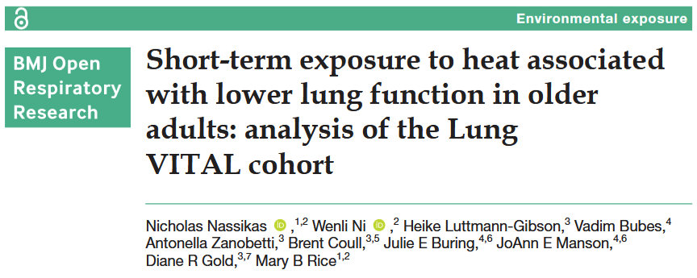

Parlons de : comment le réchauffement climatique représente une menace pour notre santé respiratoire.

## Question de recherche et objectifs 

Etant données les températures exceptionnellement élevées 🌡️ que beaucoup d'entre nous ont connues cet été, avec certains pays ayant même enregistré des records historiques de fortes chaleurs (voir : https://news.un.org/fr/story/2026/08/1159291), il n'est pas surprenant de constater que la communauté scientifique cherche de plus en plus à savoir **comment la chaleur affecte notre santé**. C'était précisément l'objectif de la présente étude, qui s'est plus spécifiquement concentrée sur la **santé respiratoire** 🫁. 

Il est déjà bien connu que l'exposition à de l'air chaud peut rendre la respiration plus difficile, et ce par le biais de différents mécanismes. Par exemple, la chaleur peut provoquer un gonflement des tout petits vaisseaux sanguins des voies respiratoires (les capillaires), réduisant l'espace disponible pour le passage de l'air (*McFadden 1990*, *Zhu et al. 2025*). De même, les températures élevées augmentent l'exposition à des irritants respiratoires tels que <u>la pollution atmosphérique par l'ozone, le pollen et les spores de moisissures</u>, ce qui peut encore aggraver les problèmes de santé (*Al-Hegelan et al. 2011*).  
De fait, les températures élevées sont souvent associées à des symptômes respiratoires comme <u>la toux, un essoufflement ou une respiration sifflante</u> 🌬️, mais aussi à une augmentation des <u>hospitalisations :hospital: voire, dans certains cas, à une mort prématurée 🪦</u> (*Sabia et al. 2010*, *O’Lenick et al. 2025*).  
Les **adultes les plus âgés** sont particulièrement vulnérables à ces vagues de chaleur, de même que le sont <u>les enfants, les femmes enceintes, les personnes socialement vulnérables ou celles souffrant d'une pathologie chronique</u> (*Silveira et al. 2023*, *Derakhshan et al. 2024*, *Parsons et al. 2023*).   

Basée sur cette connaissance de l'impact néfaste des températures élevées 🌡️ sur la santé respiratoire 🫁, l'objectif de cette étude a donc été de **mieux caractériser l'altération de la fonction pulmonaire lorsqu'une personne est exposée à des températures moyennes quotidiennes élevées, même si sur une courte durée**.  

## Une courte présentation de la méthode 

Comme pour une autre étude que nous avons précédemment déchiffrée, celle-ci a impliquée **1923 participants** issus d'une cohorte longitudinale :busts_in_silhouette: (*c'est-à-dire des participants qui ont été suivi sur une longue période de temps*), appelé **Lung Vitamin D and Omega-3 trial** (**VITAL**) et qui avait initiallement pour objectif d'évaluer l'effet de la Vitamine D et des oméga 3 sur l'occurrence d'un cancer ou d'une maladie cardiovasculaire chez les personnes agées  (*Gold et al. 2016*).  

Ces participants étaient issus de 11 localisations urbaines à travers les Etats-Unis (*Boston, Baltimore, Philadelphia, Chicago, Detroit, St. Louis, Minneapolis/St. Paul, Phoenix, Houston, Dallas et Los Angeles*) et ont réalisé **2 spirométries** 🫁 entre 2010 et 2018.  
La spirométrie est un test respiratoire simple qui permet de mesurer la quantité d'air que les poumons peuvent contenir et la vitesse à laquelle cet air peut être expiré.  
Plus précisément, les auteurs se sont intéressés à trois paramètres principaux de la fonction pulmonaire :  
- Le *volume expiratoire maximal en 1 seconde* (FEV1) : la quantité d'air qu'une personne est capable d'expirer de ses poumons en 1 seconde en soufflant aussi fort que possible
- la *capacité vitale forcée* (FVC) : la quantité maximale d’air qu’une personne peut expirer de ses poumons lors d’une seule expiration forcée
- le *débit expiratoire entre 25 et 75 % de la capacité vitale forcée* (FEF25-75) : la vitesse à laquelle une personne est capable d’expirer l’air de ses poumons pendant la partie centrale d’une expiration forcée

En plus de ces mesures qualifiant la fonction respiratoire, les auteurs ont collecté des informations relatives à la **condition météorologique** :sunny: à la date du test de spirométrie et à l'adresse géocodée des participants. Ces informations comprennent la température moyenne quotidienne, l'humidité relative et les niveaux de pollution atmosphérique relevés au cours des **7 jours précédant le test de spirométrie**.   
Une température de 20 °C a été retenue comme référence approximative pour les températures intérieures habituelles, ce qui correspond également aux recommandations de l'OMS (*Barnard et al. 2018*), tandis que **30 °C** a été utilisé pour représenter des conditions de forte chaleur 🌡️.  

Enfin, les auteurs ont collecté un **Indice de vulnérabilité sociale** (SVI) comme un facteur confondant potentiel et lié au statut socio-économique, aux caractéristiques du foyer, à l'appartenance à une minorité raciale ou ethnique, aux conditions de logement et aux moyens de transport. Ce score varie de 0 à 1 et a été réparti en quartiles. Le quartile le plus bas correspondait aux personnes les moins vulnérables (et donc, à l'inverse, le score le plus élevé correspondait à la vulnérabilité la plus élevée).  

En se basant sur la littérature, (*Rice et al. 2019*), des variables supplémentaires ont été collectées pour ajuster les modèles statistiques utilisés pour évaluer l'association entre les fortes températures et la fonction respiratoire, à savoir : l'âge des participants, leur sexe, taille, poids et s'ils étaient fumeurs de tabac.   

## Résultats: plus il fait chaud, plus il est difficile de respirer 

Tout d'abord, jetons un oeil à l'échantillon : il y avait autant de femmes que d'hommes, et la majorité des participants étaient de vieux adultes, avec un **âge moyen de 65,5 ans**:older_adult::older_woman:. Cette distribution de l'âge (*bien que puisse limiter la généralisation des résultats à la population générale*) est assez pertinente puisque la susceptibilité aux températures éleveées augmente avec l'âge. Cette vulnérabilité peut être liée à une capacité réduite à réguler la température corporelle, notamment à cause d'une diminution de la transpiration, ainsi qu’à la prise de médicaments susceptibles d’altérer la perception de la chaleur ou d’augmenter le risque de coup de chaleur.   
Par ailleurs, une minorité de participants avait déjà reçu un diagnostic d’asthme (15 %) ou de BPCO (bronchopneumopathie chronique obstructive ; 5 %), et la moitié avait des antécédents de tabagisme, même si seule une faible proportion (7 %) était encore fumeuse.  
Il convient de noter que, dans la plupart des cas, ces diagnostics d’asthme et de BPCO étaient autodéclarés plutôt que confirmés cliniquement. Cela pourrait expliquer en partie l'absence d'association statistiquement significative observée pour ces variables (*voir ci-dessous*).  

Quoiqu'il en soit, le principal résultat de cette étude est que **une augmentation de la température au-delà des 20°C de référence était associée à une altération négative de la fonction pulmonaire** 🫁. Les auteurs ont également évalué l'effet des températures de 25°C, 30°C et 35°C, constatant que cette altération était d'autant plus importante que la température était élevée 🌡️.  

Cette association était également plus marquée chez les participants souffrant d’asthme ou de BPCO 🌬️.  
En ce qui concerne la vulnérabilité sociale, évaluée par l’**Indice de vulnérabilité sociale** (SVI), les participants présentant les scores les plus bas (c’est-à-dire les plus vulnérables) semblaient plus sensibles à cette association entre les températures élevées et la diminution de la fonction pulmonaire.  
Il convient toutefois de noter que ces résultats n’étaient pas statistiquement significatifs (*donc difficile de savoir si ces conclusions peuvent être généralisées à la population générale*).  

Comme expliqué dans l'introduction, cet impact négatif des températures élevées sur la fonction pulmonaire n'est pas surprenant compte tenu des effets potentiels de la chaleur sur les voies respiratoires, décrits dans des recherches antérieures. Pourtant, certaines études n’ont rapporté aucune association de ce type, voire ont observé une amélioration de la fonction pulmonaire à des températures plus élevées (*Lin et al. 2018*, *Green et al. 2010*, *Khot et al. 1988*, *Zhang et al. 2020*).  
D'après les auteurs, ces différences pourraient en partie s'expliquer par la manière dont l'exposition à la chaleur a été mesurée : les différentes études ont utilisé des mesures de température différentes, qui ne reflètent pas nécessairement les mêmes aspects de l'exposition à la chaleur (*Baldwin et al. 2023*, *Chersich et al. 2020*, *Syed et al. 2022*).  

### :jigsaw: **Tout ce que cela signifie**
Finallement, la conclusion est plutôt simple : pour protéger notre santé respiratoire 🫁, et surtout celle des plus vulnérables d'entre nous, nous devons **lutter contre le réchauffement climatique** 🌡️!

Voici quelques exemples d'actions concrètes que chacun de nous peut entreprendre à cette fin (plus de détails ici : https://www.un.org/fr/actnow/ten-actions) : 
- :bike: Choisir des modes de transport qui produisent moins d'émissions de gaz à effet de serre.  
- :zap: Réduire sa consommation en énergie en limitant l'utilisation de la clim ou du chauffage, améliorer l'isolation de nos foyers, avoir une meilleure utilisation de nos équipements électriques, ...  
- 🥗 Adopter une alimentation plus durable : augmenter la part d'aliments d'origine végétale et réduire les déchets alimentaires.  
- :recycle: Acheter moins, réparer et réutiliser, choisir des produits faits à partir de ressources durables.  

Des mesures sont également disponibles à une échelle plus locale, voire gouvernementale (là je vous invite à regarder cette vidéo : https://www.youtube.com/watch?v=Tx3xHIeQqlM) :
- :deciduous_tree: (Re-)Végétaliser les centres urbains afin de réduire les ilôts de chaleur et le ruissellement lors de fortes pluies. 
- :bus: Réduire la dépendance aux véhicules personnels en élargissant les transports publics, les voies à vélo et les infrastructures piétonnes.
- :office: Rénover les bâtiments en mettant en œuvre une stratégie d'efficacité énergétique et développer les sources d'énergie renouvelables.
- 🌱 Protéger nos écosystèmes (nos forêts, nos zones humides et nos zones naturelles), transformer les systèmes agroalimentaires et réduire les déchets.
  
---
---
---
  
Avant de se quitter, je vous propose de voter pour le thème du prochain article que vous souhaitez que je déchiffre pour vous :  

<iframe title="StrawPoll Embed" id="strawpoll_iframe_YVyPv3W42gN" src="https://strawpoll.com/embed/YVyPv3W42gN" style="position: static; visibility: visible; display: block; width: 100%; flex-grow: 1;" frameborder="0" allowfullscreen allowtransparency>Loading...</iframe>

---
---
---
  
  
> **Lire l'article**: Nassikas N, Ni W, Luttmann-Gibson H, Bubes V, Zanobetti A, Coull B, et al (2026). **Short-term exposure to heat associated with lower lung function in older adults: analysis of the Lung VITAL cohort**. *BMJ Open Respiratory Research* 13:e004661 (https://doi.org/10.1136/bmjresp-2026-004661)

> **Autres références mentionnées**:  
> - Al-Hegelan M, Tighe RM, Castillo C, et al. 2011. Ambient ozone and pulmonary innate immunity. *Immunol Res* 49:173–91
> - Baldwin JW, Benmarhnia T, Ebi KL, et al. 2023. Humidity’s Role in Heat- Related Health Outcomes: A Heated Debate. *Environ Health Perspect* 131:55001
> - Barnard LT, Howden-Chapman P, Clarke M, et al. 2018. Report of the systematic review on the effect of indoor cold on health. In: *WHO housing and health guidelines. Geneva: World Health Organization*
> - Chersich MF, Pham MD, Areal A, et al. 2020. Associations between high temperatures in pregnancy and risk of preterm birth, low birth weight, and stillbirths: systematic review and meta-analysis. *BMJ* 371:m3811
> - Derakhshan S, Eisenman DP, Basu R, et al. 2024. Do social vulnerability indices correlate with extreme heat health outcomes? *J Clim Chang Health* 18:100276
> - Gold DR, Litonjua AA, Carey VJ, et al. 2016. Lung VITAL: Rationale, design, and baseline characteristics of an ancillary study evaluating the effects of vitamin D and/or marine omega- 3 fatty acid supplements on acute exacerbations of chronic respiratory disease, asthma control, pneumonia and lung function in adults. *Contemp Clin Trials* 47:185–95
> - Green RS, Basu R, Malig B, et al. 2010. The effect of temperature on hospital admissions in nine California counties. *Int J Public Health* 55:113–21
> - Khot A, Burn R, Evans N, et al. 1988. Biometeorological triggers in childhood asthma. *Clin Allergy* 18:351–8
> - Lin Z, Gu Y, Liu C, et al. 2018. Effects of ambient temperature on lung function in patients with chronic obstructive pulmonary disease: A time- series panel study. *Sci Total Environ* 619–620:360–5
> - McFadden ER. 1990. Hypothesis: exercise-induced asthma as a vascular phenomenon. *Lancet* 335:880–3
> - O’Lenick CR, Cleland SE, Neas LM, et al. 2025. Impact of Heat on Respiratory Hospitalizations among Older Adults in 120 Large U.S. Urban Areas. *Ann Am Thorac Soc* 22:367–77
> - Parsons LA, Lo F, Ward A, et al. 2023. Higher Temperatures in Socially Vulnerable US Communities Increasingly Limit Safe Use of Electric Fans for Cooling. *Geohealth* 7:e2023GH000809
> - Rice MB, Li W, Wilker EH, et al. 2019. Association of outdoor temperature with lung function in a temperate climate. *Eur Respir J* 53:1800612
> - Sabia S, Shipley M, Elbaz A, et al. 2010. Why does lung function predict mortality? Results from the Whitehall II Cohort Study. *Am J Epidemiol* 172:1415–23
> - Silveira IH, Cortes TR, Bell ML, et al. 2023. Effects of heat waves on cardiovascular and respiratory mortality in Rio de Janeiro, Brazil. *PLoS One* 18:e0283899
> - Syed S, O’Sullivan TL, Phillips KP. 2022. Extreme Heat and Pregnancy Outcomes: A Scoping Review of the Epidemiological Evidence. *Int J Environ Res Public Health* 19:2412
> - Zhang H, Liu S, Chen Z, et al. 2020. Effects of variations in meteorological factors on daily hospital visits for asthma: A time-series study. *Environ Res* 182:109115
> - Zhu Y, Jiang Y, Du X, et al. 2025. Heat Exposure Changes Lung Function, Biomarkers of Airway Injury, and Airway Microbiota: A Randomized, Crossover Trial. *Environ Health* 3:1344–52

