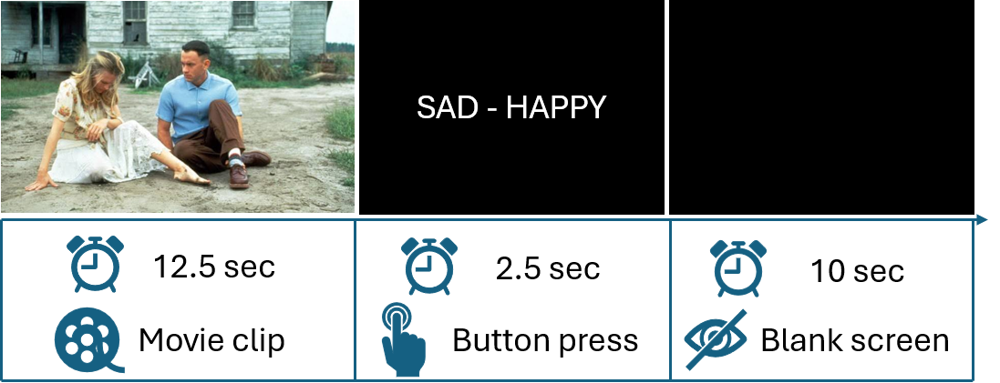
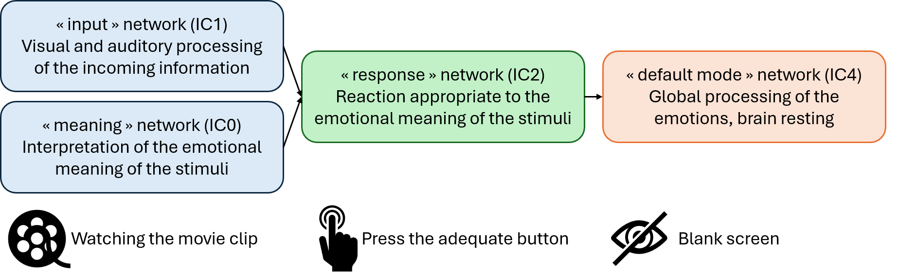

Let's talk about: how neuroimaging can help investigate how the brain encodes emotions

## Research question and objectives 

It is already known that processing emotions involves multiple interconnected regions of the brain :brain:, working together as different networks. More specifically, *Riedel et al. 2018* identified five distinct networks engaged in this emotional processing:  

- The first two networks are mainly involved in <u>seeing and hearing</u> the information. They are located in the occipital and superior temporal cortices, respectively;  
- The third network, called the <u>salience network</u>, helps us notice and pay attention to information that is particularly important or emotionally meaningful. It involves the activation of the insula and dorsal anterior cingulate cortex;  
- The fourth network includes areas of what is called the <u>default mode network</u>, such as the medial prefrontal and posterior cingulate cortices. It helps us interprete the meaning of an emotional situation and anticipate what might happen next;  
- The fifth network involves contributions from the amygdala, parahippocampal gyri and fusiform gyri, and contributes to <u>producing emotional responses that are appropriate to the situation</u>.   

However, what is still unclear is whether the nature of the emotional information received by the brain influences the spatial distribution and/or temporal dynamics of these networks (that is **where** and **when** these networks become active)? 

These questions were addressed in the present experimental study which involved the observation of brain activity while participants watched emotionally relevant movie clips. 

## A brief presentation of the methodology 

22 healthy adults participated in this experimental study. They were requested to watch specific 12.5-seconds-long clips from the movie ***Forrest Gump*** :tv: (quite an emotional movie indeed!) while undergoing  functional MRI (**fMRI**). This technique is specifically designed to measure brain activity by tracking changes in blood flow in different of the brain :brain:.  

The advantage of using <u>short clips</u> instead of lengthy segments lasting several minutes is that the longer the sequence, the more numerous the cognitive and emotional events that can occur, making it more difficult to determine exactly when and how the brain's emotional responses change over time. By using short, carefully selected clips, the researchers could study these changes in greater detail.
Moreover, the study investigated emotional processing <u>from the onset of the emotional stimulus to after its conclusion</u>, in order to better understand how the brain continue to process and regulate the emotion once the emotional stimulus has disappeared. 

Participants watched a total of 15 clips, each selected to evoke a specific emotion: **happiness** :smile:, **fear** :fearful: or **sadness** :sob:. After each clip, they had 2.5 seconds to select one of two emotion-related words presented on the screen, using hand-held controllers. Finally, a 10-seconds blank screen was presented before the next clip. 

I will spare you the details regarding the fMRI acquisition parameters, preprocessing, signal extraction and data analysis, but please feel free to read the full text if you are interested! *(see the complete reference here below)*

## Results: the spatiotemporal signatures of the emotional brain 

Interestingly, the researchers identified four networks (well, in reality six but the other 2 were interpreted as noise), each with a specific spatial distribution and temporal profile, so they could be associated with different stages of emotional processing:  
- The first two networks (called **IC0** and **IC1**) were activated as soon as the movie clip started and remained active throughout the 12.5-second sequence. 
   - These networks involved activity in the visual and temporal areas of the brain (i.e. the lateral occipital and pericalcarine gyri), with IC1 also involving the superior temporal gyrus, amygdala, and medial posterior cingulate regions. 
   - More specifically, the brain activity identified within **IC1** aligned with aspects of Networks 1, 2 and 5 described by *Riedel et al. 2018* which are associated with <u>the visual and auditory perception of emotional stimuli</u>, and with the <u>evaluation of the nature of these stimuli</u>. 
   - Regarding the **IC0** network, increased co-activity was observed in lateral frontal and middle temporal areas, which are typically associated with <u>semantic processing</u> (*Huth et al. 2016*, *Visser et al. 2012*). It also involved regions associated with <u>salience network</u>, such as the insula and the anterior cingulate cortex (*Seeley, 2019*). Moreover, these brain activities showed time-to-peak values that lagged ~2 seconds behind those of IC1, leading the authors to conclude that this network was involved in the <u>processing of the meaning associated with the incoming information</u>.  
&rarr; :brain: **The first two networks help the brain perceives the emotional information, and then making sense of what it means** 
- the third network (**IC2**) was associated with the next step of the experiment, that is making a decision about the emotional stimulus: <u>processing the emotional words displayed on the screen</u> (with activities located in the cortical and subcortical regions); <u>selecting the most relevant emotion-related word</u> (with stronger signals detected in the caudate nucleus region); and finally, the <u>motor response of pressing the corresponding controller button</u> (with activity in primary motor regions such as the precentral gyrus, as well as in regions involved in task-related attention such as the insula and the anterior cingulate cortex) (*Grahn et al. 2008*, *Seeley 2019*).  
&rarr; :brain: **The third network was associated with the task of deciding which emotion best matched the stimuli the brain had just perceived**
- the fourth pattern of brain activities identified (**IC4**) was consistent with the <u>default mode network</u>, which is particularly active when a person is at rest or engaged in mind-wandering. This network was active throughout the behavioral experiment, but showed a peak during the intertial rest period (*Riedel et al. 2018*, *Buckner et al. 2008*, *Gross, 2015*).  
&rarr; :brain: **The fourth network illustrates the moment the brain is not focused on a specific external task**

In other words, what the study showed is that the brain activity seemed to follow a sequence: 
**perceiving the emotion → understanding its meaning → making a decision → resting**

It should also be noted that there was greater agreement among participants when the emotional stimulus was sadness, as well as faster decision-making. 
Could this mean that sadness is processed particularly quickly? Maybe—but we should be cautious about this interpretation.
Indeed, we could hypothesize that this result was partly related to the strong sad component of the movie selected for the experimental study, *Forrest Gump* :sneezing_face:. 
Moreover, as pointed out by the authors themselves, previous studies have also reported fast processing of fearful stimuli (*Méndez-Bértolo et al. 2016*, *Bo et al. 2022*, *Grootswagers et al. 2020*).
Thus, further research would be needed to determine whether this finding is specific to sadness or related to the particular experimental stimuli.

### :jigsaw: **Putting everything together**
Finally, thanks to fMRI recordings performed while participants viewed short movie clips from *Forrest Gump*, the authors were able to identify and track the time course of four independent brain networks, associated with different stages of emotional processing: from the perception of the emotional stimulus, to the interpretation of its meaning, followed by the translation of this processing into a decision through the relevant emotional word, and finally to the period of rest following the response. 

These new insights into emotional processing, and especially its temporal component, are not only interesting from a basic neuroscience perspective, but could also help the future clinical research on emotional disorders: many of them are associated with difficulties in regulating emotions over time, that is disturbances in the temporal regulation of emotion (*Kuppens & Verduyn 2017*, *Waugh et al. 2015*). 

---
---
---

> **Read the article**: Niels Janssen, Uriel KA Elvira, Joost Janssen, Theo GM van Erp (2026) **Dynamic fMRI networks of human emotion** *eLife* 14:RP106070 (https://doi.org/10.7554/eLife.106070.3).  

> **Cited references**:  
> - Buckner RL, Andrews- Hanna JR, Schacter DL. 2008. The brain’s default network: anatomy, function, and relevance to disease. *Annals of the New York Academy of Sciences* 1124:1–38 (https://doi.org/10.1196/annals.1440.011)
> - Grahn JA, Parkinson JA, Owen AM. 2008. The cognitive functions of the caudate nucleus. *Progress in Neurobiology* 86:141–155 (https://doi.org/10.1016/j.pneurobio.2008.09.004)
> - Gross JJ. 2015. The extended process model of emotion regulation: elaborations, applications, and future directions. *Psychological Inquiry* 26:130–137 (https://doi.org/10.1080/1047840X.2015.989751)
> - Huth AG, de Heer WA, Griffiths TL, Theunissen FE, Gallant JL. 2016. Natural speech reveals the semantic maps that tile human cerebral cortex. *Nature* 532:453–458 (https://doi.org/10.1038/nature17637)
> - Kuppens P, Verduyn P. 2017. Emotion dynamics. *Current Opinion in Psychology* 17:22–26 (https://doi.org/10.1016/j.copsyc.2017.06.004)
> - Riedel MC, Yanes JA, Ray KL, Eickhoff SB, Fox PT, Sutherland MT, Laird AR. 2018. Dissociable meta-analytic brain networks contribute to coordinated emotional processing. *Human Brain Mapping* 39:2514–2531 (https://doi.org/10.1002/hbm.24018)
> - Seeley WW. 2019. The salience network: a neural system for perceiving and responding to homeostatic demands. *The Journal of Neuroscience* 39:9878–9882 (https://doi.org/10.1523/JNEUROSCI.1138-17.2019)
> - Visser M, Jefferies E, Embleton KV, Lambon Ralph MA. 2012. Both the middle temporal gyrus and the ventral anterior temporal area are crucial for multimodal semantic processing: distortion-corrected fMRI evidence for a double gradient of information convergence in the temporal lobes. *Journal of Cognitive Neuroscience* 24:1766–1778 (https://doi.org/10.1162/jocn_a_00244)
> - Waugh CE, Shing EZ, Avery BM. 2015. Temporal dynamics of emotional processing in the brain. *Emotion Review* 7:323–329 (https://doi.org/10.1177/1754073915590615)